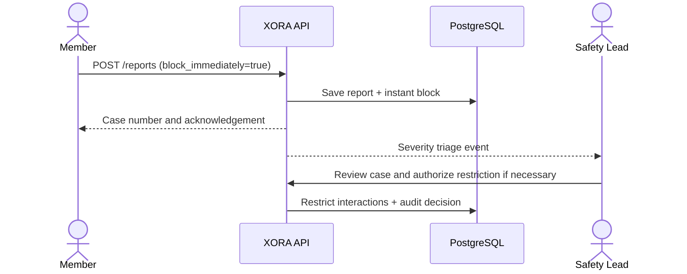

# XORA — Web API Specification

**Document:** `API_SPECIFICATION.md`  
**Version:** 1.0 (proposed REST contract)  
**Status:** Engineering handoff draft; not deployed and not a representation of existing live endpoints  
**Companion documents:** [`PRD.md`](PRD.md) v1.2; [`ARCHITECTURE.md`](ARCHITECTURE.md) v1.0; [`DATABASE_SCHEMA.md`](DATABASE_SCHEMA.md) v1.0  
**Base URL:** `https://<approved-xora-domain>/api/v1` (placeholder, not an active URL)  
**Client:** Responsive web app/PWA; shared Date/Casual account and one admin workspace  
**Date/time:** ISO 8601 UTC on the wire; display Africa/Kampala (EAT) in the browser

> **Product boundary:** This API is for an adults-only, consensual dating and casual-connection service. It does **not** expose escort booking, sexual-services pricing, in-app transfers, escrow, client wallets, meeting deposits, user-to-user payments, automatic charges, or lifetime membership. Before enabling production money movement or storing sensitive identity evidence, obtain actual Ugandan legal/privacy and Mobile Money account/provider approval.

---

## 1. API design goals

- Support every important member and staff journey in the approved PRD without separate Dating and Casual accounts.
- Keep private member data and admin/payment operations behind verified, role-scoped server routes.
- Provide an affordable **manual payments** workflow: create order → show frozen verified business recipient → collect transaction reference and optional private evidence → independently confirm received funds → approved entitlement/promotion.
- Preserve the first **accepted** outgoing free introduction; keep incoming invitations and existing chats free.
- Make repeat submissions safe with idempotency and version checks. A double click must not become two orders, two approvals or two conversations.
- Support slow Ugandan mobile connections: compact responses, cursor pagination, upload retries, honest progress states, and accessible errors.
- Separate the browser's view of status from privileged operational evidence. No user-provided amount, `paid=true` flag or screenshot grants access.

**Architecture:** REST-style JSON endpoints handled by the modular Next.js/TypeScript server, backed by PostgreSQL, private object storage, transactional outbox and scheduled jobs. This is a **contract proposal**, not a requirement to choose a different stack.

## 2. Protocol and security conventions

### 2.1 Authentication and sessions

- Member web sessions use **secure, HttpOnly, SameSite** cookies over HTTPS. Never store long-lived bearer tokens in browser `localStorage`.
- Email + password + verification link is the MVP signup method. The approved auth provider may own the low-level password endpoints; the paths below define expected app behavior and may be implemented as server wrappers.
- Staff sign-in uses separate staff authorization and **mandatory MFA**; member sessions alone never grant access to `/admin`.
- All mutating cookie-authenticated requests require same-origin checks and CSRF defenses appropriate to the chosen framework. Apply security headers, rate limiting and session invalidation on account restriction/logout.
- Sensitive URLs and upload keys are signed, scoped, short-lived; never expose receipt/ID storage keys as public URLs.
- `X-Request-ID` is accepted or generated and returned for support tracing; do not echo confidential payloads in logs.

### 2.2 Request and response shape

Successful single-resource response:

```json
{
  "data": { "id": "uuid", "status": "pending" },
  "meta": { "request_id": "req_sample_01" }
}
```

Successful list response (cursor-based):

```json
{
  "data": [ { "id": "uuid" } ],
  "meta": { "next_cursor": "opaque-cursor-or-null", "request_id": "req_sample_02" }
}
```

Error response follows RFC-style Problem Details plus stable XORA code:

```json
{
  "type": "https://docs.xora.example/problems/connect-pass-required",
  "title": "An active Connect Pass is required",
  "status": 403,
  "code": "CONNECT_PASS_REQUIRED",
  "detail": "Your first accepted introduction has already been used. Choose a Connect Pass to send more invitations.",
  "request_id": "req_sample_03"
}
```

The `.example` host above is deliberately non-production documentation. Never expose fraud-scoring rules, other members' private details, identity evidence or stack traces in `detail`.

### 2.3 Common header and field rules

| Item | Contract |
|---|---|
| `Content-Type` | `application/json` except binary object-storage upload |
| `Idempotency-Key` | Required for paid order creation, invitation creation, message send, receipt submission and staff approval/refund confirmation |
| `If-Match` / version | Required for sensitive admin mutations; protects against stale staff screens |
| Timestamps | ISO-8601 UTC (`2026-12-01T11:00:00Z`), EAT display derived in frontend |
| Money | Integer `amount_ugx`, always with `currency: "UGX"`; server-generated price only |
| IDs | UUID strings internal; public `order_reference` is separate |
| Pagination | `limit` (default 20, max 50), `cursor` opaque; stable sort |
| Validation | Reject unsupported fields, overlong text, impossible dates, large uploads; no silent truncation |
| Resource access | Member may read only owned data or approved discoverable profiles; admin uses explicit permissions |
| All search queries | Enforce current eligibility, mutual preferences, blocks and restrictions on every request |
| Mutating response | Includes new status/version and meaningful next action where appropriate |

### 2.4 Status codes

| HTTP | Meaning | Examples |
|---|---|---|
| `200` | Success or idempotent replay | Approved order fetched again |
| `201` | New resource created | Invitation, order, support ticket |
| `202` | Accepted for asynchronous processing | Profile review, privacy export |
| `204` | Completed, no response body | Unsave/unlike action |
| `400` | Malformed request | Invalid request JSON |
| `401` | Not signed in or session expired | Member-only route |
| `403` | Not permitted by eligibility, consent, permission, pass or block | `CONNECT_PASS_REQUIRED` |
| `404` | Not found **or** resource inaccessible | Another member's private payment order |
| `409` | Conflict with business state or version | Already pending free invite, transfer allocated |
| `410` | Resource gone | Expired one-time upload link |
| `413` | File too large | Photo/receipt exceeds limit |
| `422` | Valid JSON but invalid field/business combination | Missing payment reference |
| `429` | Rate limited | Too many invite/verification attempts |
| `500/503` | Server or dependent service unavailable | Do not fake approval during outage |

`403` is used for subscription gating rather than requiring the uncommon `402` behavior. UI can show a purchase link based on the stable code; it must not misrepresent the request as already sent.

## 3. Identity, consent and adult eligibility

### 3.1 Endpoints

| Method | Path | Access | Purpose |
|---|---|---|---|
| `POST` | `/auth/register` | Visitor | Register email/password and record terms/privacy version, separate optional marketing choice |
| `POST` | `/auth/verify-email` | Token holder | Confirm possession of email with one-time token |
| `POST` | `/auth/resend-verification` | Limited visitor/member | Resend with rate limits and neutral response |
| `POST` | `/auth/login` | Visitor | Create member session; enforce account restrictions |
| `POST` | `/auth/logout` | Member | Revoke session and clear cookie |
| `POST` | `/auth/request-password-reset` | Visitor | Neutral response to prevent email enumeration |
| `POST` | `/auth/complete-password-reset` | Valid token | Set new credential, revoke stale sessions as required |
| `GET` | `/me` | Member | Return safe account status, profile completion, eligibility summary, membership status |
| `PATCH` | `/me` | Member | Update permitted account fields, not verified email/status directly |
| `GET` | `/me/security/sessions` | Member | Display active device/session summaries |
| `DELETE` | `/me/security/sessions/{id}` | Member | Revoke own session |
| `GET` | `/me/consents` | Member | Versions/marketing preferences given |
| `POST` | `/me/consents` | Member | Record consent/withdrawal event |
| `GET` | `/me/verification` | Member | Read **outcome and next action only**, never raw document |
| `POST` | `/me/verification/submit` | Member | Submit eligibility method/evidence token for authorized review |

**Registration fields:** email, password, confirmed legal age acknowledgement, accepted terms/privacy versions and optional marketing opt-in. Profile wizard later requests screen name, private adult-age evidence under approved process, approximate area, intention, minimum necessary gender/discovery preferences, biography, interests and at least one approved photo (unless approved accessibility exception). No phone number or ID-file collection is silently mandatory at registration.

**Eligibility response example:**

```json
{
  "data": {
    "email_verified": true,
    "adult_eligibility": "approved",
    "profile_review": "pending",
    "can_discover": false,
    "can_send_invitations": false,
    "next_action": "WAIT_FOR_PROFILE_REVIEW"
  }
}
```

`can_discover` is a computed permission, not a client-updateable column. Never return exact birthdate or ID evidence in this response.

## 4. Profile onboarding, moderation and discovery

### 4.1 Member profile endpoints

| Method | Path | Access | Purpose |
|---|---|---|---|
| `GET` | `/me/profile` | Member | Retrieve own complete editable profile, with safe sensitive fields omitted/masked |
| `PUT` | `/me/profile` | Member | Save draft/create profile; includes `display_name`, `city_code`, `area_code`, `intent`, `bio` |
| `PATCH` | `/me/profile` | Member | Edit approved fields; material edits may return to review |
| `GET` | `/me/discovery-preferences` | Member | Read private matching filters |
| `PUT` | `/me/discovery-preferences` | Member | Save desired intents, genders, age range, regions |
| `POST` | `/me/profile/submit` | Member | Request eligibility/content review; status `review_pending` |
| `POST` | `/me/profile/pause` | Member | Hide from discovery immediately |
| `POST` | `/me/profile/resume` | Member | Restore only if still eligible/approved |
| `GET` | `/me/profile/media` | Member | Photo order and moderation state |
| `POST` | `/me/profile/media` | Member | Attach previously uploaded private media intent |
| `PATCH` | `/me/profile/media/{id}` | Owner | Reorder or update approved caption where permitted |
| `DELETE` | `/me/profile/media/{id}` | Owner | Remove photo; if minimum photo lost, unpublish until corrected |
| `GET` | `/me/saved-profiles` | Member | List private saved profiles subject to current visibility |
| `PUT` | `/me/saved-profiles/{accountId}` | Member | Save eligible profile |
| `DELETE` | `/me/saved-profiles/{accountId}` | Member | Unsave |

Profile `intent` accepts only `date`, `casual` or `both`. Changing mode does **not** create a new account/free credit nor reset existing paid periods. An edited profile must never become visible before any required re-review completes.

### 4.2 Private media upload endpoints

| Method | Path | Access | Purpose |
|---|---|---|---|
| `POST` | `/media/upload-intents` | Member with purpose authorization | Request one-time upload parameters for `profile_photo`, `payment_proof` or `verification_evidence` |
| `POST` | `/media/upload-intents/{id}/complete` | Owner | Server validates uploaded object's metadata and records private storage pointer |
| `GET` | `/me/profile/media/{id}/view` | Owner | Short-lived view of own private/pending image |
| `GET` | `/profiles/{accountId}/media/{id}` | Eligible member | Authorized read for **approved** profile media only |

Upload intent includes `purpose`, `declared_mime_type`, and `declared_size_bytes`; server sets exact max size, allowed formats and destination. A payment-proof upload is **optional** and cannot approve a payment. Identity evidence is accessible only in restricted verification review; do not return its signed URL to generic support/finance UI.

### 4.3 Discovery endpoints

| Method | Path | Access | Purpose |
|---|---|---|---|
| `GET` | `/discovery?mode=date|casual|both&city=...&area=...&cursor=...` | Eligible adult member | Find mutually eligible, approved, unblocked profiles |
| `GET` | `/profiles/{accountId}` | Eligible adult member | Approved safe profile detail, not private account fields |
| `PUT` | `/profiles/{accountId}/like` | Eligible adult member | Private non-monetized expression of interest |
| `DELETE` | `/profiles/{accountId}/like` | Eligible adult member | Remove like |
| `GET` | `/discovery/filters` | Member | Allowed cities, areas, interest choices and consent-safe filters |

**Discovery results** must be filtered for both sides' preferences *before* adding separately labeled VIP/Spotlight slots. A paid profile that is paused, blocked, unsafe or incompatible is never displayed merely because the campaign is paid. Search results are not indexed publicly by search engines.

```json
{
  "data": [
    {
      "account_id": "sample-user-uuid",
      "display_name": "Example Member",
      "city": "Kampala",
      "area_label": "Approximate area",
      "intent": "both",
      "is_adult_verified": true,
      "photo_url": "short-lived-authorized-url",
      "placement": "organic"
    }
  ],
  "meta": { "next_cursor": null }
}
```

The example's `photo_url` is illustrative only. Production URL lifetime and access control must be designed so it cannot leak reusable private media URLs.

## 5. Invitations, first free acceptance and conversations

### 5.1 Endpoints

| Method | Path | Access | Purpose |
|---|---|---|---|
| `GET` | `/me/connection-access` | Member | Show unused/used free allowance and Connect status; no raw finance data |
| `POST` | `/invitations` | Eligible adult member | Send a new outgoing request, gated by free allowance or active Connect |
| `GET` | `/invitations?direction=incoming|outgoing&status=pending` | Member | List own invitations, paginated |
| `GET` | `/invitations/{id}` | Participant | Status of one own invitation |
| `POST` | `/invitations/{id}/accept` | Recipient only | Atomically accept, consume sender free credit if applicable, open chat |
| `POST` | `/invitations/{id}/decline` | Recipient only | Decline; sender free credit remains unused |
| `POST` | `/invitations/{id}/withdraw` | Sender only | Withdraw; free credit remains unused |
| `GET` | `/conversations` | Member | Active and historical own threads, paginated |
| `GET` | `/conversations/{id}` | Participant | Conversation details, safe participant summaries |
| `GET` | `/conversations/{id}/messages?cursor=...` | Participant | Cursor-paginated messages |
| `POST` | `/conversations/{id}/messages` | Unblocked active participant | Text-only message, idempotent and rate-limited |
| `POST` | `/conversations/{id}/unmatch` | Participant | Close mutual interaction, prevent new messages |
| `POST` | `/blocks` | Member | Block target immediately |
| `DELETE` | `/blocks/{accountId}` | Blocker only | Unblock, subject to safety restrictions |
| `GET` | `/me/blocks` | Member | List own blocked accounts |

**Request:** first invitation

```http
POST /api/v1/invitations
Idempotency-Key: demo-send-first-001
Content-Type: application/json

{"recipient_account_id":"00000000-0000-4000-8000-000000000123"}
```

**Response:** free outgoing slot reserved, **not consumed**.

```json
{
  "data": {
    "id": "00000000-0000-4000-8000-000000000456",
    "status": "pending",
    "funding_basis": "free_pending",
    "sent_at": "2026-12-01T09:00:00Z",
    "expires_at": "2026-12-08T09:00:00Z",
    "free_allowance_consumed": false
  }
}
```

**Accept response:**

```json
{
  "data": {
    "invitation_id": "00000000-0000-4000-8000-000000000456",
    "status": "accepted",
    "conversation_id": "00000000-0000-4000-8000-000000000789",
    "sender_free_allowance_now_used": true
  }
}
```

**Critical server contract:** when free pending, lock invitation and sender's `free_intro_allowances` row, check still pending/unexpired and eligible, mark used, create one conversation, and commit all changes together. Recipient's free allowance is never consumed by accepting. If declined, withdrawn or expired, the sender can send another first free invitation subject to limits. A paid invite sent while a pass was active remains valid after the pass expires; chat is free thereafter.

**Free slot policy:** proposed one pending outgoing free invitation at a time and 7-day expiry. This does not grant repeated accepted free introductions. After one acceptance, any additional outgoing request requires valid Connect access.

### 5.2 Message request/response

```json
{
  "body": "Hello! I enjoyed your profile.",
  "client_message_key": "local-message-unique-001"
}
```

Returns `201` and stored message ID/time. Reject media/file uploads in chat MVP. Read permissions must be checked on every fetch; membership expiration must not lock a conversation. Block/unmatch/restriction must be respected at send time, including race conditions.

### 5.3 Common invitation errors

| Code | HTTP | Client behavior |
|---|---:|---|
| `EMAIL_VERIFICATION_REQUIRED` | 403 | Verify account email |
| `ADULT_ELIGIBILITY_REQUIRED` | 403 | Complete approved eligibility review |
| `PROFILE_NOT_APPROVED` | 403 | Show review status and next step |
| `FREE_INVITATION_ALREADY_PENDING` | 409 | Go to existing pending request; don't charge |
| `CONNECT_PASS_REQUIRED` | 403 | Show Connect plans, no invitation created |
| `INVITATION_ALREADY_FINAL` | 409 | Show final state, no credit change |
| `INVITATION_EXPIRED` | 409 | Show expired; free credit remains unused if not accepted |
| `RELATIONSHIP_NOT_ALLOWED` | 403 | Generic privacy-safe message (block/compatibility) |
| `INVITATION_RATE_LIMIT` | 429 | Explain temporary pause and respectful use |
| `CONVERSATION_UNAVAILABLE` | 403 | Don't permit message after block/unmatch/restriction |

Avoid revealing the specific reason a profile disappeared where that would expose another member's privacy or safety action.

## 6. Membership catalog and exact paid-right checks

### 6.1 Product catalog endpoints

| Method | Path | Access | Purpose |
|---|---|---|---|
| `GET` | `/catalog` | Public | Show approved current sellable plans/prices/benefits; **no live payee details** |
| `GET` | `/catalog/{sku}` | Public | Plan details and purchase disclosures |
| `GET` | `/me/connect-entitlements` | Member | Own active, queued, expired and corrected periods |
| `GET` | `/me/promotion-campaigns` | Member | Own promotions and status/metrics |
| `GET` | `/me/membership-summary` | Member | Free allowance, current Connect and next renewal dates |

**Catalog proposal:**

| SKU | Price UGX | Days | Function |
|---|---:|---:|---|
| `CONNECT_W7` | 10,000 | 7 | Initiate additional eligible outgoing introductions |
| `CONNECT_M30` | 25,000 | 30 | Same Connect permission |
| `CONNECT_Q90` | 60,000 | 90 | Same Connect permission |
| `VIP_W7` | 20,000 | 7 | Labeled promotion rotation |
| `SPOTLIGHT_M30` | 50,000 | 30 | Featured placement |
| `VIP_M30` | 80,000 | 30 | Enhanced labeled placement and aggregate insights |

No lifetime SKU, no recurring charge, no auto-renew. Each product is a versioned row; checkout snapshots the **current approved version** so later price edits cannot alter existing orders. Price/currency are returned by server; the client submits only `sku`, not chosen amount.

**Access test:** `now >= starts_at AND now < ends_at AND revoked_at IS NULL AND account eligible`. Queued entitlement begins automatically at its approved future timestamp, independent of whether a scheduled email has run.

**Renewal:** purchase/approve a fresh order; compute the next Connect start as the later of actual approval and latest active/queued unrevoked term end. Different Connect tiers queue by default. Promotions are independent and never unlock introductions.

## 7. Manual checkout, evidence and member status

### 7.1 Member endpoints

| Method | Path | Access | Purpose |
|---|---|---|---|
| `POST` | `/orders` | Verified eligible member | Create order from approved catalog SKU; snapshot price/payee; return exact instructions |
| `GET` | `/orders` | Member | Own orders, statuses and purchase history |
| `GET` | `/orders/{id}` | Order owner | Own order status, next action, frozen instructions and receipt summary |
| `POST` | `/orders/{id}/payment-submissions` | Order owner | Submit provider transaction reference and optional proof token; **never activate** |
| `POST` | `/orders/{id}/request-correction` | Owner | Provide safe correction or clarification on existing order |
| `POST` | `/orders/{id}/cancel` | Owner | Close unpaid order; actual late funds still reconciled |
| `GET` | `/orders/{id}/receipt` | Owner, only after approval | Receipt with order ID, SKU, dates, amount and settlement reference |
| `POST` | `/orders/{id}/support-ticket` | Owner | Raise a payment problem linked to order |

For MVP, checkout should require completed adult eligibility and approved account/profile; VIP also requires an approved unpaused profile. If the system cannot lawfully accept payments, do not show a live purchase action or real receiving number. Public catalog pages may remain visible as proposals.

### 7.2 Create order example

```http
POST /api/v1/orders
Idempotency-Key: order-connect-month-001
Content-Type: application/json

{"sku":"CONNECT_M30"}
```

**Server response (`201`):** values are illustrative placeholders; *never copy a demo number into a live site*.

```json
{
  "data": {
    "id": "00000000-0000-4000-8000-000000001111",
    "order_reference": "XOR-DEMO-K82FQ",
    "status": "awaiting_transfer",
    "product": { "sku": "CONNECT_M30", "name": "Connect Month", "duration_days": 30 },
    "amount_ugx": 25000,
    "currency": "UGX",
    "instructions_expires_at": "2026-12-02T09:00:00Z",
    "payment_instruction_snapshot": {
      "method": "mtn_momo",
      "recipient_name": "DEMO BUSINESS RECIPIENT — NOT A REAL PAYEE",
      "recipient_display": "PAYEE_UNCONFIGURED_IN_DEMO",
      "instructions": "Use only the verified payee shown in the live web app. Confirm the recipient name before transferring."
    },
    "activation_policy": "Starts when verified payment is approved; early Connect renewals start after existing paid time.",
    "review_hours_display": "To be configured before launch"
  }
}
```

Payment instructions shown in production derive from an authorized `payment_channel_versions` snapshot. If multiple verified channels exist, member selects method in `POST /orders` via `payment_method`, with price unaffected. The response must show the exact destination *before payment*, so orders are created with a specific payee version.

### 7.3 Submit transaction details example

```http
POST /api/v1/orders/00000000-0000-4000-8000-000000001111/payment-submissions
Idempotency-Key: payment-proof-first-001
Content-Type: application/json

{
  "provider_transaction_reference": "DEMO-REFERENCE-123",
  "claimed_paid_at": "2026-12-01T09:14:00Z",
  "claimed_amount_ugx": 25000,
  "payer_phone": "07XX-XXX-XXX",
  "payment_proof_upload_id": null
}
```

**Response (`202`):**

```json
{
  "data": {
    "order_id": "00000000-0000-4000-8000-000000001111",
    "status": "submitted",
    "display_status": "Submitted for verification",
    "paid_access_active": false,
    "next_action": "WAIT_FOR_FINANCE_REVIEW",
    "review_hours_display": "Configured staffed hours shown to member",
    "support_available": true
  }
}
```

Phone number is collected only to assist reconciliation and handled as sensitive finance data; it must never become a public profile contact field. Proof is optional if finance can verify the transfer independently. Support can request a safe correction without demanding another transfer.

### 7.4 User-facing status mapping

| Internal `orders.status` | Public label | Main available action |
|---|---|---|
| `awaiting_transfer` | Awaiting your payment | View instructions / cancel |
| `submitted` | Submitted for verification | Track / contact support |
| `in_review` | Being checked | Track / support |
| `needs_details` | Action needed | Correct details on same order |
| `unmatched` | Payment not confirmed — support reviewing | Open or follow ticket |
| `approved` | Approved — pass active or queued; promotion active or scheduled | View dated entitlement/receipt |
| `rejected` | Could not verify payment | Read safe reason / appeal |
| `cancelled`, `expired_unpaid` | Order closed | New order; late funds investigated separately |
| `refund_pending` | Refund being processed | Track case |
| `refunded` | Refund completed | Show actual transfer reference/date |

Order approval isn't “instant” and there is no automatic payment detection in MVP. If staff cannot verify official receiving-account funds, the order **remains pending/unmatched**, never automatically approved on timer expiry.

## 8. Admin identity, roles and controls

### 8.1 Staff access endpoints

| Method | Path | Permission | Purpose |
|---|---|---|---|
| `POST` | `/admin/auth/login` | Authorized staff | Establish distinct staff session, MFA challenge |
| `POST` | `/admin/auth/mfa/verify` | Staff pending MFA | Complete MFA step |
| `POST` | `/admin/auth/logout` | Staff | End staff session |
| `GET` | `/admin/me` | Staff | Identity and explicitly granted capabilities |
| `GET` | `/admin/overview` | Scoped staff | Action queues, oldest pending age, urgent cases |
| `GET` | `/admin/staff` | Owner/admin permission | List staff safely |
| `POST` | `/admin/staff/{id}/role-grants` | Owner/admin permission | Grant narrowly scoped role; audit |
| `DELETE` | `/admin/staff/{id}/role-grants/{grantId}` | Owner/admin permission | Revoke role; audit |
| `GET` | `/admin/audit-events` | Explicit auditor/authorized role | Filtered immutable trail; redacted sensitive fields |
| `GET` | `/admin/config` | Scoped staff | Read operational config keys permitted to role |
| `POST` | `/admin/config/change-requests` | Authorized role | Propose controlled changes, not arbitrary SQL/config mutation |

**Sample staff roles:** owner, finance reviewer, finance supervisor, profile moderator, verification specialist, safety lead, support, content editor and auditor. A founder may temporarily wear multiple roles, but sensitive action logs/second-check exceptions still apply. **No staff bypass of an account's age-eligibility gate by manually ticking “paid.”**

## 9. Manual finance review, reconciliation, approval and refunds

### 9.1 Finance endpoints

| Method | Path | Permission | Purpose |
|---|---|---|---|
| `GET` | `/admin/finance/orders?status=submitted&cursor=...` | Finance reviewer+ | Scoped review queue; age and filters |
| `GET` | `/admin/finance/orders/{id}` | Finance reviewer+ | Order, commercial snapshot, submissions, safe exceptions |
| `GET` | `/admin/finance/orders/{id}/proof/{submissionId}` | Finance reviewer+ | Short-lived restricted receipt view with access audit |
| `POST` | `/admin/finance/orders/{id}/start-review` | Finance reviewer+ | Claim/lock case assignment |
| `POST` | `/admin/finance/orders/{id}/request-details` | Finance reviewer+ | Safe correction request |
| `POST` | `/admin/finance/orders/{id}/reject` | Finance reviewer+ | Reasoned rejection after documented review |
| `GET` | `/admin/finance/verified-transfers` | Finance reviewer+ | Officially observed incoming transfers, matched/unmatched |
| `POST` | `/admin/finance/verified-transfers` | Finance reviewer+ | Record staff-verified transfer from official account history |
| `POST` | `/admin/finance/orders/{id}/approve` | Finance reviewer+ | Atomic allocation, grant and audit |
| `GET` | `/admin/finance/exceptions` | Finance reviewer+ | Reused refs, under/overpay, late, reversed, disputed |
| `POST` | `/admin/finance/exceptions` | Finance reviewer+ | Open investigation without granting access |
| `PATCH` | `/admin/finance/exceptions/{id}` | Assigned finance+ | Resolution/ownership updates with audit |
| `GET` | `/admin/finance/reconciliation-runs` | Finance reviewer+ | Daily finance reconciliation/handover |
| `POST` | `/admin/finance/reconciliation-runs` | Finance reviewer+ | Start run for official channel/date range |
| `POST` | `/admin/finance/reconciliation-runs/{id}/close` | Finance supervisor | Document matched/unmatched and next owner |
| `GET` | `/admin/finance/refund-cases` | Finance reviewer+ | Refund pipeline |
| `POST` | `/admin/finance/refund-cases` | Finance reviewer+ | Request refund case; do not mark refund sent |
| `POST` | `/admin/finance/refund-cases/{id}/approve` | Finance supervisor | Authorize outward transfer |
| `POST` | `/admin/finance/refund-cases/{id}/confirm-sent` | Authorized finance, preferably separate | Record actual outward transaction reference and amount |
| `POST` | `/admin/finance/corrections` | Finance supervisor | Audited compensation/correction, not history deletion |

**High-trust rule:** the finance reviewer verifies against an **official receiving-account transaction history/statement outside XORA** (or a provider-approved import) and records the result. There is no automated payment gateway or self-declared approval. Never request payment PIN or scrape personal SMS messages.

### 9.2 Independently record a settled transfer

```http
POST /api/v1/admin/finance/verified-transfers
Idempotency-Key: observed-transfer-demo-001
Content-Type: application/json

{
  "channel_version_id": "00000000-0000-4000-8000-000000009111",
  "provider_reference": "DEMO-REFERENCE-123",
  "amount_ugx": 25000,
  "settled_at": "2026-12-01T09:14:00Z",
  "verified_from": "authorized_account_history",
  "official_evidence_ref": "restricted-official-ledger-entry-id"
}
```

Returns the verified transfer ID. Storing the ID means staff recorded it from an official source; confirmation still requires matching recipient, amount, non-reversal and allocation conditions. Duplicate references return a conflict or the exact existing official record if idempotency matches. A member-supplied screenshot is **never** accepted as `official_evidence_ref`.

### 9.3 Approve order (critical atomic operation)

```http
POST /api/v1/admin/finance/orders/00000000-0000-4000-8000-000000001111/approve
Idempotency-Key: approve-demo-order-001
If-Match: "3"
Content-Type: application/json

{
  "verified_transfer_id": "00000000-0000-4000-8000-000000009222",
  "decision_reason": "SETTLED_FUNDS_CONFIRMED"
}
```

Illustrative successful response:

```json
{
  "data": {
    "order_id": "00000000-0000-4000-8000-000000001111",
    "order_reference": "XOR-DEMO-K82FQ",
    "status": "approved",
    "allocation_id": "00000000-0000-4000-8000-000000009333",
    "grant": {
      "kind": "connect_entitlement",
      "product_sku": "CONNECT_M30",
      "status": "active",
      "starts_at": "2026-12-01T11:00:00Z",
      "ends_at": "2026-12-31T11:00:00Z"
    },
    "member_notification_queued": true,
    "audit_event_recorded": true
  }
}
```

For early renewals, `grant.status` may be `queued` and `starts_at` is the end of existing paid time. VIP orders return `kind: "promotion_campaign"` instead. Approval must happen **inside one PostgreSQL transaction** that:

1. Locks order, verified transfer and entitlement planning scope; rejects stale `If-Match`.
2. Confirms transfer settled into the frozen, approved receiving account; amount/currency/ref reconcile; not reversed or previously allocated.
3. Confirms account/verification/profile eligibility and product sellability under current lawful policy.
4. Creates one `payment_allocations` record (`UNIQUE(order_id)` and `UNIQUE(verified_transfer_id)`).
5. Marks order approved, inserts one `connect_entitlements` **or** `promotion_campaigns` row linked uniquely to the order; handles queueing without overlap.
6. Inserts payment decision, audit event and minimal outbox notification event.
7. Commits everything or rolls everything back. Retry returns the prior approved result; cannot grant twice.

**No approved transfer match = no approve button action.** If actual received amount differs or multiple transfers appear, create an exception case, not a fictitious “green” settlement.

### 9.4 Manual refund and reversal

- Refund request may originate from member support or finance. Create a case with reason, linked approved order/allocation, requested sum and review status.
- Supervisor authorizes according to published policy; status remains **approved_for_refund/pending_disbursement** until actual Mobile Money transfer-out occurs.
- Finance confirms actual recipient and official outward transaction ID. Only then return `refunded` with confirmed timestamp and receipt.
- A reversed incoming payment after entitlement activation creates a **finance correction case**, not a hidden delete. Safety restrictions and fair member notice still apply.
- Underpayment/overpayment, duplicate transfer, late transfer to an expired order or wrong-recipient report must be escalated with explicit member messaging and auditable resolution.

### 9.5 Changing official receiving account

| Method | Path | Permission | Purpose |
|---|---|---|---|
| `GET` | `/admin/payment-channels` | Owner/finance scope | List current verified channel versions and effective times |
| `POST` | `/admin/payment-channels/change-requests` | Owner/proposer | Propose new authorized payee version with evidence |
| `POST` | `/admin/payment-channels/change-requests/{id}/approve` | Independent qualified approver when possible | Second review + effective date + audit |
| `POST` | `/admin/payment-channels/change-requests/{id}/reject` | Qualified approver | Reject with reason |

New instructions apply only to **new** orders at the effective time. Existing pending orders keep their stored original receiving details. Never disclose full recipient history to unrelated admin/support staff.

## 10. Admin review, safety, support and privacy APIs

### 10.1 Profile and eligibility queues

| Method | Path | Permission | Purpose |
|---|---|---|---|
| `GET` | `/admin/profile-reviews` | Profile moderator | Pending/rework queue with safe thumbnails |
| `GET` | `/admin/profile-reviews/{id}` | Profile moderator | Submitted version and moderation notes |
| `POST` | `/admin/profile-reviews/{id}/approve` | Profile moderator | Approve content only; adult eligibility remains separate |
| `POST` | `/admin/profile-reviews/{id}/request-changes` | Profile moderator | Send clear reason and resubmission path |
| `POST` | `/admin/profile-reviews/{id}/reject` | Profile moderator | Decision with appeal path |
| `GET` | `/admin/verification-cases` | Verification specialist | Restricted age/identity queue |
| `GET` | `/admin/verification-cases/{id}` | Verification specialist | Minimal permitted outcome/evidence; access audited |
| `POST` | `/admin/verification-cases/{id}/decide` | Verification specialist | Age/identity decision with reason and audit |
| `GET` | `/admin/members/{id}` | Scoped staff | Safe summary of profile, account, relevant flags and purchases |
| `POST` | `/admin/members/{id}/restrict` | Safety lead/authorized role | Restrict immediately with documented reason |
| `POST` | `/admin/members/{id}/restore` | Authorized safety role | Restore only after eligibility and case resolution |

No single staff “Approve Member” route may blindly bypass separate age evidence, profile review and safety checks.

### 10.2 Member and staff safety

| Method | Path | Access | Purpose |
|---|---|---|---|
| `POST` | `/reports` | Member | Report profile, user or particular message; optionally block immediately |
| `GET` | `/me/reports` | Reporter | Own report IDs and limited status |
| `POST` | `/appeals` | Affected member | Appeal eligible restriction/moderation decision |
| `GET` | `/me/appeals` | Affected member | Own appeals/status |
| `GET` | `/admin/safety-cases` | Safety lead | Triage queue, urgent cases first |
| `GET` | `/admin/safety-cases/{id}` | Authorized safety investigator | Case summary; evidence access separately authorized/logged |
| `POST` | `/admin/safety-cases/{id}/actions` | Authorized safety investigator | Warning, restrict, content removal, closure with reason |
| `GET` | `/admin/safety-cases/{id}/evidence/{evidenceId}` | Case-authorized investigator | Short-lived restricted evidence access with access audit |
| `POST` | `/admin/appeals/{id}/decide` | Authorized reviewer | Decision with record and notice |

**Immediate block must succeed independently of report review.** In suspected underage, exploitation or coercion cases, restrict discoverability and interactions promptly and follow documented escalation. No purchase overrides such restrictions.

Report example:

```json
{
  "reported_account_id": "00000000-0000-4000-8000-000000000222",
  "reason_code": "HARASSMENT",
  "message_id": null,
  "short_description": "Repeated unwanted messages",
  "block_immediately": true
}
```

### 10.3 Support and privacy

| Method | Path | Access | Purpose |
|---|---|---|---|
| `POST` | `/support/tickets` | Member | Open billing, safety, account or technical issue |
| `GET` | `/support/tickets` | Member | Own tickets |
| `GET` | `/support/tickets/{id}` | Owner | Own ticket history and safe status |
| `POST` | `/support/tickets/{id}/replies` | Owner | Add reply |
| `GET` | `/admin/support/tickets` | Support | Assigned queues, safe summaries |
| `POST` | `/admin/support/tickets/{id}/replies` | Support assigned | Reply without overexposing financial/ID evidence |
| `PATCH` | `/admin/support/tickets/{id}` | Authorized support | Assign/escalate/resolve |
| `POST` | `/me/privacy-requests` | Member, re-authenticated when needed | Request account closure, data access/correction/deletion |
| `GET` | `/me/privacy-requests` | Member | Own request statuses |
| `GET` | `/admin/privacy-requests` | Privacy-authorized staff | Govern lawful deletion/retention decisions |
| `POST` | `/admin/privacy-requests/{id}/decide` | Privacy-authorized staff | Document approval/exception and completion workflow |
| `GET` | `/notifications` | Member | Own in-app notifications |
| `POST` | `/notifications/{id}/read` | Owner | Mark read |
| `GET` | `/me/notification-preferences` | Member | Read own preferences |
| `PUT` | `/me/notification-preferences` | Member | Change discreet notifications and optional marketing settings |

A privacy closure request immediately hides profile from discovery and may freeze messages/new invites while review proceeds. Financial/audit records may be retained only as lawfully necessary under documented schedules and restricted access. Generic support agents cannot see unrestricted private chats or identity documents.

## 11. Content, operations and reporting endpoints

| Method | Path | Access | Purpose |
|---|---|---|---|
| `GET` | `/public/site-config` | Visitor | Public page copy, language, region and non-sensitive service status |
| `GET` | `/public/policies` | Visitor | Current versioned terms, privacy, safety and refund policies |
| `GET` | `/public/faq` | Visitor | Dating, consent, membership, manual payment FAQ |
| `GET` | `/admin/promotions` | Promotion manager | View scheduled/active/held campaigns |
| `POST` | `/admin/promotions/{id}/hold` | Safety/promotion authorized | Hold placement with reason; finance remedies remain separate |
| `POST` | `/admin/promotions/{id}/release` | Authorized after eligibility review | Restore only if account eligible |
| `GET` | `/admin/catalog` | Owner/pricing role | Read current product versions |
| `POST` | `/admin/catalog/change-requests` | Owner/pricing role | Propose future pricing/version; approval required |
| `GET` | `/admin/reports/membership` | Management authorized | Verified activations, paid renewals and expiries |
| `GET` | `/admin/reports/finance` | Finance/owner | Settled receipts, allocations, unmatched funds and actual refunds |
| `GET` | `/admin/reports/safety` | Safety/owner | Aggregate incidents, backlog and trends |
| `GET` | `/admin/reports/promotions` | Promotion/owner | Aggregate impressions and actions, not individual viewer logs |
| `GET` | `/admin/health/queues` | Operations authorized | Pending/outbox/scheduled task age and error counts |

**No income may be counted from screenshot submissions alone.** Financial dashboards distinguish confirmed incoming cash, orders approved, unmatched cash, paid refunds and disputed/reversed funds. Metric definitions are published internally and consistent across reports.

## 12. Privacy, rate limits and anti-abuse behavior

| Activity | Control |
|---|---|
| Register, login and reset | IP+account rate limits, bot checks where lawful, anti-enumeration responses |
| Discovery | Eligible adults only, capped pages, no bulk harvesting or export |
| Invitations | Max pending, daily outgoing limits, one pending free intro, consent compatibility |
| Chat | Participant authorization per fetch/send, text length cap, spam reporting, block/rate limits |
| Receipt uploads | Private signed write, file-type/size check, malware inspection where available, optional evidence |
| Official transfer record | Finance-only create, independent evidence, dedupe, immutable correction path |
| Approve/refund | RBAC, MFA, optimistic locking, idempotency and append-only audit |
| Age evidence | Justified access, vault, short-lived links, restricted retention |
| Member data export | Reauthentication, explicit scope, limited duration and controlled delivery |
| Staff audit/access logs | No passwords/PINs/raw ID/photos/receipts/complete message bodies in application logs |

**No hidden behavior:** There is no API for public exact location, phone-number scraping, exposing other members' billing status, creating fake engagement, bypassing mutual preferences by paying, or marking unverified payments approved.

## 13. Notification and background job contracts

The following are **internal outbox events**, not publicly callable client APIs:

| Event | When emitted | Action |
|---|---|---|
| `AccountEmailVerified` | Email confirmed | Continue onboarding |
| `ProfileReviewCompleted` | Moderator decided | Update member safely |
| `InvitationCreated` | Eligible invitation stored | Private recipient notification |
| `InvitationAccepted` | Conversation atomically opened | Inform participants, sender free allowance only if first free |
| `FirstFreeIntroductionUsed` | Free acceptance committed | Explain future Connect requirement discreetly |
| `PaymentDetailsSubmitted` | Receipt/ref added | Finance review queue, no entitlement |
| `OrderNeedsMoreDetails` | Reviewer requests correction | Show one safe next action |
| `OrderApproved` | Official transfer allocated and rights granted | Send receipt and exact EAT dates |
| `ConnectEntitlementScheduled` | Early renewal approved | Explain queued start date |
| `ConnectEntitlementExpiring` | 3/1 days before end, per settings | Opt-in reminder, no auto-charge |
| `PromotionStarted`, `PromotionExpired` | Date/eligibility event | Update placement and dashboard |
| `SafetyCaseOpened` | Report filed | Severity triage and acknowledgement |
| `AccountRestrictionApplied` | Authorized urgent action | Stop new interactions immediately |
| `PrivacyRequestOpened` | Verified member request | Hide from discovery and start governed workflow |

**Workers:** pending invitation expiry, reminder dispatch, outbox delivery/retry, scheduled promotion placement, reconciliation backlog warning, retention/deletion, and backup checking. They are **not** the source of truth for Connect validity: check timestamps on every send attempt.

## 14. End-to-end journey sequences

### 14.1 Registration → first connection

```mermaid
sequenceDiagram
  actor Visitor
  participant Site as XORA Web
  participant API as XORA API
  participant DB as PostgreSQL
  actor Other as Other Member
  Visitor->>Site: Join + verify email
  Site->>API: Register, verify, create profile draft
  API->>DB: Account + unused free allowance + profile
  Visitor->>Site: Complete adult review and profile approval
  API->>DB: Record separate approval outcomes
  Visitor->>Site: Search compatible profiles, send first invitation
  Site->>API: POST /invitations
  API->>DB: Reserve pending free slot (not consume)
  Other->>API: POST /invitations/id/accept
  API->>DB: Atomic free use + accepted invitation + chat
  API-->>Visitor: Open conversation; free allowance used once
```

### 14.2 Connect Week/Month/Quarter manual purchase

```mermaid
sequenceDiagram
  actor Member
  participant API as XORA API
  participant DB as PostgreSQL
  actor Staff as Finance Reviewer
  participant Ledger as Official MoMo/Airtel account history
  Member->>API: POST /orders (selected SKU)
  API->>DB: Freeze catalog price/payee and create order
  API-->>Member: Verified payee instructions + order reference
  Member->>Ledger: Transfer funds externally
  Member->>API: Submit transaction ref; optional private proof
  API->>DB: Save submitted status only
  Staff->>Ledger: Independently verify received settlement
  Staff->>API: Record verified transfer
  Staff->>API: Approve order with transfer ID and Idempotency-Key
  API->>DB: One atomic allocation + entitlement + audit + outbox
  API-->>Member: Approved; active or queued dated Connect Pass
```

### 14.3 Safety incident



## 15. API coverage versus the PRD

| PRD sections / journeys | API surface | Data source | Status |
|---|---|---|---|
| §9 visitor/join | `/public/*`, `/auth/*` | Public policies, accounts | Covered |
| §10 R1–R5 registration/onboarding | `/auth/*`, `/me/*`, `/me/profile/*` | Accounts, profiles, consents | Covered |
| §11–12 verification/photos | `/me/verification/*`, `/media/*`, admin reviews | Verification/evidence/media | Covered |
| §13 D1–D4 discover, mode switch | `/discovery`, `/profiles/*`, preferences | Profiles, preferences, blocks, campaigns | Covered |
| §14 C1–C4 free invitation/pass | `/invitations/*`, `/me/connection-access` | Invitation/free allowance/entitlement | Covered |
| §15 M1–M3 conversations | `/conversations/*`, `/blocks` | Conversations/messages/blocks | Covered |
| §16 P1–P2 VIP/Spotlight | `/catalog`, `/orders`, `/me/promotion-campaigns`, admin promotions | Product versions/campaigns | Covered |
| §17 PAY0–PAY4 manual payments | `/orders/*`, `/admin/finance/*` | Orders/transfers/allocations/refunds | Covered |
| §18 A1–A8 account/privacy | `/me`, settings, security, `/me/privacy-requests` | Preferences/privacy | Covered |
| §19 S1–S3 report/block/appeal | `/reports`, `/blocks`, `/appeals`, admin safety | Reports/safety cases | Covered |
| §20–21 ADM1–ADM14 | `/admin/overview`, finance, reviews, support, config, audit | All operational domains | Covered |
| §22 notifications | `/notifications`, preferences, internal outbox | Notifications/outbox | Covered |
| §23–25 web UX/accessibility | Web UI uses API; no native mobile service | API-agnostic web implementation | Covered by frontend design, not endpoints |
| §26–27 privacy/support | `/me/privacy-requests`, `/support/*`, staff workflows | Privacy/support records | Covered |
| §28 exceptional cases | Explicit conflicts/exceptions/refunds/queues | Finance exceptions, logs | Covered |
| §29–31 reporting/launch QA | `/admin/reports/*`, `/admin/health/queues` | Aggregates and reconciliation | Covered |
| §32 out-of-scope | **No wallet, booking, auto-billing, lifetime SKU or paid-sex endpoints** | Intentional absence | Covered |

## 16. Acceptance and contract tests

| Test | Action | Required result |
|---|---|---|
| API-01 | Register then never verify email | Cannot discover/invite |
| API-02 | User claims adult status only, fails approved age check | Cannot publish, invite or buy active rights |
| API-03 | Update intent Date → Both | Same account/free credit; compatibility recomputed |
| API-04 | Query incompatible/blocked profile | Not returned, even if promoted |
| API-05 | Send two free pending invitations concurrently | At most one created; one conflict/replay |
| API-06 | Decline or expire first free pending invite | Free credit unchanged |
| API-07 | Accept first free invite twice | One conversation and one used free credit |
| API-08 | Accept incoming invitation as unpaid recipient | Allowed if otherwise eligible |
| API-09 | Send after free used, no active pass | `CONNECT_PASS_REQUIRED`, no invitation created |
| API-10 | Send during active Connect, later expire before acceptance | Recipient can accept original invitation |
| API-11 | Continue conversation after Connect expiry | Allowed while consent/safety conditions hold |
| API-12 | Try send message to blocked member | Denied immediately |
| API-13 | Create order twice with same idempotency key | Same order returned |
| API-14 | Send claimed amount different from product | Server order price unchanged; exception if mismatch |
| API-15 | Upload screenshot without verified transfer | Pending; no paid rights |
| API-16 | Use fake/reused provider reference | Finance flag; cannot approve second order |
| API-17 | Approve order concurrently from two staff sessions | Exactly one allocation and one entitlement/campaign |
| API-18 | Renew early | Full new 7/30/90 days appended after latest end |
| API-19 | Purchase VIP while account paused/restricted | No promoted visibility; documented refund/remedy if charged |
| API-20 | Move official payee version | Old pending orders keep old recipient snapshot |
| API-21 | Refund marked approved but not sent | Must not be shown as completed |
| API-22 | Finance reviewer requests unrelated ID file | Denied; access attempt logged |
| API-23 | Support requests unrelated private conversation | Denied |
| API-24 | Member requests deletion | Hide profile immediately; rights/retention workflow documented |
| API-25 | Outbox retries approval notification | No repeated grant or unbounded duplicate messages |
| API-26 | Member edits photo after approval | Requires content review as policy dictates |
| API-27 | Staff submits stale `If-Match` | `409`, no lost update or approval |
| API-28 | External ledger unavailable | Payments remain unapproved, honest delay shown |
| API-29 | Order instructions expire but funds arrive late | Finance exception, no silent loss of money |
| API-30 | Invalid media upload or large file | `413/422`, private storage untouched |
| API-31 | Role revoked mid-session | Next admin request denied |
| API-32 | User calls admin endpoint using member cookie | `401/403`, no admin details leaked |

## 17. Open decisions, changelog and handoff

**Still requiring approval:** exact age-verification process, business payee/recipient approval, staff finance review hours, refunds/overpayments/top-up policy, pending invitation expiry (7 days proposed), outgoing rate limits, promotion queue and pause-credit rule, actual mobile-number formatting, privacy retention periods, staff dual-control exceptions, XORA trademark/domain clearance, and final service/legal scope. These are **not** implicitly approved by the presence of an endpoint.

**Before the first implementation sprint:**

1. Convert this proposed contract into an OpenAPI 3.1 file and generate schema/validation types from it.
2. Map each endpoint to one architecture module and one database transaction owner.
3. Define field validation, secure upload limits, retry/idempotency TTLs and error messages in a test fixture repository.
4. Implement member authorization, staff roles and age/discovery predicates **before** monetization.
5. Write database-backed integration tests for free-introduction races, allocation uniqueness, renewals and refund states.
6. Run all acceptance tests with synthetic users and **fake payment-recipient data** in staging.
7. Obtain the legal/payment/privacy go-ahead before replacing fake payment instructions with real ones.

**Final contract:** XORA has one account, two connection intentions plus Both, one private and safe connection system, optional timed profile visibility, and six proposed manually approved renewable products. The API must make lawful consent, independently verified money, and accurate paid-time accounting non-negotiable.
