# XORA — System Architecture & PRD Alignment

**Product:** XORA — premium adult Date / Casual dating **web application**  
**Architecture version:** 1.0 (implementation blueprint)  
**Source of truth:** `PRD.md`, version **1.2**, dated **22 November 2026**  
**Prepared:** 22 November 2026  
**Status:** Proposed architecture; implementation and operational choices require approval  
**Audience:** Founder, product designer, engineering lead, developers, QA, finance operations, safety/moderation team and security/privacy advisers  
**Geography:** Uganda-first; prices in **UGX**, customer-facing dates in **East Africa Time (Africa/Kampala)**

> **Read this first:** This document translates the PRD into an implementable **web-app architecture**. It is deliberately not a redesign of the business model. In particular, XORA is **not** an escort booking or paid-sex platform; it has no lifetime subscription, no payment gateway at MVP, no stored-value wallet, no native phone app, and no auto-renewal. Before accepting money or member data, the actual activity, hosting and receiving-account arrangements must pass the PRD's legal, business, privacy and payment-provider approval gates.

---

## Contents

1. [Architecture decision in one page](#1-architecture-decision-in-one-page)
2. [PRD-to-architecture comparison](#2-prd-to-architecture-comparison)
3. [System context diagram](#3-system-context-diagram)
4. [High-level application architecture](#4-high-level-application-architecture)
5. [Technology and deployment choices](#5-technology-and-deployment-choices)
6. [Core modules and boundaries](#6-core-modules-and-boundaries)
7. [Public/member/admin information architecture](#7-publicmemberadmin-information-architecture)
8. [Data ownership and conceptual database](#8-data-ownership-and-conceptual-database)
9. [Registration and adult eligibility journey](#9-registration-and-adult-eligibility-journey)
10. [Date/Casual discovery and privacy rules](#10-datecasual-discovery-and-privacy-rules)
11. [Invitations, one free acceptance and chat](#11-invitations-one-free-acceptance-and-chat)
12. [Renewable Connect Pass entitlement engine](#12-renewable-connect-pass-entitlement-engine)
13. [Manual Mobile Money checkout and reconciliation](#13-manual-mobile-money-checkout-and-reconciliation)
14. [VIP/Spotlight promotion architecture](#14-vipspotlight-promotion-architecture)
15. [Admin dashboard, permissions and operations](#15-admin-dashboard-permissions-and-operations)
16. [Safety, trust, support and privacy-rights workflows](#16-safety-trust-support-and-privacy-rights-workflows)
17. [Notifications and scheduled work](#17-notifications-and-scheduled-work)
18. [Security, privacy and abuse prevention](#18-security-privacy-and-abuse-prevention)
19. [Performance, availability and cost containment](#19-performance-availability-and-cost-containment)
20. [State machines and operational invariants](#20-state-machines-and-operational-invariants)
21. [Failure scenarios and recovery](#21-failure-scenarios-and-recovery)
22. [Analytics and management reporting](#22-analytics-and-management-reporting)
23. [Acceptance tests derived from the PRD](#23-acceptance-tests-derived-from-the-prd)
24. [Delivery phases and architecture gates](#24-delivery-phases-and-architecture-gates)
25. [Open decisions and assumptions](#25-open-decisions-and-assumptions)
26. [Final architecture specification](#26-final-architecture-specification)

---

## 1. Architecture decision in one page

### 1.1 The recommendation

Build XORA as a **single mobile-first responsive web app backed by a modular monolith**. “Modular monolith” means one backend application with clearly separated business modules—not a complicated fleet of microservices. One domain, one member identity, one admin system, one PostgreSQL source of truth, one auditable manual-payment workflow.

**Why this fits the PRD:**

- It minimizes early engineering costs and hosting overhead.
- It keeps the most critical rules—free introductions, consent, paid entitlements, fraud prevention—inside single database transactions.
- It is easier for a small team to operate, debug, secure and audit.
- It can add background workers, search indexing or an approved payment integration **later** without rewriting all modules.
- It works in mobile browsers on slow connections; installation is unnecessary.

### 1.2 What the architecture must guarantee

1. **One account / three intentions:** `Date`, `Casual`, or `Both` are profile/discovery settings, not separate databases or sites.
2. **Free registration:** standard member profiles can be approved and discovered with no payment.
3. **Free introduction:** one accepted **outgoing** invitation uses the member's one-time free benefit; sending a Like, being rejected, or having a request expire does not use it.
4. **Fair incoming access:** incoming invitations and established conversations remain free, including after a Connect Pass ends.
5. **Timed products only:** Connect Week (7 days, UGX 10,000), Month (30 days, UGX 25,000), Quarter (90 days, UGX 60,000). **No lifetime pass; no auto-renewal.**
6. **Separate promotions:** VIP Week (7 days, UGX 20,000), Spotlight Month (30 days, UGX 50,000), VIP Month (30 days, UGX 80,000). Promotion changes visibility, not permission, verification or consent.
7. **Manual payment:** members transfer through a provider-approved external receiving account. Proof is submitted; a finance reviewer independently finds settled funds in official account records. **No gateway, no wallet, no automatic money movement.**
8. **Secure staff control:** payment approval, age/profile review, member sanctions, refunds and receiving-account changes have separate permissions and logged reasons.
9. **Safety first:** underage concerns, reports, blocks and privacy restrictions override commercial benefits.
10. **Legal approval gate:** lawful scope, payment-provider permission, data protection and brand checks are prerequisites for live use.

### 1.3 Architectural styles we deliberately reject at MVP

| Rejected for v1 | Reason |
|---|---|
| Microservices and Kubernetes | Too expensive and operationally complex for initial launch |
| Native Android/iOS apps | PRD is specifically a browser-based web app |
| Wallet/coins/escrow | Contradicts PRD, creates additional financial risks |
| Automatic payment approvals from screenshots | Screenshots are easily fabricated; do not prove money arrived |
| Web scraping personal MoMo SMS | Not permitted as a trustworthy financial control; risks account/privacy breaches |
| Public indexed member directory | Exposes sensitive profile, intention and photo data |
| AI chatbots pretending to be people | Misleading and specifically excluded by PRD |
| Real-time GPS/member maps | Violates privacy-first approximate-area model |
| Payments or commissions for meetings/sex | Outside XORA's product boundary |

---

## 2. PRD-to-architecture comparison

This is a **requirements traceability crosswalk**, not a second PRD. Each item maps the exact v1.2 intent to an architectural owner and a testable control. Detailed rows collectively cover all 35 PRD chapters.

| PRD chapter / requirement | Architecture owner | How implemented / enforced | Priority |
|---|---|---|---|
| §§1–6, one brand, Date/Casual/Both, web-first | Web shell + Accounts + Discovery | One account and unified database; `intent` is a profile field | P0 |
| §3, no paid-sex service listings/bookings | Content Policy + Safety | Prohibited-content checks; no booking, fee-per-person, escrow or service-price data model | P0 |
| §7, Connect 7/30/90-day pricing | Product Catalogue + Entitlements | Versioned SKU snapshot per order; absolute UTC activation/expiry; Uganda-local display | P0 |
| §7, VIP/Spotlight 7/30-day promotions | Promotion module | Separate paid campaign entitlement and clearly labeled eligible placements | P0 if sold |
| §8, member/staff roles | Authorization | Member role plus fine-grained staff capabilities and audit logs | P0 |
| §9, public visitor trust/pages | Public Web | SSR/cached marketing, FAQ and terms; never public member indexing | P0 |
| §10, email signup, profile wizard and drafts | Auth + Onboarding | Verified email, resumable draft, controlled publication status | P0 |
| §11, photos and hidden sensitive fields | Profiles + Media | Approved public-to-members images separate from restricted records | P0 |
| §12, adult assurance, content and identity separation | Verification + Moderation | Distinct check statuses; review queues; no purchasable verification badge | P0 |
| §13, intention-aware discovery | Discovery | Eligibility, two-way preference and block filters before ranking | P0 |
| §14, first free accepted outgoing request | Invitations + Free Credit | One active free request; credit consumed **atomically on acceptance** | P0 |
| §14, after free use require active pass for new outgoing | Entitlements + Invitations | Server authorization at invitation send, not in browser | P0 |
| §14, incoming, replies and existing chats free | Invitations + Messaging | Incoming acceptance/chat authorization independent of Connect entitlement | P0 |
| §15, private messaging/unmatch | Messages | Chat created by accepted invitation; participant-level access; block/unmatch | P0 |
| §16, paid placement never overrides matching | Promotion + Discovery | Eligibility-first candidates, sponsored label, rotation and caps | P0 if sold |
| §17, manual MTN/Airtel transfer and optional proof | Orders + Reconciliation | Generated order; locked payee/price; member reference; optional private attachment | P0 |
| §17, genuine funds before approval | Finance + Entitlements | Independent incoming-funds record + uniqueness + atomic approval | P0 |
| §17, partial/duplicate/refunds/reversal | Finance Cases | Exceptions, tracked refund records, no silent double benefits | P0 |
| §18, member settings/pause/deletion | Accounts + Privacy | Immediate discovery exclusion; privacy-request workflow | P0 |
| §19, block/report/appeal | Safety | Immediate block, severity queue, evidence minimization, appeals | P0 |
| §§20–21, admin queues and handovers | Admin Workspace | Capability-based routes, queue SLAs, staff notes and audit trail | P0 |
| §22, discreet notifications | Notifications | In-app notification centre, generic email, opted-in marketing | P0 basic |
| §23, full page inventory | Web Routes | Public, member and staff route maps below | P0/P1 |
| §§24–25, tasteful fast mobile UI | Design System + Web | Responsive accessible components, data-saving imagery, graceful failures | P0 |
| §26, data minimization/deletion | Privacy + Security | Private storage, retention jobs, request workflows, access logs | P0 |
| §§27–28, support and edge cases | Support + Finance Cases | Ticket states, resolution paths, self-service status and appeals | P0 |
| §29, metrics | Analytics | Privacy-aware aggregate events, cash vs submitted payment separation | P0 basic |
| §§30–31, launch gates | Testing + Operations | Phase exit gates, security/restore tests, acceptance suite | P0 |
| §32, exclusions | Product Governance | No out-of-scope APIs, screens or tables for prohibited features | P0 |
| §§33–35, founder decisions and references | Change Control | Open-decision log; PRD is baseline; future revisions require sign-off | Governance |

### 2.1 Clarifications the architecture resolves

The PRD describes business outcomes. Engineering must choose deterministic rules:

- **Invitation is authorized when sent**; a previously valid invitation may be accepted after a paid pass expires.
- A free invitation gets a `free_pending` basis at send; **only acceptance** consumes the free benefit. Declined/expired/withdrawn requests release the pending slot.
- If multiple events race, database locking ensures only **one** free accepted outgoing introduction is charged. Other invitations cannot slip through stale browser state.
- Membership time is counted as **consecutive exact 24-hour days** in UTC. UI displays dates/times in `Africa/Kampala` (EAT). No daylight-saving assumptions are baked into access checks.
- Future renewals are **queued**, not overlapping; when a queued pass begins, it has its full purchased duration.
- An order’s **price, duration, payee, terms and policy version are immutable snapshots**. Future admin price changes do not modify past orders.
- **Member-supplied proof never creates money** in the system. A confirmed incoming transfer is represented separately from an order and can be allocated only once.
- Approval and entitlement creation are **one atomic database action**; a retry cannot grant the same product twice.
- Staff cannot read private chat as a routine support feature; only specific reported evidence follows an approved safety-access workflow.

### 2.2 PRD issues requiring explicit founder sign-off (not silently decided)

- Verified adult-age assurance method and accepted evidence.
- Exact outgoing invitation anti-spam quotas/cooldowns for paid members.
- Invitation lifespan (PRD suggests **7 days**) and message retention period.
- What happens to promotion time if a member voluntarily pauses their profile (PRD says show warning and ordinarily time continues).
- Handling a previously valid promotion when the profile becomes temporarily ineligible.
- Exact staffed review hours, refund deadlines, statement export process, and privacy retention periods.
- Hosting, email and Mobile Money providers' approval of the **actual** dating/casual business.

---

## 3. System context diagram

**Who uses XORA and what remains outside its trust boundary?**

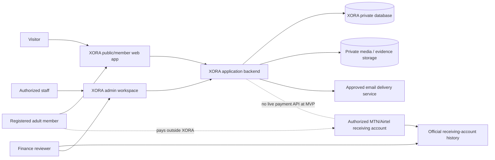

**Trust boundary:** the browser, customer-entered transaction reference and receipt screenshot are *untrusted*. The system only records an incoming payment as finance-confirmed after independent inspection of the approved receiving account. The member never sends money to another member through XORA.

---

## 4. High-level application architecture

### 4.1 Component diagram

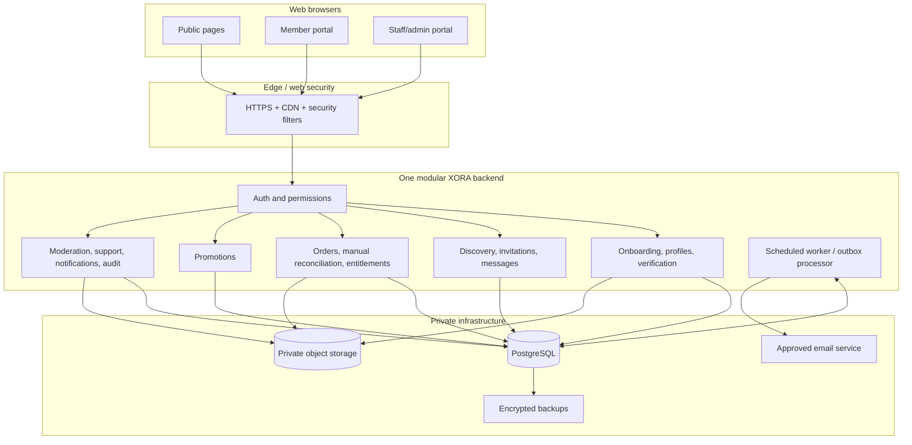

**Architectural rule:** the arrows represent logical access, not seven separately deployed services. All sensitive state transitions happen in server code backed by database constraints. The website calls only its own authorized server endpoints; the client does not directly alter entitlements or financial records.

### 4.2 Overview drawing for non-technical review


The image above is a companion artifact. The Mermaid diagrams remain the **editable source diagrams** inside this Markdown document.

### 4.3 Request flow

1. User opens HTTPS page through CDN/security layer.
2. Public pages can be cached. Member/admin views require an authenticated session.
3. Backend checks the identity and capability of the caller.
4. Backend performs business rules in modules, then reads/writes PostgreSQL.
5. Photos and sensitive documents are served with **time-limited, authorized access** from private storage.
6. Important changes create an audit/event record in the same transaction.
7. Worker sends discreet notifications and runs expiry/cleanup tasks.

---

## 5. Technology and deployment choices

### 5.1 Recommended first implementation

| Layer | Preferred v1 choice | Reason and rule |
|---|---|---|
| Web app + server | **Next.js with TypeScript** | One web project; server-render public content and private member/admin routes |
| Styling/UI | **Tailwind CSS** with accessible UI components | Fast consistent mobile-first design; maintain a small design system |
| Database | **Managed PostgreSQL** | Strong transactions, relationships, indexes and constraints for money and entitlement correctness |
| Login | Verified-email/password identity solution with secure sessions | Avoid requiring paid SMS at MVP; rate-limit recovery and verification |
| Object storage | Private, S3-compatible storage or managed equivalent | Separate buckets/areas for approved profile photos, payment proof and identity evidence |
| Email | Approved transactional email sender | Verification, recovery, security, payment notifications; generic discreet subjects |
| Background work | Database-backed jobs + reliable scheduled runner | Expiry, reminders, outbox dispatch, retention and reconciliation alerts |
| Hosting | Managed web hosting/runtime suited to Next.js | Lower operational cost than self-managed servers; ensure policy acceptance |
| Error monitoring | Application error tracking, privacy-redacted | Detect payment/permission failures without collecting messages or receipt contents |
| Web analytics | Privacy-first aggregate analytics | Avoid transmitting sensitive intentions/profile data to ad-tech |
| Search | PostgreSQL query/indexes initially | Enough for first Kampala pilot; add dedicated search only when necessary |
| Admin authentication | Separate staff access with MFA | Reduce risk of payment/detail hijacking |

**Vendor flexibility:** a hosted platform combining auth/database/storage (for example, a managed PostgreSQL/Auth/Storage provider) may simplify MVP, but the chosen provider must permit the actual business and satisfy privacy/security review. No provider or free tier is assumed to approve adult-oriented services automatically. Avoid hard-coding business logic into vendor-only features that prevent future migration.

### 5.2 Environments and domains

- **Local development:** fabricated accounts, fake orders, fake bank/MoMo records; **never** real member images or production statements.
- **Staging:** separate database, storage, email and payment instruction mockups; safe test domain and privacy controls.
- **Production:** real domain with HTTPS, monitored backups, official business payment recipient after authorization, minimum necessary privileges.
- Suggested routes: `xora.<approved-domain>` for the member-facing site and `admin.xora.<approved-domain>` **or** `/admin` with stronger staff access. No separate Date/Casual domains.

### 5.3 Deployment drawing

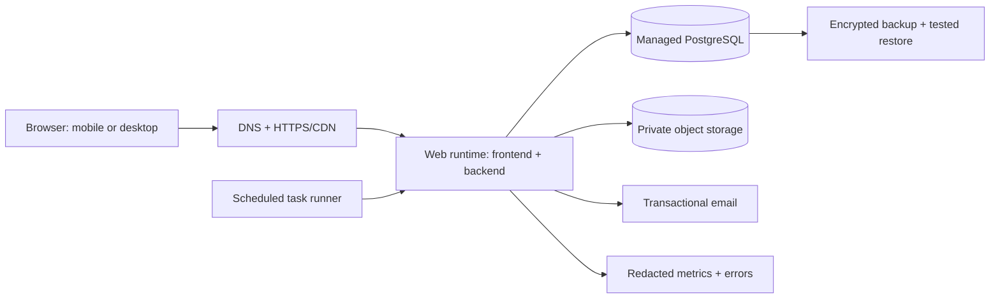

**Infrastructure cost principle:** rent only resources necessary to serve a controlled pilot, with backup, security and operational reliability treated as non-negotiable. Do not promise “zero cost”: domain, hosting, email, storage, support and identity verification may still cost money.

---

## 6. Core modules and boundaries

Each module has a defined responsibility. The same deployment can contain all of them, but **one module must not casually change another module's protected records**.

| Module | Owns | Essential business rules |
|---|---|---|
| Identity & Sessions | Accounts, sign-in, verified email, password recovery | Unverified/restricted accounts cannot contact members |
| Member Profiles | Bios, gender/preferences, area, photos, visibility, changes | Public-to-members view excludes private account fields |
| Verification | Contact, adult eligibility, profile review, optional identity outcome | Four checks kept distinct; no paid verification badge |
| Discovery | Date/Casual/Both intent matching, filters, favorites | Two-way compatibility, age safety, blocks and pause enforced before ranking |
| Invitations | Likes, outgoing requests, acceptance, declines, expiry | Free credit consumed at acceptance only; no spam loophole |
| Messaging | Accepted conversation threads, messages, unmatch/block | Only participants; no chat unlocked by a screenshot or promotion |
| Product Catalogue | Versioned Connect/Promotion offerings | Only founder-authorized active SKUs displayed; historical orders immutable |
| Orders & Proof | Checkout orders, payee snapshot, submitted transfer details | No auto-payment and no screenshot-as-settlement |
| Finance & Reconciliation | Incoming transfer evidence, matching, approval, refunds | An external transfer assigned to no more than one order; review independently |
| Entitlements | Connect durations, queued renewals, access checks | Start after approval; exact expiry; existing chats remain free |
| Promotions | VIP/Spotlight campaign dates and ranking slots | Clearly labeled; no bypass of compatibility or sanctions |
| Trust & Safety | Blocks, reports, investigations, sanctions, appeals | High-risk reports prioritized regardless of payment status |
| Support | Case tickets, member replies, escalations | Minimum necessary details; no admin browsing of unrelated private chats |
| Notifications | In-app feed, generic email, user preferences | Discreet and consent-aware; idempotent delivery |
| Audit & Compliance | Staff actions, sensitive access events, legal holds, requests | Append-only investigation trail; controlled deletion/retention |
| Configuration & Reporting | Allowed areas, staffed hours, thresholds, aggregated KPIs | Changes versioned; restricted staff permissions |

### 6.1 Cross-module commands (business operations)

Define named server actions such as:

- `SubmitProfileForReview` → member validation → review queue → notification.
- `SendInvitation` → eligibility + relationship + free/pass permission → invitation persisted.
- `AcceptInvitation` → consent checks → atomically consume free credit **if applicable** → create chat.
- `SubmitPaymentDetails` → order status/evidence update; **no paid access**.
- `ConfirmSettledTransferAndApproveOrder` → verified incoming transfer + eligibility + one-time grant.
- `StartOrQueueEntitlement` → dates and renewal schedule.
- `OpenReportAndBlock` → immediately block + create triage case.
- `ChangeReceivingAccount` → dual authorization + effective date + immutable existing order snapshots.

These should be narrow transactions, not generic “admin can edit any field” operations.

---

## 7. Public/member/admin information architecture

### 7.1 Web route map

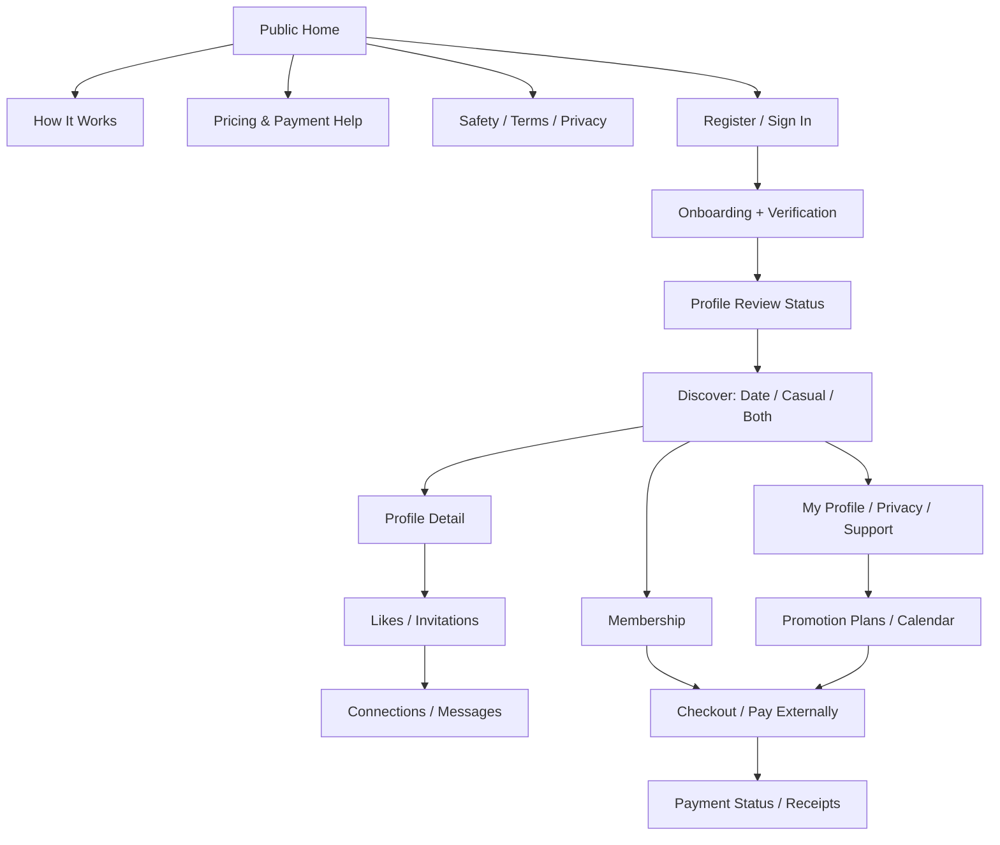

### 7.2 Page groups

**Public** (indexable, no member records): Home, About, How It Works, Date explainer, Casual explainer, Pricing, Payment Help, Safety, Contact, Terms, Privacy, Community Rules, Refund Policy, FAQs, Sign In, Register, Reset Password.

**Member-only** (authentication + review-based permissions): Welcome, Setup Wizard, Email Verification, Review Status, Discover, Profile Detail, Saved, Likes, Invitations Sent, Invitations Received, Connections, Messages, Membership, Promotions, Order Summary, Official Instructions, Submit Details, Payment Status, History/Receipts, Promotion Calendar, My Profile, Privacy, Security, Support, Reports, Appeal, Delete Account.

**Staff-only** (named staff auth + capabilities): Overview, Critical Safety, Members, Profiles, Verification Cases, Discovery Health, Invitations Exceptions, Finance Payments, Payment Detail, Unmatched Transfers, Refunds, Entitlements, Promotions, Support, Appeals, Analytics, Content, Approved Channels, Staff Roles, Audit, Incidents and Handover.

### 7.3 Mobile navigation and state handling

- Bottom navigation: **Discover / Invitations / Messages / Membership / Profile**.
- Date/Casual/Both selector inside Discover, not separate logins or homepages.
- In-app notification centre reachable from the header.
- Every screen has loading, empty, success, validation failure, offline and account-restricted states.
- Checkout forms retain drafts on an interrupted connection; duplicate submission protection keeps the same order.
- Private pages and images require authentication and must not be cached publicly or indexed by search engines.

---

## 8. Data ownership and conceptual database

### 8.1 Conceptual entity relationship diagram

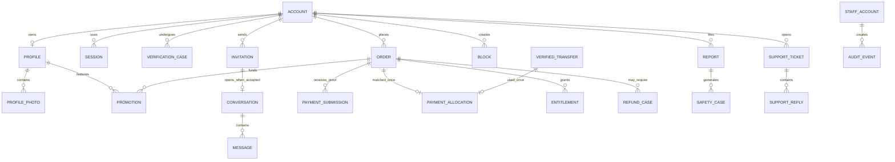

**This is a conceptual model**, not a final SQL migration. Some relationships (like conversation participants or staff assignments) need junction tables in the physical schema.

### 8.2 Data families and minimum fields

| Data entity | Essential fields | Privacy / integrity constraint |
|---|---|---|
| `accounts` | ID, verified email, password/auth reference, active/restricted state, created timestamp | Email private; one canonical account ID; never expose password hash |
| `profiles` | account ID, display name, DOB/approved age token, broad area, gender/preferences where appropriate, intent, bio, visibility, review status | Public-facing view is explicitly allowlisted; exact DOB private |
| `profile_photos` | profile ID, storage key, review state, order, ownership status | Approved photos only; original bytes private |
| `verification_cases` | account, check type, reviewer, outcome, evidence pointer, time | Sensitive record; separate from profile gallery and finance |
| `likes`, `saved_profiles` | source, target, timestamps | Private to originating member |
| `blocks` | blocker, blocked account, time | Immediate exclusion in discovery and invitations |
| `invitations` | sender, recipient, status, funding basis (`free_pending`/`pass`), expiry, accepted time, idempotency key | No self-invitations; enforce one active free outgoing request |
| `free_intro_credits` | account ID, used at, used-by invitation ID | One record per account; consume once on a valid accepted outgoing invite |
| `conversations`, `participants` | conversation, inviter/invitee, active/unmatched state | Only participants can retrieve messages |
| `messages` | conversation, sender, text, created time, moderation flags | Encrypted at rest; no public indexing; retention policy |
| `products`, `product_versions` | SKU, type, price UGX, duration days, effective dates, description | Founder-approved versioning; no retroactive price edits |
| `orders` | ID/reference, member, product snapshot, price, payee snapshot, status, created/expiry time | **Immutable commercial snapshot**; public status distinct from finance state |
| `payment_submissions` | order, provided transaction ID, payer fragment, amount, time, optional evidence storage key | **Member claim**, not confirmation of settlement |
| `verified_transfers` | account/channel, official reference, amount, settled time, status, reviewer/source | Independent incoming-funds evidence; strong uniqueness |
| `payment_allocations` | order, verified transfer, allocated UGX, reviewer, time | Unique per settled transfer and per fulfilled order; corrections audited |
| `entitlements` | account, product type, source order, starts, ends, status, queued position | One entitlement period per approved order; no perpetual entitlements |
| `promotions` | profile, product, source order, scheduled/active dates, state | Eligible only while approved visible profile remains so |
| `refund_cases` | order/allocation, request reason, decision, payment-out reference, status | Actual refunds tracked separately from proof of intent |
| `reports`, `safety_cases`, `appeals` | reporter/subject, category, severity, status, limited evidence, reviewer | Sensitive; role-gated access and retention |
| `support_tickets`, `replies` | owner, category, case state, messages, assignment | Support sees only necessary financial details |
| `notifications`, `outbox_events` | recipient, template/event, status, retry count, preference | Never store unnecessary intimate details in email body |
| `staff_accounts`, `staff_permissions` | staff ID, capability set, MFA status, active flag | No shared staff credentials |
| `audit_events` | actor, action, target, before/after identifiers, reason, timestamp | Append-only; separate restricted read access |
| `payment_channel_versions` | method, official recipient, verified business ownership, effective dates, approver | Checkout references immutable historical version |
| `privacy_requests`, `retention_holds` | account, rights request, owner, deadline, resolution | No immediate erasure of lawfully held accounting/safety evidence |

### 8.3 Essential database constraints

- `accounts.email` unique after normalized validation (with secure recovery for changes).
- `free_intro_credits.account_id` unique; one successful consumption max.
- Exactly one current `free_pending` outgoing invitation per sender (use a partial unique index or transaction lock).
- Prevent a second active invitation to the same recipient from the same sender, as defined by policy.
- Payment `order.reference` unique, human-readable; not equal to provider transaction reference.
- `(receiving_account_id, provider_transaction_id)` unique for verified incoming funds where official reference exists, plus secondary safeguards where references are incomplete.
- `payment_allocations.verified_transfer_id` unique while allocated; `payment_allocations.order_id` unique for fully paid one-transfer orders. Exception/top-up structures must be explicit, not bypass uniqueness.
- `entitlements.source_order_id` unique for each purchased entitlement issuance; the same order cannot activate twice.
- `promotions.source_order_id` uniqueness where one campaign is purchased per order.
- All member/profile/message/order links use foreign keys; use database transactions for invitations and finance decisions.
- Timestamps stored in UTC with timezone-aware types; no freeform date strings as the source of truth.
- Use soft restriction / retention policies for sensitive records rather than unrestricted destructive admin edits.

### 8.4 Data classification

- **Public marketing:** product information, policies, pricing and approved anonymous media.
- **Member-visible:** approved profile display fields for eligible signed-in adults.
- **Personal private:** account email, DOB/age outcome, preferences, block list, chats, invitations.
- **Highly restricted:** verification evidence, member reports, private conversation evidence in an authorized case, receipt screenshots, receiving-account history, refund details.
- **Audit/legal:** staff decisions and finance history retained under written schedules and applicable law.

Do not include intimate preferences or member identities in analytics exports by default.

---

## 9. Registration and adult eligibility journey

### 9.1 Exact collected details (consistent with PRD §10)

**At first registration:** email, password, adult-age declaration, Terms acceptance and Privacy Notice acknowledgment; separate optional marketing choice. Account created but **not discoverable** until verified and approved.

**In progressive onboarding:** display name; necessary DOB or approved age-evidence alternative; city/approximate area; self-described gender and desired adult discovery preference where lawful; Date/Casual/Both intention; short bio/interests; at least one acceptable photo (or approved exception); privacy/notification settings; final preview and submission.

**Only when justified:** restricted age/identity evidence. Never routinely require national ID image, legal name, exact address, MoMo PIN, OTP, contact list, sexual history or income merely to browse.

### 9.2 Journey diagram

```mermaid
sequenceDiagram
    actor Member
    participant Web as XORA Web
    participant Auth as Identity
    participant Profile as Profiles
    participant Review as Age/Profile Review
    participant DB as Database
    Member->>Web: Join free, confirm 18+, accept policies
    Web->>Auth: Create email/password account
    Auth->>Member: Verification email
    Member->>Web: Confirm email link
    Web->>Auth: Verify token; activate sign-in
    Member->>Web: Fill profile wizard and privacy
    Web->>Profile: Save resumable draft
    Profile->>DB: Draft changes
    Member->>Web: Submit profile
    Web->>Review: Queue checks
    alt Eligible and compliant
        Review->>DB: Record separate check outcomes
        Review->>Member: Profile approved notification
        Member->>Web: Discover compatible adults
    else Correction / age question
        Review->>Member: Needs changes / restricted status
    end
```

### 9.3 Publication guard

An account is discoverable only if contact verification, adult eligibility and profile review satisfy policy **and** member visibility is on **and** account has no safety restriction. Optional identity verification is displayed only if actually performed and explained.

### 9.4 Signup recovery

Keep drafts; resend confirmation with rate limits; detect duplicate email accounts; protect email-change and password-reset routes; never let a partial profile send invitations. A reported underage account is immediately removed from discovery while reviewed.

---

## 10. Date/Casual discovery and privacy rules

### 10.1 Discovery eligibility pipeline

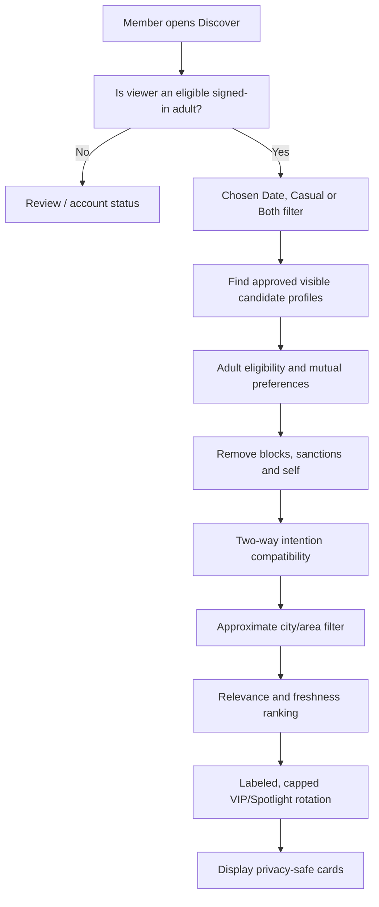

**Key distinction:** `Both` means open to more than one kind of connection, not consent to everyone. Mutual gender/age/location preferences, block rules and requested boundaries continue to apply. Date-only members are not shown to Casual-only searchers when interests are incompatible. Paid placement does not create eligibility.

### 10.2 Ranking for pilot

Start with a simple transparent ranking: compatible mode and preferences, broad area, profile quality, real recent activity where consented; rotate sponsored placements only *after* eligibility. Do not buy/rely on opaque high-cost recommendation AI. Limit repeated profiles and impose impression caps on paid placements.

### 10.3 Member profile visibility controls

- Pause/unpause discovery; block any account; hide activity indicator; choose broad area rather than GPS.
- Show a **preview of the exact fields** other eligible adults see.
- Never expose email, raw date of birth, legal ID, payment receipts or precise home location.
- Search engines index public marketing pages, **not member profiles**; require authentication for details and media.
- No list of all registered members available through a public endpoint.
- Personal blocks filter both discovery and new invitations immediately, even with active promotion.

---

## 11. Invitations, one free acceptance and chat

### 11.1 Member-level invitation contract

- A **Like** is only private interest; it does not create a conversation or consume a free introduction.
- An **Invitation** requests permission to speak; recipient can accept, decline, ignore or block.
- A new free account can maintain **one pending outgoing free invitation**. Its expiry is proposed at 7 days pending founder approval.
- On first acceptance, **sender's** free introduction is consumed once; recipient's free allowance is unaffected.
- After that free introduction is used, the **sender** needs an active Connect Pass to start a new outgoing invitation. Incoming acceptance and existing conversation replies stay free.
- Anti-spam controls apply even with a paid pass. No paid access guarantees a response.

### 11.2 Invitation + free-credit state machine

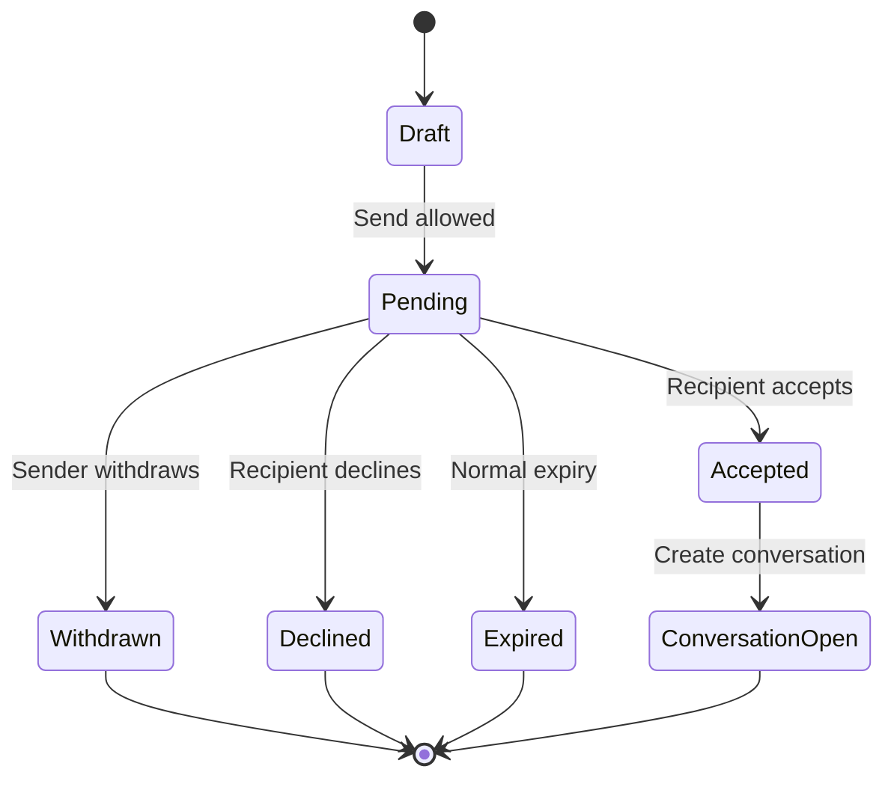

**Atomic acceptance transaction:** lock the invitation and sender's free-credit row; verify still pending, recipient eligible, no block; if funding basis is `free_pending`, verify unused credit then mark used; create exactly one conversation; set invitation accepted; commit as a unit. A duplicate click/retry returns the existing conversation.

### 11.3 Free invitation journey

```mermaid
sequenceDiagram
    actor A as Sending member
    participant W as Web
    participant I as Invitation module
    participant DB as Database
    actor B as Receiving member
    A->>W: Say Hello (first free request)
    W->>I: Request invitation
    I->>DB: Lock account; ensure one free pending slot
    I->>DB: Create pending invitation (no credit used)
    I-->>B: Private invitation notification
    alt B accepts
        B->>I: Accept
        I->>DB: Atomic check + consume sender's one free credit
        I->>DB: Create private conversation once
        I-->>A: Connection opened
        I-->>B: Connection opened
    else B declines / request expires
        I->>DB: Close invitation, free credit unchanged
    end
```

### 11.4 Paid pass authorization and timing

At the moment a new outgoing invitation is **sent**, inspect: approved active account, recipient consent compatibility, block status, safety limits, free-credit state, and any valid pass. Store a funding basis (`free_pending` or `connect_pass`) on the invitation so that a pass expiring while the invitation waits does not invalidate it retroactively.

**Important exception:** free pending invitations reserve the one active free slot, *not* a used credit. If paid membership activates while a free request is outstanding, keep its original basis; accepting that first free request can still use the credit, while paid-basis requests stay independent. Handle any attempt to consume the same free credit twice transactionally.

### 11.5 Chat architecture

- Create one-to-one private conversation after acceptance only; no unsolicited DM endpoint.
- Text-first MVP, no intimate media/video attachments; profile photos are moderated separately.
- Fetch conversations with secure participant checks and cursor pagination; use **short polling or managed real-time** only if affordable/approved. Realtime is convenience, not a requirement for correctness.
- No message content in email previews. Do not expose chat contents to finance/support staff.
- Block/unmatch immediately prevents further messaging between those members, subject to limited lawful evidence preservation for a reported incident.
- Existing conversations remain readable and writable after Connect expiry unless restricted or blocked.

---

## 12. Renewable Connect Pass entitlement engine

### 12.1 Catalog and plan rules

| SKU (example) | Product | Price | Duration | Grants |
|---|---|---:|---:|---|
| `CONNECT_W7` | Connect Week | UGX 10,000 | 7 days | Additional eligible outgoing invitations |
| `CONNECT_M30` | Connect Month | UGX 25,000 | 30 days | Same permission for longer |
| `CONNECT_Q90` | Connect Quarter | UGX 60,000 | 90 days | Same permission for longer |
| `VIP_W7` | VIP Week | UGX 20,000 | 7 days | Labeled boosted placement |
| `SPOTLIGHT_M30` | Spotlight Month | UGX 50,000 | 30 days | Labeled feature placement |
| `VIP_M30` | VIP Month | UGX 80,000 | 30 days | Enhanced labeled rotation/insights |

**No `LIFETIME` SKU and no auto-renew payment schedule.** Price and products are proposed PRD values; the system reads active versioned catalog records instead of scattering hard-coded prices across pages. Admin edits apply **prospectively**.

### 12.2 Entitlement timeline

For a first or expired pass approved at time `T`, `start = T` and `end = T + duration` (using exact consecutive 24-hour days). For early renewal, `start = max(approval_time, latest_queued_or_active_end)`; `end = start + duration`.

Example: a Connect Week is active until 10 December at 14:00 EAT. A renewed Week approved 8 December must begin **10 December at 14:00 EAT**, expire **17 December at 14:00 EAT**, and not shorten the old pass. A pending payment does not grant access. Activation never uses the external transfer time as the paid term's starting clock.

**When a member changes product** (e.g., Week to Month), MVP should schedule the next product, not silently overwrite the remaining active period. Any immediate-tier change requires an explicit future policy and accounting review.

### 12.3 Entitlement data and engine

- Store entitlements as non-overlapping, dated rows linked to approved orders.
- Determine active right from `start <= now < end` plus account/eligibility status—not from a client timer or mutable boolean alone.
- A scheduled worker marks expired/queued entitlements for reporting/notification; **authorization still checks timestamps directly**, so an offline worker cannot leave stale access active.
- Approval may create a queued entitlement. Its effective access begins automatically at its scheduled start; staff need not log in to click another button.
- Disabling an entitlement for safety is a separate restricted action with reason, correction trail and refund consideration.
- Member-facing dashboard shows exact EAT start, end, remaining days, queued renewals, and no auto-renew.

### 12.4 Entitlement state diagram

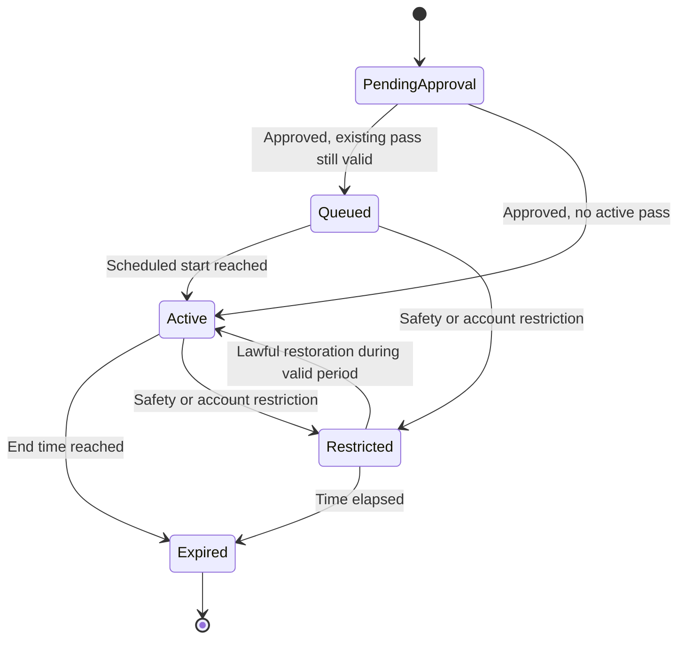

The `PendingApproval` stage actually belongs to an order; diagram includes it to explain customer experience. A database `entitlement` row is only issued after order approval.

---

## 13. Manual Mobile Money checkout and reconciliation

This is XORA's **highest-integrity business workflow**. The feature should look polished without pretending to be an instant automated payment gateway.

### 13.1 Two separate truths

1. **Member's claim:** “I transferred UGX X; here is my transaction reference and optional receipt.” Store as `payment_submission`.
2. **Business's independently confirmed settlement:** “The authorized receiving account has a settled incoming transaction matching this order.” Store as `verified_transfer`, linked through a controlled `payment_allocation`.

**Never confuse 1 with 2.** A proof screenshot, payment-provider SMS copied by a member, or clicking “I've paid” can never directly grant membership.

### 13.2 Payment context diagram

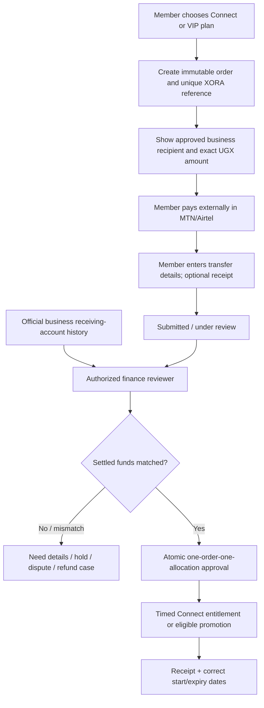

### 13.3 Exact customer journey

1. Choose a product: the purchase screen shows name, price, 7/30/90-day duration, what expires, what stays free, refund rules, and staffed payment-review hours.
2. Create **one** order for that attempted purchase. Lock product SKU version, amount, member, channel and approved payee snapshot.
3. Show registered recipient name and provider-approved business code/number. Explain any payer-side transaction charge. Never ask for mobile-money PIN or OTP.
4. Show XORA order reference and explain it is **not necessarily** a reference field accepted by MTN/Airtel.
5. Allow “Pay later”; keep the unpaid order visible until its stated instruction expiry (proposed 24h, to confirm).
6. Member transfers outside the web app, then returns to enter mobile-money transaction reference, approximate transfer date/time, sent amount, sending number fragment if necessary, and optional private screenshot.
7. System shows **Submitted for verification**, in-app timeline, staffed hours and a support link. Duplicate button taps update/resume the same request, not create new charges.
8. Finance checks funds independently. If confirmed and eligibility holds, approval grants one entitlement or schedules one promotion from the appropriate activation time.
9. Member sees approved order, receipt, paid period dates and next action; no invitation gets sent on their behalf.
10. If unresolved, status shows exactly what information/support step is required; never label it paid while unverified.

### 13.4 Status model and allowed actions

| Internal order/payment state | Public wording | Who can cause transition |
|---|---|---|
| `created` | Awaiting your payment | Member places order |
| `submitted` | Submitted for verification | Member enters proof details |
| `reviewing` | Being checked | Finance accepts case |
| `needs_info` | Action needed | Finance requests specific correction |
| `unmatched` | Payment not confirmed — under review | Finance cannot match official records |
| `approved` | Approved — active or scheduled | Authorized finance action with official settled transfer |
| `rejected` | Could not verify payment | Finance after investigation; member can appeal |
| `refund_pending` | Refund being processed | Finance supervisor/process |
| `refunded` | Refund completed | Finance confirms actual outgoing refund |
| `cancelled` / `expired_unpaid` | Order closed | Member action/expiry; late money still tracked |

A member-facing status is a **projection of multiple internal finance states**; do not implement a single editable text field as the only record of truth.

### 13.5 The approval transaction (invariant)

**Preconditions checked on the server:**

- Reviewer has `finance.approve_payment` capability, with an authenticated staff session and recorded identity.
- An order exists, is not already fulfilled, and retains its locked amount, currency, product, account and payee snapshot.
- Official settled incoming transfer recorded by an authorized reviewer/import is identifiable, under the correct approved business receiving account, and not reversed or previously allocated.
- Required settlement value matches order price, or a documented exception workflow has been independently authorized; do not silently approve partials or overpayments.
- Account and profile eligibility requirements for purchased benefits are satisfied; a safety restriction blocks activation without erasing finance facts.
- Any required second authorization for unusual override is present.

**Atomic transaction (conceptual):**

```text
BEGIN
  lock order, verified transfer, member entitlement calendar
  re-check reviewer permission + order/transfer status + eligibility
  assert verified transfer settled and not allocated before
  assert one order will not issue benefits twice
  create payment allocation and immutable approval/audit event
  mark order approved
  create one time-bounded Connect entitlement OR one promotion
  calculate non-overlapping start and expiry from approval time
  enqueue a discreet notification/receipt event
COMMIT

On network retry: look up existing approval/entitlement and return it;
never create a second period, reassign a transfer, or issue a duplicate receipt.
```

The data constraints are as important as the app code. Use database uniqueness and transaction locking to prevent two admins from approving the same transfer simultaneously.

### 13.6 Independent finance confirmation without a gateway

At MVP, finance should open the official receiving-account ledger/history **outside** XORA. They may either:

- Record a verified transfer in an access-controlled reconciliation screen, with official reference, amount, date, authorized recipient and a restricted note; or
- Import a provider-approved/exported statement with deduplication, checking that the document originated from the legitimate account and was not supplied by the paying member.

No scraping staff personal SMS or asking staff to share a PIN. If official account records are inaccessible, approvals **pause** and the member sees a truthful delay status.

### 13.7 Finance exception workbench

The admin finance UI needs explicit queues for **new proof, in review, unmatched incoming money, underpayment, overpayment, duplicate transfer, late payment, suspected alteration, reversal, refund requested, refund pending, resolved**. Each case owns an assignee, time received, review evidence, next action, related order and communication log.

- **Underpayment:** no automatic partial entitlement. Use approved top-up/refund resolution and documented re-allocation policy.
- **Overpayment:** review excess for refund/consented outcome; never silently sell extra services.
- **Duplicate transfers:** no duplicate entitlement. Match/refund legitimate surplus.
- **Late funds to closed order:** reconcile and honor eligible order or resolve/refund according to policy.
- **Wrong recipient:** do not pretend XORA received funds; refer to provider reversal route.
- **Funds reversed after approval:** finance case, controlled correction, fair notice/refund obligations; preserve original approval trail.
- **Transfer reference reused on two orders:** flag for investigation, prevent second allocation.
- **Payment screenshot but no official funds:** remain unverified; do not activate access.
- **Profile not eligible:** do not publish VIP or unlock restricted activities just because money arrived; handle refund/fair resolution.

### 13.8 Refunds are real financial actions, not status toggles

A refund case should record **reason, amount, approval, recipient confirmation, actual transfer-out reference, timestamp, reviewer, notices, and linked original allocation**. Never mark a refund completed when only requested. A high-risk refund or change of official recipient should require another authorized person whenever possible; where staffing makes this impossible, record explicit founder exception and review it later.

### 13.9 Official receiving-account change flow

Propose change → verify business ownership and provider authorization → second authorized approval (when possible) → schedule effective time → publish only for **new orders** → preserve prior-order instruction snapshots → audit and notify staff. Do not silently rewrite recipient details on pending payments. Expose a prominent fraud-warning and help path during migration.

---

## 14. VIP/Spotlight promotion architecture

### 14.1 Separation from membership

Connect grants permission to **send additional eligible outgoing invitations**. VIP/Spotlight grants **more labeled impressions** only. Either may be purchased without the other, subject to ordinary account eligibility. Neither purchases consent or a guarantee of matches.

### 14.2 Promotion lifecycle

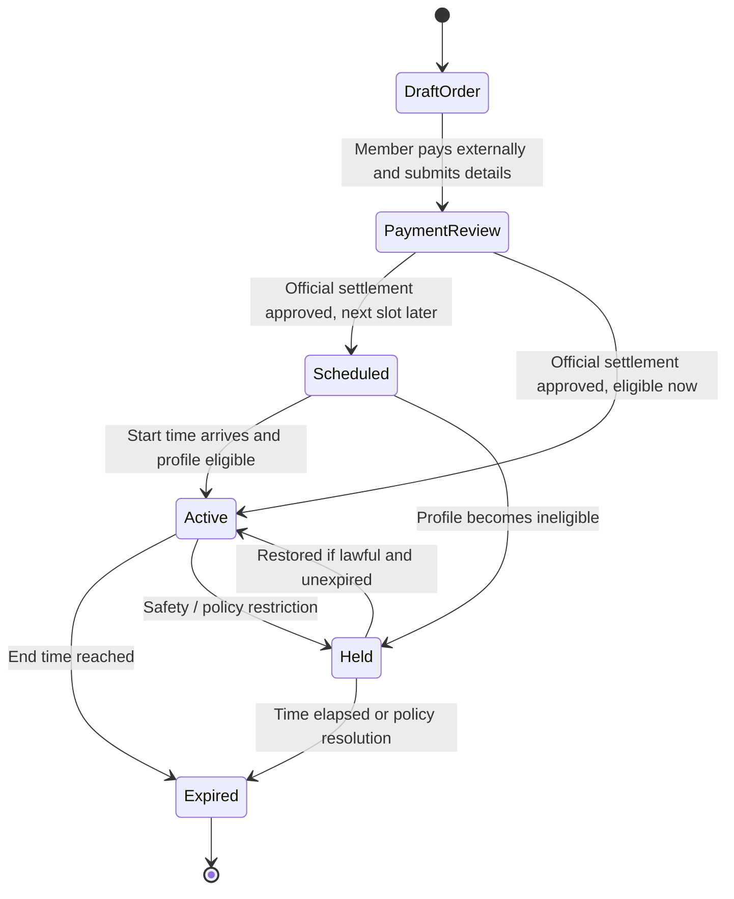

**Implementation note:** keep the paid promotion's scheduled time window independent of profile visibility. If voluntarily paused, the campaign may continue expiring with a visible warning per PRD. If the platform suspends a profile or suffers a service outage, create a case for the published fair remedy/refund policy rather than quietly erasing time.

### 14.3 Sponsored ranking

1. Determine eligible discovery audience using adult verification, mutual preferences, privacy and blocks.
2. Obtain candidates of promoted profiles from the eligible set.
3. Insert into a **limited labeled slot**, with rotation and frequency caps.
4. Ensure organic profiles remain discoverable.
5. Log aggregate, privacy-respecting promotion impressions/clicks so members see credible analytics; never promise number-one placement or fabricated engagement.

### 14.4 Admin controls

Plan creation, campaign approval, queued campaigns, pause/restore, source order, active/expired, eligibility warnings, misleading copy review and promotion revenue reports. Finance controls whether money was received; promotions controls presentation but cannot independently mark an order paid.

---

## 15. Admin dashboard, permissions and operations

### 15.1 Staff-only dashboard layout

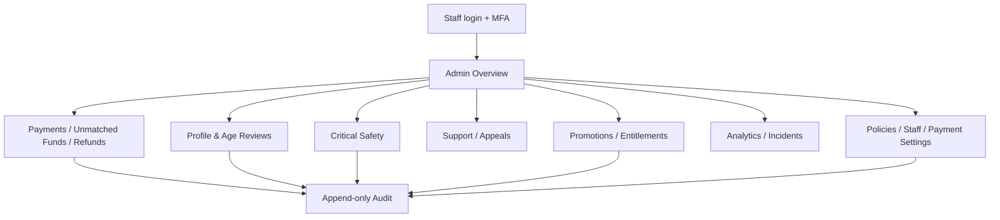

The overview prioritizes **Critical Safety**, **Payments to Verify**, **Unmatched Money/Refunds**, **Profiles to Review**, **Support Waiting**, and **Promotions Starting/Expiring**. Every queue shows pending count, oldest age, owner and overdue status. Show **verified** revenue, not screenshot-based “revenue.”

### 15.2 Permission matrix (examples)

| Capability | Owner | Finance reviewer | Finance supervisor | Profile moderator | Verification specialist | Safety lead | Support |
|---|:---:|:---:|:---:|:---:|:---:|:---:|:---:|
| View operational overview | Yes | Relevant | Relevant | Relevant | Relevant | Relevant | Relevant |
| View receipt submissions | Scoped | Yes | Yes | No | No | No* | Minimal status |
| Record official incoming transfer | Scoped | Yes | Yes | No | No | No | No |
| Approve ordinary valid order | Scoped | Yes | Yes | No | No | No | No |
| Approve refund/financial correction | Controlled | No | Yes | No | No | No | No |
| Change official receiving account | Propose/approve with safeguards | No | Second reviewer | No | No | No | No |
| Review member profile | Scoped | No | No | Yes | No | For safety cases | No |
| Access restricted age/ID evidence | Rare/justified | No | No | No | Yes | Justified case only | No |
| Restrict dangerous account | Emergency authority | No | No | Scoped | Scoped age action | Yes | Escalate |
| Access unrelated private chat | No | No | No | No | No | No | No |
| Review specific reported chat evidence | Restricted process | No | No | No | No | Yes, documented | No |
| Reply to support tickets | Scoped | Finance cases | Finance cases | Policy cases | Age cases | Safety cases | Yes |
| Read audit trail | Scoped | Own actions | Scoped | Own actions | Own actions | Scoped | Own actions |

\* Safety can see only payment-related data when strictly necessary for an authorized fraud investigation, not as routine access.

### 15.3 The 14 admin journeys mapped to operations

| PRD admin journey | Required admin view / command | Evidence & result |
|---|---|---|
| ADM1 Morning start | Overview + queue health | Assigned priority queue and reconciler availability |
| ADM2 Review profile | Profile Reviews | Eligibility check results + decision reason |
| ADM3 Confirm payment | Finance Detail + official transfer record | Exactly one allocation, entitlement, audit and receipt |
| ADM4 “I paid, nothing happened” | Search by XORA order ID + Support | Status explanation; escalate activation error, never demand repeat payment |
| ADM5 Wrong amount/duplicate/late | Finance Exceptions | Unmatched/overpayment/partial case + documented refund/resolve |
| ADM6 Suspicious screenshot | Reconciliation/Flagged Evidence | No approval based only on picture; investigate official account |
| ADM7 Correct wrong approval | Finance Corrections | Supervisor reason + compensating action, original history retained |
| ADM8 Change receiving details | Payment Channel Change Control | Verified owner, versioned change, second sign-off |
| ADM9 Suspected underage | Critical Safety + Verification | Immediate restriction, protected investigation, finance separately handled |
| ADM10 Harassment/scam | Safety Reports / Member restriction | Evidence-specific review, block, sanctions, appeal |
| ADM11 Campaign lifecycle | Promotions Calendar | Accurate actual dates and eligibility; refund/extension case if necessary |
| ADM12 Delete account | Privacy Requests | Hide promptly; validated rights workflow and lawful retention exceptions |
| ADM13 Finance handover | Reconciliation Summary | Matched/unmatched/approved/refunded ledger and next owner |
| ADM14 Weekly founder review | Management Metrics | Cash accuracy, member value, renewals, safety and backlog trends |

### 15.4 Mandatory audit on privileged actions

Log *who, what, when, which record, before/after status, evidence or reason, and originating staff session*. Especially important: payment approvals/reversals/refunds, entitlement grants, staff privilege changes, payee updates, profile restrictions, moderation evidence access, deletion/retention decisions, and exports. Staff may add corrective events; they cannot edit away history.

---

## 16. Safety, trust, support and privacy-rights workflows

### 16.1 Report and block flow

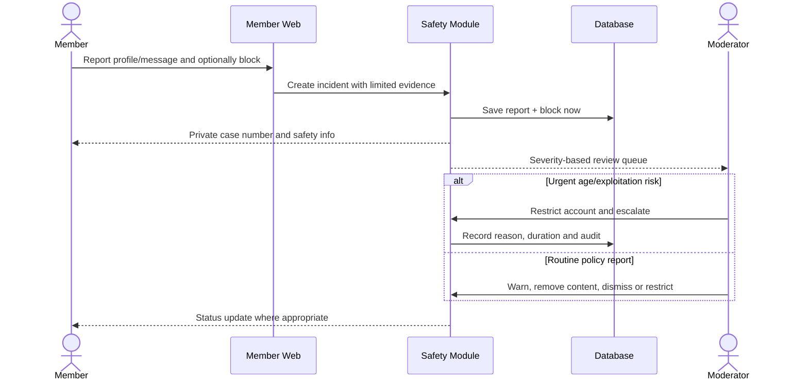

**Blocking is immediate** and does not wait for human review. In suspected minor/trafficking/coercion scenarios, urgent restriction and legally appropriate escalation take priority over payments, promotions and support queues. No staff employee is authorized to “sell” reinstatement.

### 16.2 Privacy request flow

Account → Privacy → Delete/Request Data/Correct Information → re-authenticate as appropriate → immediately hide from discovery → open documented privacy workflow → evaluate legal holds/mandatory financial retention → erase or anonymize eligible data → give member status and completion/exception explanation. Paid subscriptions and promotion rights are handled under published policies; retain only lawful minimum accounting/safety records.

### 16.3 Restricted evidence vault

- Separate storage areas for ordinary approved profile photos, receipts and ID/safety evidence.
- Short-lived links gated by role and case; never make receipts or age documents public.
- Log restricted evidence access, not just downloads when possible.
- Avoid bulk exports, accidental attachment in email, and copying files to personal devices.
- Redact unnecessary receipt message content and image metadata; apply approved retention limits.
- Support staff access a **status summary**, not every sensitive underlying file.

### 16.4 Eligibility and safety trump commerce

- Payment does not approve a profile or undo a restriction.
- A member reporting another person can block instantly while the report is reviewed.
- A paused or blocked profile is excluded from new discovery even if VIP is active.
- A suspicious age case immediately stops new matching and payment-driven feature use until resolved.
- No abusive member may bypass anti-spam limits by buying multiple passes.

---

## 17. Notifications and scheduled work

### 17.1 Event-driven notification architecture

Any important database transaction also writes an **outbox event** in the same transaction. A scheduled worker reads events, creates an in-app notification, and sends appropriate generic email. A delivery retry must not resend the same event indefinitely. No intimate preference, profile photo or match details in email subject/previews.

**Events:** verify email, profile reviewed, invitation received/accepted, first free intro used, Connect approval/queued/expiring/expired, payment submitted/needs info/unmatched/approved/refunded, promo scheduled/active/expired, report received, restriction/appeal, account security notices.

### 17.2 Background jobs

| Job | Trigger/frequency approach | Safety/correctness rule |
|---|---|---|
| Outbox delivery | Frequent background polling | Retries with dedupe and dead-letter monitoring |
| Pending invitation expiry | Scheduled sweep | Free pending slot released; no free credit consumed |
| Connect expiry display/alerts | Daily/hourly as needed | Access check uses timestamps even if worker late |
| Queued Connect start | Schedule boundary | Entitlement dates fixed when approved; activation reflects time |
| Promotion eligibility and expiry | Scheduled checks | Paid placement never overrides safety flags |
| Payment instruction expiry | Schedule boundary | Closing unpaid order does not erase late money |
| Stuck payment case alerts | During staffed window | Notify staff; do not invent instant verification |
| Renewal reminder | Proposed 3 days and 1 day prior, plus expiry | Respect notification preferences and privacy |
| Retention/erasure processing | Approved schedule | Legal holds and documented exceptions respected |
| Daily finance reconciliation | Staff-assisted daily work | Compare official funds, allocations, entitlements and refunds |
| Backup verification | Recurring operational job | Periodic restore test, not just backup success message |

---

## 18. Security, privacy and abuse prevention

### 18.1 High-priority threats

1. **Fake payment proofs** → independent settlement evidence, duplicate detection and permissioned approvals.
2. **Payment-account takeover/substitution** → receiving-account versioning, MFA, second approval where possible, customer confirmation guidance.
3. **Stolen user credentials** → verified email, secure password hashing via maintained auth system, recovery limits, session revocation, suspicious sign-in notices.
4. **Staff misuse or breach** → least privilege, separate staff credentials, MFA, sensitive access logs, rapid offboarding.
5. **Underage/ineligible accounts** → effective adult assurance and urgent safety restriction.
6. **Privacy leakage of dating intentions or conversations** → private profiles, server authorization, encryption, redacted logs, no advertising trackers carrying private data.
7. **Spam/harassment** → invitation caps, one pending free request, per-account/device/IP rate limits, blocks and reports.
8. **Scraping/stalking** → no public member lists, paginated discovery, low-volume rate limits, no precise location, abuse signals.
9. **Malicious images/attachments** → type/size validation, malware/metadata review, safe transformation, restricted storage; no raw executable uploads.
10. **Concurrent finance actions** → database uniqueness, row locks, idempotent commands and append-only audits.

### 18.2 Authorization policy

- **Authentication** confirms identity; **authorization** re-checks whether the identity can perform the specific action on the specific record.
- Every private read and write must have server-side ownership/participant/role checks; never rely on hidden buttons.
- Member may read only own orders, support cases, account-private data and conversations they participate in.
- Staff role scopes must be enforced in data queries, not only in navigation menus.
- For managed Postgres with row-level security, policies are defense-in-depth; server authorization remains explicit. Never expose a database service key in browser code.

### 18.3 Web/security defaults

HTTPS everywhere, secure HTTP-only session cookies, appropriate CSRF protection for state-changing requests, CSP and secure headers, input validation, output escaping, rate limits, bot controls, request size limits, private cache controls for member/admin responses, encrypted data-at-rest, managed secrets, regular dependency updates, safe file upload scanning, and production access logs with sensitive fields redacted.

### 18.4 Privacy governance

Data protection impact/risk assessment before launch; clear policy and legal basis for sensitive preferences and ID checks; member consent where required; minimum collection; retention schedules; breach handling; appropriate processor contracts and international transfer review. Legal counsel/qualified privacy professional must confirm requirements under Ugandan law. Neither hosting nor manual payments remove these duties.

### 18.5 Age verification is a real control

An “I am 18” checkbox alone is not sufficient for a higher-risk service. Use a proportionate and legally reviewed assurance pathway; keep an eligibility outcome in normal app data while storing any necessary documents in a **separate highly restricted vault** and deleting unnecessary raw evidence according to policy. Do not publicly guarantee users are safe merely because a check passed.

---

## 19. Performance, availability and cost containment

### 19.1 Practical non-functional targets (initial proposals, not measured promises)

| Attribute | Pilot target / practice |
|---|---|
| Device support | Common current Android/iPhone/desktop browsers; no native install |
| Connection quality | Usable on modest Uganda mobile connections; optimize images and form resumes |
| Initial page speed | Aim for fast interactive public pages on mid-range mobile; set measured budgets after prototype |
| Private API | Aim for responsive common actions; measure p95 latency rather than claiming a fixed guarantee |
| Chat | Near-real-time acceptable; short polling can be used first |
| Admin finance | Correctness and trustworthy state over instant response |
| Recovery | Document restore objectives before launch; test actual backup restore |
| Website availability | Public status/support path for incidents and payment delays |
| Media | Responsive sizes, thumbnails, private originals, bandwidth limits |
| Monitoring | Error rate, failed login, failed payment allocations, stuck jobs, backups and abuse spikes |

### 19.2 Low-cost choices that remain safe

- Modular monolith instead of microservices.
- One managed PostgreSQL database; relational indexes before buying search infrastructure.
- Simple short-poll chat before WebSocket infrastructure.
- Email verification instead of paid SMS where reliable and appropriate.
- Staff-assisted finance statement review instead of expensive or prohibited integrations.
- One secure private media store, image limits, compression and controlled retention.
- Compact event/outbox worker rather than separate messaging infrastructure.

**Never cut:** proper adult assurance, private storage permissions, staff MFA, financial uniqueness/approval controls, privacy rights, monitoring, backups or required legal/payment authorization.

---

## 20. State machines and operational invariants

### 20.1 Account / profile status

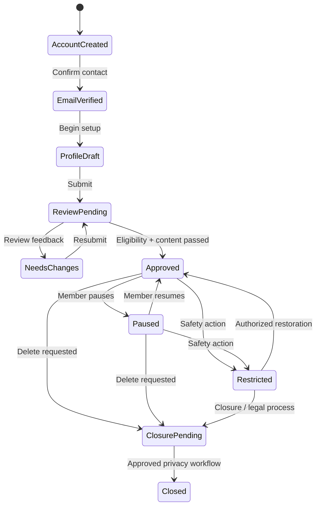

Separate the **account**, **eligibility**, **content-review** and **member visibility** flags in data; the diagram above illustrates the combined member journey only. Do not make a single state field carry every meaning.

### 20.2 Non-negotiable invariants

| ID | Invariant | Why |
|---|---|---|
| INV-01 | No account below eligible adult-age criteria enters discovery | Child safety |
| INV-02 | An unapproved or paused profile is not discoverable | Consent/privacy |
| INV-03 | No one sees a profile that failed mutual preference or block rules | Respect preference and safety |
| INV-04 | Free outgoing benefit consumed **only after first accepted outgoing invitation** | PRD fairness |
| INV-05 | One free credit consumed at most once per account | Fraud/concurrency correctness |
| INV-06 | Incoming invitations and existing chats do not require paid Connect | PRD commercial promise |
| INV-07 | A new outgoing invite after free consumption requires valid timed Connect | Monetization rule |
| INV-08 | Active Connect alone cannot bypass anti-spam or recipient consent | Safety |
| INV-09 | One approved order cannot create two entitlement periods | Financial correctness |
| INV-10 | One confirmed external transfer cannot fund two orders | Prevent duplicate-use fraud |
| INV-11 | No payment approval without independent official funds record | Prevent screenshot fraud |
| INV-12 | Paid term starts at approval or queued boundary, not member-submitted proof time | Fair paid duration |
| INV-13 | Early renewal never destroys already-paid days | Fair membership |
| INV-14 | Paid promotion never overrides eligibility or modifies verification status | Trust |
| INV-15 | Finance/support cannot routinely read private conversations/ID evidence | Least privilege |
| INV-16 | Critical administrative actions leave immutable audit events | Accountability |
| INV-17 | No member-to-member payments, paid sexual-service booking, wallet or auto-renew | Legal/product scope |
| INV-18 | Member/payment records are not indexed on public internet search | Privacy |

---

## 21. Failure scenarios and recovery

| Failure / unusual event | Member experience | System / staff recovery |
|---|---|---|
| Browser closes mid-onboarding | Draft preserved | Resume exact stage; no duplicate account |
| Email verification delayed | Resend/troubleshooting | Rate-limited token refresh; profile not published |
| Network fails while invitation sent | Safe retry; one invitation | Idempotency key + unique active request checks |
| Recipient accepts as pass expires | Chat opens if invitation valid when sent | Funding basis captured at send, acceptance transaction idempotent |
| Two acceptance requests hit simultaneously | One actual accepted connection | Locks/unique constraints; no double free-credit use |
| Member pays but uploads no screenshot | Reference details accepted | Finance reconciles official records |
| Member accidentally clicks submit twice | One payment request | Request idempotency and pending-order reuse |
| Two reviewers approve same transfer | One allocation and paid term | Database uniqueness + atomic approval |
| Funds received; entitlement save fails | Status remains traceable; no second payment requested | One transaction rollback or safe repair with audit |
| Admin cannot access official account | Clear review delay | Approvals paused; no guessed settlement |
| Same transfer referenced by two customers | Both held/reviewed appropriately | Unique allocation and fraud/ownership investigation |
| Payment to wrong number | Clear unsupported transfer warning | Refer to provider for reversal; no false activation |
| Late transfer after order expiration | Member receives status/help | Reconcile and honor/refund per policy |
| Refund initiated but not transferred | “Refund being processed” | Finalize only after independent outgoing transfer reference |
| Hosted storage access control fails | Avoid serving files | Disable affected route and investigate access incident |
| Safety report of possible minor | Discovery/contact restricted fast | Critical case procedure; finance separately resolved |
| Staff changes payee incorrectly | New order creation paused if needed | Revert via audited channel version; preserve earlier snapshots |
| Reminder background job delayed | Entitlements remain time-correct | Server timestamp checks; replay outbox safely |
| User asks to delete profile | Discovery hidden promptly | Follow privacy request and lawful retention schedule |
| Datastore outage | Honest error state; no phantom paid activation | Restore service, replay safely; check pending orders/transactions |

---

## 22. Analytics and management reporting

### 22.1 Operational dashboard

Founder dashboard should distinguish **member activity**, **actual business cash**, **access sold**, and **safety health**:

- Registration → contact-verified → profile-complete → review-approved conversion.
- Active eligible profiles per broad launch area, split by intended modes in appropriately aggregated fashion.
- Invitations sent, accepted, declined, expired; time to first accepted intro; chat engagement without reading message contents.
- Free-to-paid conversion for Connect Week/Month/Quarter; manual-review turnaround; repeat purchases; expiring active passes.
- Paid placement purchases, eligible impressions and honest engagement (no promise of matches).
- **Confirmed received money** vs submitted proof vs allocated revenue vs actual refunds/fees vs unmatched cash; never equate screenshots with income.
- Safety reports per severity, restricted accounts, response times and appeal results.
- Support volume, backlog, payment complaints and refund turnaround.

### 22.2 Privacy limits

Prefer aggregated reports and narrow role access. No sending member profiles, gender/intention details, chat text, exact locations, transfer screenshots or verification documents to consumer ad-tracking tools. Small-cell aggregation should avoid exposing specific people in sparse locations.

### 22.3 Daily reconciliation report

At a minimum show: opening reconciled balance, newly verified incoming transfers, order allocations, unmatched official transfers, over/underpayments, reversals, outgoing refunds, ending confirmed balance/checks, active entitlements issued, outstanding support cases and reviewer sign-off. This report is not a substitute for official financial statements.

---

## 23. Acceptance tests derived from the PRD

These are the **must-pass P0 tests** before real users or money. IDs connect back to architectural invariants.

| Test ID | Given / when | Expected outcome |
|---|---|---|
| T-01 | Visitor opens public site | No identifiable member profiles exposed/indexed |
| T-02 | Email unverified / age unapproved | Cannot discover or send invitations |
| T-03 | Approved member chooses Date-only | Casual-only candidates excluded unless compatible under mutual rules |
| T-04 | Member blocks another | Immediate discovery, invitation and messaging restriction |
| T-05 | Member sends free request, recipient declines | Free accepted outgoing benefit remains unused |
| T-06 | Member sends free request, recipient accepts | One chat created, sender's free benefit consumed once |
| T-07 | Two accept/retry operations race | No double credit consumption or duplicate conversation |
| T-08 | Free benefit used, no paid pass | New outgoing request prompts Connect offer; no invite sent |
| T-09 | Free member receives invite | Can accept and chat for free |
| T-10 | Connect expires during existing chat | Chat still works; additional outgoing requests restricted |
| T-11 | Active pass sends invite, pass later expires | Existing pending invite remains valid until usual expiration |
| T-12 | Week renewed before expiry | Full added week queues after old period without losing days |
| T-13 | User uploads plausible screenshot, no official transfer | No membership activation |
| T-14 | User submits reference without screenshot, official transfer verified | Finance may approve valid order |
| T-15 | Same external transfer attached to two orders | Second allocation prevented; exception surfaced |
| T-16 | Two admins approve same order concurrently | Exactly one entitlement, allocation and receipt |
| T-17 | Finance approves order after delay | Full 7/30/90 days from approval/queued boundary |
| T-18 | Wrong/extra/partial/reversed transfer | Exception workflow; no automatic incorrect grant |
| T-19 | Existing order during payee change | Original recipient snapshot visible and preserved |
| T-20 | VIP bought for incompatible candidate | Never shown to incompatible/blocked audiences |
| T-21 | Profile paused with active VIP | Disappears; clear duration/remedy rules applied |
| T-22 | Member reported for underage concern | Immediate protective restriction independent of paid status |
| T-23 | Support role opens receipt vault or private chat | Forbidden unless explicitly scoped lawful exception |
| T-24 | Staff grants/refunds/restricts | Named immutable audit event recorded |
| T-25 | Member requests deletion | Removed from discovery, privacy case tracked, legal holds respected |
| T-26 | Network retry on checkout/order submission | No accidental additional order/payment claim |
| T-27 | Background expiry job fails | Server-time authorization still correctly expires Connect |
| T-28 | Staging environment accessed | No production accounts, documents or real payee instructions |
| T-29 | User on poor network reloads payment status | Existing state and order reference preserved |
| T-30 | Member attempts to solicit paid sex/service booking | Prohibited content flagged/removed under policy; no platform booking path |

**Additional test types:** automated unit tests on state rules; integration tests for database transactions and permissions; end-to-end web tests for mobile journeys; accessibility tests; security tests, file-upload abuse checks, restore drills and staff rehearsal using fake statements.

---

## 24. Delivery phases and architecture gates

### Phase 0 — Approval gates, before money or identifiable member launch

- Founder legal review of intended Date/Casual business and content/moderation rules.
- Provider confirms actual receiving-account activities are permitted; establish authorized business recipient.
- Brand/domain clearance; privacy obligations and consent/age assurance reviewed.
- Assign finance/safety/privacy owners and set review hours/refund process.
- Confirm retention, staff access, incident and backup plans.

### Phase 1 — Visual prototype + architecture skeleton

- Mobile web design system, public pages, signup and profile mockups, Discover, Membership, checkout, payment tracker, admin workbench.
- Establish route structure, database migrations, auth/session/security, staging data, CI, automated tests and audit conventions.
- Usability test with adults; avoid collecting real sensitive material during prototype.

### Phase 2 — Core member MVP

- Registration/email validation, resumable profile, adult assurance, photo review, visibility/privacy, Date/Casual filters.
- Likes, one free pending invitation, acceptance and private text chat; blocks/reports.
- Member account, discovery states, in-app notification centre, support basics.

### Phase 3 — Manual commerce and admin MVP

- Versioned product catalog, order checkout/instructions, proof form, finance statement reconciliation, atomic approval, time-based Connect entitlements and promotions.
- Refund exceptions, staff role controls, account reviews, audit trail, critical-safety queues and daily handover.
- Staging rehearsals for duplicated transfers, two-admin race, payee change and reversals.

### Phase 4 — Closed controlled pilot

- Controlled verified adults in a small Kampala-area cluster; no public promise of instant payments.
- Monitor approved-profile quality, accepted invitations, renewal purchases, finance accuracy, fraud, safety cases and retention.
- Fix operational gaps; review actual payment volume before adding automation.

### Phase 5 — Expansion only after metrics and compliance

- Refine ranking/filters and optional language choices; scale infrastructure incrementally.
- Only consider approved payment integration, enhanced search or push notifications after evidence justifies costs and compliance.

### Exit gates before public launch

All **P0** scenarios in §23 pass; legal/payment/brand/privacy gates signed off; staff roles exercised in production-like tests; backup/restore demonstrated; support and safety coverage assigned; official receiving details accurate; public policies published; no prohibited paid-services workflows present.

---

## 25. Open decisions and assumptions

| ID | Decision required | Proposed architectural default | Impact if changed |
|---|---|---|---|
| D-01 | Final adult eligibility provider/process | Restricted manual/assisted review; outcome-only ordinary profile data | Verification queues, vendor contracts and media retention |
| D-02 | Is signup email-only for launch? | Yes, email + password + verified link | Auth flows, optional SMS cost |
| D-03 | Free pending invitation expiry | 7 days (PRD proposal) | Expiration job, UX and anti-spam controls |
| D-04 | Paid invitation rate limit | Reasonable configurable daily and total pending caps; founder/safety to set | Invitations module / misuse protection |
| D-05 | Official MTN/Airtel business recipient | Unset until explicit provider authorization | Checkout cannot accept live transfers before approval |
| D-06 | Payment instruction expiry | Suggested 24 hours; late money escalated, not discarded | Order state and finance exception flow |
| D-07 | Official statement ingestion method | Staff manual attestation first; optional approved CSV import | Reconciliation permissions / audit |
| D-08 | Refund policy, period and authority | Written prelaunch policy, finance supervisor on exceptions | Finance workflow and customer copy |
| D-09 | Staffed payment-review hours | Must match real staff; no assumed instant review | Pricing/checkout/status text |
| D-10 | Promotion pauses / platform-caused downtime | Member-initiated pause continues time with warning; platform-caused cases escalated for remedy | Campaign calendar and refunds |
| D-11 | Raw ID / receipt / chat retention | Minimized, lawyer/privacy reviewed, per category | Deletion jobs and storage costs |
| D-12 | Staff separation in small team | RBAC always; second reviewer for high-risk where possible, audited exception otherwise | Approval controls and audit |
| D-13 | Web provider choices | Managed Next.js/PostgreSQL/object store/email; each approved for actual business | Deployment/security operations |
| D-14 | Real-time chat vs polling | Text and short polling initially | UX/cost; not business rules |
| D-15 | Domain and XORA mark clearance | Working name only pending checks | Public branding/URLs |
| D-16 | Scope/legality of casual-hookup positioning | Legal counsel signs off; no paid-sex facilitation | Launch approval and content rules |

**Change-control principle:** a founder-approved PRD change triggers updates to this architecture's pricing catalog, journey contracts, data records, access rules, acceptance tests and support policies together. Never change checkout copy alone while leaving backend behavior inconsistent.

---

## 26. Final architecture specification

### 26.1 Minimum deployable systems

**Member-facing:** one mobile-first site with free registration, private profile setup and review, Date/Casual/Both discovery, one accepted free outgoing introduction, permission-based chat, optional timed Connect Passes, VIP/Spotlight packages, manual payment instructions/proof/status, member self-service, safety reporting, and discreet notifications.

**Admin-facing:** one protected staff workspace with Critical Safety, Profile Review, Verification, Payments & Independent Reconciliation, Unmatched Funds, Refund Cases, Entitlements, Promotions, Support, Privacy Requests, Staff Access, Analytics, Incidents and Audit.

**Behind the scenes:** one modular backend; PostgreSQL; private, access-controlled media and evidence storage; email; simple background jobs; monitoring; encrypted backups; and acceptance-tested rules.

### 26.2 Core architectural principle

> **XORA must be easy for members to use, but hard for fraud, privacy abuse or administrative mistakes to exploit.** A connection requires consent, a paid right requires genuinely confirmed funds, a promoted profile still requires eligibility, and every important administrative action must be accountable.

### 26.3 Definition of architecture complete

An engineering team can use this document together with `PRD.md` to build the web app without guessing about the key commercial rules. Before coding production finance or verification, the founder must settle the open decisions in §25 and obtain the external approvals in Phase 0.

---

**End of `ARCHITECTURE.md` — aligned to XORA PRD v1.2, 22 November 2026.**
