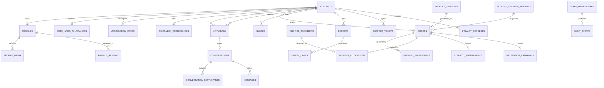
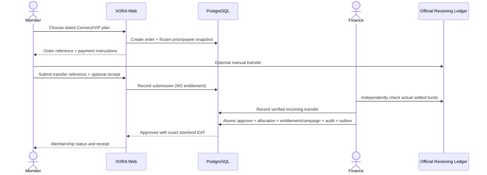

# XORA — Database Schema & Data Governance

**Document:** `DATABASE_SCHEMA.md`  
**Version:** 1.0 (implementation baseline)  
**Status:** Proposed engineering specification — pending founder, legal, privacy and payment-operations approval  
**Companion documents:** [`PRD.md`](PRD.md) v1.2; [`ARCHITECTURE.md`](ARCHITECTURE.md) v1.0; [`API_SPECIFICATION.md`](API_SPECIFICATION.md) v1.0  
**Product:** One responsive adult dating and casual-connection **web app**, one account and one admin workspace  
**Currency:** Ugandan shillings (UGX); **display time zone:** Africa/Kampala (EAT, UTC+03:00)

> **Scope and legal boundary.** XORA enables independent, consenting adults to discover other adults and mutually agree to converse. It must not offer, advertise, book, broker or take payment for sexual services. Payment acceptance and all account/age-data processing are subject to legal, provider and privacy clearance. No payment integration, auto-debit, internal wallet, escrow, person-to-person payment or lifetime membership is in scope.

---

## 1. Purpose and source-of-truth reconciliation

This document converts the non-technical PRD's journeys and the architecture's module boundaries into persistent records, relationships, integrity controls and implementable PostgreSQL patterns. It is **not** a claim that every SQL excerpt is a ready-to-run production migration; the excerpts show critical patterns. Actual migrations must be reviewed, integrated with the selected authentication/storage provider and run in development, staging and production order.

**Priority when documents differ:** approved founder change record → PRD business intent → architecture security invariants → this physical model → API contract. Any disagreement must be documented and approved, never silently resolved in code.

| PRD / architecture decision | Physical representation | Enforced outcome |
|---|---|---|
| One account for Date, Casual or Both | `accounts`, `profiles`, `discovery_preferences` | One identity across both modes |
| Free registration, verified adult-only discovery | `accounts`, `verification_cases`, `profile_reviews`, `profile_media` | Nothing is public-to-members without eligibility and content approval |
| One *accepted* free outgoing introduction | `free_intro_allowances`, `invitations` | Reserve while pending; consume at acceptance once |
| Incoming invitations and existing chats remain free | `invitations`, `conversations`, `conversation_participants` | Connect Pass gates new outgoing requests only |
| Week/Month/Quarter passes (7/30/90 days) | `product_versions`, `orders`, `connect_entitlements` | Dated access, no lifetime or auto-renew |
| VIP/Spotlight (7/30 days) is optional | `promotion_campaigns` | Labeled visibility; never identity/consent priority |
| Payment is externally made and manually verified | `orders`, `payment_submissions`, `verified_transfers`, `payment_allocations` | Receipt != settlement; one allocation per approved order |
| Early renewal preserves days | `connect_entitlements` nonoverlap + queued start | New term starts at latest existing end |
| Staff roles and separately controlled evidence | `staff_memberships`, `staff_role_grants`, `audit_events`, media storage categories | Least privilege and audit trail |
| Safety overrides promotions and paid rights | `blocks`, `reports`, `safety_cases`, `account_restrictions` | Suspensions and blocks always win |
| Data correction/deletion and lawful record retention | `privacy_requests`, `retention_policies`, `legal_holds` | Erase only where legally permitted; never erase financial audit silently |

## 2. Storage principles

1. **PostgreSQL is the system of record.** All business decisions are made by server-side transactions. No browser payment status or screenshot grants a right.
2. **UUIDs are identifiers**; use opaque IDs rather than sequential public member IDs. Public order references are separate random, non-guessable, human-readable values (for example `XOR-26-8K4D7P`).
3. **Amounts are `BIGINT` minor currency units expressed as whole UGX** (no floating point). Every price/order/allocation has currency `UGX`.
4. **Store timestamps in `timestamptz` (UTC)**. Convert to East Africa Time for customers, notices and reports. An access window is always `[starts_at, ends_at)` and a “day” means 24 consecutive hours for these passes.
5. **Separate public, personal and highly restricted records.** No identity-document image, private DOB, receipt, transaction phone number or chat body in a publicly readable profile row or analytics event.
6. **Commercial snapshots are immutable.** Prices, duration and receiving instructions shown to a purchaser remain saved even if configuration later changes.
7. **A payment order is not proof of money received.** Staff must independently confirm a transfer from the official receiving account.
8. **Approvals create business rights exactly once.** Use unique source keys, locks, a transaction and replay-safe API operations.
9. **No hard deletes of settled financial activity** in ordinary workflows. Use correcting entries, privacy-aware redaction and approved retention.
10. **As little sensitive data as possible.** Do not collect national ID images by default before verifying that the process is necessary, legal and secure. Do not collect home addresses or mobile-money PINs.

## 3. Conventions, keys and field standards

| Standard | Recommended approach |
|---|---|
| Primary key | `id uuid PRIMARY KEY DEFAULT gen_random_uuid()` unless documented composite key |
| Foreign keys | Indexed; use `ON DELETE RESTRICT` for finance/safety records; cascade only safe ephemeral children |
| Created/updated | `created_at`, `updated_at` as `timestamptz`; updates via server, not client |
| Optimistic concurrency | `record_version bigint NOT NULL DEFAULT 1` on mutable operational records |
| Enumerations | `text` + named `CHECK` constraint or managed PostgreSQL enum with controlled migration |
| Idempotency | `idempotency_records` scoped by authenticated actor, operation and key |
| Money | `amount_ugx bigint CHECK (amount_ugx > 0)`; verified incoming transfers may use zero only for special imported ledger entries that cannot settle orders |
| Statuses | Explicit named states with controlled transitions; do not infer payment from `paid=true` |
| External refs | Normalize reference whitespace/case *carefully*; preserve original entered value separately |
| Search and public views | Separate explicitly allowlisted discoverable-profile projection; no `SELECT *` on private records |
| Soft deletion | For accounts/profiles with retention obligations, record closure timestamps and remove discovery eligibility; handle final erasure via privacy workflow |
| Row-level rules | Always enforce in app service layer; where supported, reinforce with PostgreSQL RLS and private views |

**Recommended extensions:** `pgcrypto` (UUID generation), `citext` (case-insensitive email if self-hosted), and `btree_gist` (optional exclusion constraints for time-window non-overlap). Extension availability depends on hosting.

## 4. Logical entity map



The diagram summarizes critical entities; the tables below also include auxiliary entities for exact permissions, recipients, finance exceptions, notifications, staff decisions and retention.

## 5. Catalog of tables — canonical fields and responsibility

Column lists show essential fields, not every audit column; add standard timestamps and versions where suitable. Types are PostgreSQL-oriented; `jsonb` is limited to flexible content, **not** a substitute for normalized ownership, prices or settlement records.

### 5.1 Accounts, security and preferences

| Table | Main fields | Rules and privacy |
|---|---|---|
| `accounts` | `id`, `email`, `email_verified_at`, `account_status`, `created_at`, `closed_at`, `record_version` | Unique normalized email; account never self-declares `approved` |
| `auth_identities` | `id`, `account_id`, `provider`, `provider_subject`, `created_at` | External auth provider reference; password hashes stay in approved auth subsystem |
| `sessions` (if managed locally) | `id`, `account_id`, `session_hash`, `expires_at`, `revoked_at` | Store token hash, not readable session token; rotate/revoke |
| `account_preferences` | `account_id`, `email_notifications_enabled`, `marketing_opt_in`, `activity_visibility`, `privacy_options`, `updated_at` | Separate marketing consent; no hidden default opt-in |
| `consent_events` | `id`, `account_id`, `consent_type`, `document_version`, `accepted_at`, `withdrawn_at`, `source` | Record affirmative terms/privacy acknowledgement and separate marketing consent |
| `free_intro_allowances` | `account_id`, `used_at`, `used_by_invitation_id`, `created_at` | One row/account; consumption happens only in acceptance transaction |
| `account_restrictions` | `id`, `account_id`, `kind`, `reason_code`, `started_at`, `ends_at`, `lifted_at`, `safety_case_id` | Eligibility/safety restriction cannot be bypassed by paid rights |
| `idempotency_records` | `actor_key`, `operation`, `idempotency_key`, `request_hash`, `response_code`, `response_body_ref`, `expires_at` | Prevent duplicate creation/approval; never persist secrets or private media in response cache |

**Account states:** `pending_email`, `active`, `restricted`, `closure_pending`, `closed`. Profile approval and eligibility are separate flags, not overloaded into account state.

### 5.2 Profiles, adult verification and discovery

| Table | Main fields | Rules and privacy |
|---|---|---|
| `profiles` | `account_id` (unique), `display_name`, `bio`, `city_code`, `area_code`, `intent` (`date/casual/both`), `profile_status`, `is_paused`, `last_active_at`, `approved_at`, `record_version` | Public-to-eligible-members view only; no DOB/ID/phone/payment refs |
| `discovery_preferences` | `account_id`, `desired_intents`, `desired_genders`, `min_age`, `max_age`, `selected_areas`, `updated_at` | Sensitive, not publicly indexed; mutual preference matching |
| `profile_interests` | `profile_account_id`, `interest_code` | Controlled taxonomy; no inferred sensitive categorization |
| `profile_media` | `id`, `profile_account_id`, `storage_key`, `media_kind`, `review_status`, `display_order`, `created_at`, `deleted_at` | Private storage; serve only approved media via authorized retrieval |
| `profile_reviews` | `id`, `profile_account_id`, `review_status`, `reason_code`, `reviewed_by`, `reviewed_at`, `reviewed_profile_version` | Edits that materially change approved content may require re-review |
| `verification_cases` | `id`, `account_id`, `check_kind`, `status`, `decision`, `reviewed_by`, `reviewed_at`, `valid_until` | Types: email, adult eligibility, optional identity, content review; only supported claims displayed |
| `verification_evidence` | `id`, `case_id`, `storage_key`, `evidence_kind`, `expires_at`, `deleted_at` | **Restricted evidence vault**; access logged and time-limited |
| `private_age_records` (only if lawful/necessary) | `account_id`, `date_of_birth_encrypted`, `method`, `adult_confirmed_at`, `retention_until` | Restricted; preferably store outcome rather than raw DOB or ID when feasible |
| `likes` | `sender_id`, `recipient_id`, `created_at` | Private; independent from invitation and paid credits |
| `saved_profiles` | `account_id`, `saved_account_id`, `created_at` | Private; no notification to saved person |
| `blocks` | `blocker_id`, `blocked_id`, `created_at` | Unique pair, immediate two-way interaction exclusion; no self-block |
| `discovery_exposures` (aggregate/optional) | `profile_account_id`, `date_bucket`, `organic_views`, `promoted_views` | No per-viewer surveillance for routine analytics |

**Visibility is computed:** `active account AND current adult-eligibility approval AND profile approved AND not paused/restricted AND eligible photo AND mutual preferences AND neither side blocked`. Buying promotion must not relax this predicate. `last_active_at` should be coarse for display and not leak precise activity time to other members.

### 5.3 Invitations and messages

| Table | Main fields | Rules and privacy |
|---|---|---|
| `invitations` | `id`, `sender_id`, `recipient_id`, `status`, `funding_basis`, `source_connect_entitlement_id` nullable, `sent_at`, `expires_at`, `responded_at`, `idempotency_key` | `funding_basis=free_pending` or `connect_pass`; original basis is fixed after creation |
| `conversations` | `id`, `invitation_id` unique, `status`, `opened_at`, `closed_at` | One conversation per accepted invitation |
| `conversation_participants` | `conversation_id`, `account_id`, `joined_at`, `left_at`, `last_read_at` | Exactly sender and recipient; enforce against invitation in service transaction |
| `messages` | `id`, `conversation_id`, `sender_id`, `body_ciphertext` or approved encrypted body, `sent_at`, `deleted_at`, `client_message_key` | Text-only MVP; per-message idempotency; no DM before acceptance |
| `message_reports` | `id`, `message_id`, `report_id` | Sensitive evidence only within specific report process |

**Invitation states:** `pending`, `accepted`, `declined`, `withdrawn`, `expired`. **Conversation states:** `open`, `unmatched`, `restricted`, `closed`. When a Connect Pass expires, do not close conversations or erase messages. When a block is created, stop new messages immediately.

### 5.4 Products, payment instructions and manual money reconciliation

| Table | Main fields | Rules and privacy |
|---|---|---|
| `products` | `id`, `sku`, `kind` (`connect/promotion`), `name`, `is_sellable` | Stable identity for each plan |
| `product_versions` | `id`, `product_id`, `version`, `price_ugx`, `duration_days`, `benefits_snapshot`, `valid_from`, `valid_to`, `approved_by` | Never mutate sold version; effective dates nonoverlapping per SKU |
| `payment_channels` | `id`, `method` (`mtn_momo/airtel_money`), `business_label`, `status` | No account receives funds without approved onboarding |
| `payment_channel_versions` | `id`, `channel_id`, `recipient_name`, `recipient_identifier_encrypted`, `display_identifier`, `effective_from`, `effective_until`, `verified_by`, `approved_by` | Versioned payee; two-person signoff where possible |
| `payment_channel_change_requests` | `id`, `channel_id`, `proposed_version_id`, `requested_by`, `reviewed_by`, `reason`, `status` | Never silently rewrite past orders |
| `orders` | `id`, `order_reference`, `account_id`, `product_version_id`, `product_sku_snapshot`, `amount_ugx`, `duration_days_snapshot`, `payee_version_id`, `payee_snapshot`, `status`, `instructions_expires_at`, `approved_at`, `record_version` | One SKU/order; commercial snapshot immutable; order status ≠ proof |
| `payment_submissions` | `id`, `order_id`, `provider_ref_original`, `provider_ref_normalized`, `payer_phone_encrypted`, `claimed_paid_at`, `claimed_amount_ugx`, `proof_storage_key`, `submitted_at` | Editable via new submission events; do not overwrite history |
| `verified_transfers` | `id`, `channel_version_id`, `provider_reference`, `amount_ugx`, `settled_at`, `verified_from`, `official_evidence_ref`, `recorded_by`, `verified_at`, `reversal_at` | Staff must consult actual receiving-account history; one external transfer identity |
| `payment_allocations` | `id`, `order_id` unique, `verified_transfer_id` unique, `amount_applied_ugx`, `allocated_by`, `allocated_at` | **MVP one fully settled incoming transfer per approved order**, with flagged exceptions for other cases |
| `payment_decisions` | `id`, `order_id`, `action`, `actor_staff_id`, `reason_code`, `note_redacted`, `created_at` | Append-only decision history, including corrections |
| `finance_exceptions` | `id`, `order_id` nullable, `transfer_id` nullable, `kind`, `status`, `assigned_to`, `resolution`, `created_at`, `resolved_at` | Under/overpayment, late money, reused ref, reversal, unmatched, fraud review |
| `refund_cases` | `id`, `order_id`, `allocation_id`, `reason_code`, `amount_ugx`, `status`, `requested_by`, `approved_by`, `member_notice_at` | Do not equate “refund approved” with money sent |
| `refund_disbursements` | `id`, `refund_case_id`, `provider_reference`, `recipient_verification_ref`, `amount_ugx`, `confirmed_sent_at`, `recorded_by` | Proof of actual outward transfer; one or multiple documented adjustments if policy permits |
| `finance_reconciliation_runs` | `id`, `channel_version_id`, `period_start`, `period_end`, `opened_by`, `closed_by`, `status`, `unmatched_count` | Daily handover and outstanding balance review |

**Order states (internal):** `awaiting_transfer`, `submitted`, `in_review`, `needs_details`, `unmatched`, `approved`, `rejected`, `cancelled`, `expired_unpaid`, `refund_pending`, `refunded`. Some states are operational overlays; keep finance exceptions and refunds separately to avoid contradictory payment-state edits. A settled order remains historically approved even if a later reversal creates a corrective case.

**Manual-payment design decision:** one verified incoming transfer settles one order in MVP, and `amount_applied_ugx = orders.amount_ugx`. An underpayment, overpayment, split payment or two transfers against one order must enter **finance exception review**, not an automatic split/merge or entitlement grant. A future reviewed migration may support many-to-many transfer components without changing historical allocations.

### 5.5 Paid rights, promotions and scheduled work

| Table | Main fields | Rules and privacy |
|---|---|---|
| `connect_entitlements` | `id`, `account_id`, `source_order_id` unique, `starts_at`, `ends_at`, `revoked_at`, `revocation_reason`, `created_at` | One per approved Connect order; nonoverlapping valid windows; effective check uses timestamps |
| `promotion_campaigns` | `id`, `account_id`, `source_order_id` unique, `promotion_type`, `starts_at`, `ends_at`, `held_at`, `hold_reason`, `created_at` | One campaign per approved promotion order; eligibility always rechecked |
| `campaign_metrics_daily` | `campaign_id`, `day`, `impressions`, `clicks` | Aggregate only; clearly labeled placements |
| `outbox_events` | `id`, `event_type`, `aggregate_type`, `aggregate_id`, `payload_minimal`, `created_at`, `delivered_at`, `attempt_count` | Written in same transaction as state-changing action |
| `notifications` | `id`, `account_id`, `type`, `title_generic`, `body_generic`, `read_at`, `created_at` | Avoid explicit intimate content in push/email previews |
| `notification_deliveries` | `id`, `notification_id`, `channel`, `status`, `provider_message_id`, `attempted_at` | Dedupe and retry |
| `scheduled_tasks` (optional) | `id`, `task_type`, `target_id`, `run_at`, `status`, `attempt_count` | Periodic sweeps must not define authorization truth |

**Entitlement windows:** `start=max(approval_timestamp, final_end_of_existing_active_or_queued_connect_entitlements)` for an eligible next Connect purchase. Paid days are never lost during early renewal. Distinct paid tiers are queued by default; immediate upgrade/credit is a **future, separately approved rule**. Promotions are independently queued; they do not extend Connect access.

### 5.6 Safety, support, staff, compliance and audit

| Table | Main fields | Rules and privacy |
|---|---|---|
| `reports` | `id`, `reporter_id`, `reported_account_id`, `report_reason`, `limited_context`, `status`, `created_at` | Reporter identity private; severe reports prioritized |
| `safety_cases` | `id`, `report_id` nullable, `subject_account_id`, `severity`, `status`, `owner_staff_id`, `outcome`, `closed_at` | Only authorized investigators see evidence |
| `safety_evidence` | `id`, `safety_case_id`, `evidence_type`, `storage_key` nullable, `message_id` nullable, `retention_until` | Restricted vault; audit access |
| `appeals` | `id`, `case_id`, `appellant_account_id`, `grounds`, `status`, `reviewed_by`, `resolved_at` | Review path independent of purchase |
| `support_tickets` | `id`, `account_id`, `kind`, `subject_generic`, `status`, `assigned_staff_id`, `linked_order_id`, `created_at` | Support sees safe status, not unrestricted ID/payment/chat evidence |
| `support_replies` | `id`, `ticket_id`, `sender_account_id` nullable, `sender_staff_id` nullable, `body`, `created_at` | Enforce exactly one sender; sanitize exports |
| `staff_memberships` | `id`, `account_id` or separate staff identity, `status`, `mfa_required`, `last_login_at` | Distinct staff access and MFA; no backdoor owner exemption |
| `staff_role_grants` | `staff_id`, `role_code`, `granted_by`, `granted_at`, `revoked_at` | Permission-scoped; role assignment audited |
| `audit_events` | `id`, `actor_staff_id` nullable, `actor_account_id` nullable, `action`, `target_type`, `target_id`, `request_id`, `reason_code`, `before_summary`, `after_summary`, `created_at` | Append-only; summaries do not copy secrets/sensitive media |
| `evidence_access_events` | `id`, `staff_id`, `evidence_kind`, `evidence_id`, `purpose_code`, `created_at` | Record when restricted data viewed/exported |
| `privacy_requests` | `id`, `account_id`, `request_type`, `status`, `requested_at`, `verified_at`, `resolved_at`, `decision_note` | Closure hides profile immediately; lawful financial retention may continue |
| `legal_holds` | `id`, `subject_type`, `subject_id`, `legal_basis`, `authorized_by`, `starts_at`, `ends_at` | Restricted; not general excuse for indefinite retention |
| `retention_policies` | `data_category`, `approved_period_days`, `policy_version`, `effective_at`, `approved_by` | Values must be set by legal/privacy review, not invented |
| `configuration_versions` | `key`, `value_json`, `effective_from`, `approved_by`, `change_reason` | Review hours, fair-use limits, serviceable areas, policy versions |

## 6. Selected physical constraints and SQL reference

The snippets below are **representative PostgreSQL DDL** and must be adapted to the final authentication design, naming conventions, migration history and row-level policies. They are deliberately explicit about the highest-risk business rules.

```sql
CREATE EXTENSION IF NOT EXISTS pgcrypto;
CREATE EXTENSION IF NOT EXISTS citext;
CREATE EXTENSION IF NOT EXISTS btree_gist;

CREATE TABLE accounts (
  id uuid PRIMARY KEY DEFAULT gen_random_uuid(),
  email citext NOT NULL UNIQUE,
  email_verified_at timestamptz,
  account_status text NOT NULL DEFAULT 'pending_email'
    CHECK (account_status IN ('pending_email','active','restricted','closure_pending','closed')),
  created_at timestamptz NOT NULL DEFAULT now(),
  updated_at timestamptz NOT NULL DEFAULT now(),
  closed_at timestamptz,
  record_version bigint NOT NULL DEFAULT 1
);

CREATE TABLE free_intro_allowances (
  account_id uuid PRIMARY KEY REFERENCES accounts(id) ON DELETE RESTRICT,
  used_at timestamptz,
  used_by_invitation_id uuid UNIQUE,
  created_at timestamptz NOT NULL DEFAULT now(),
  CHECK ((used_at IS NULL) = (used_by_invitation_id IS NULL))
);

CREATE TABLE invitations (
  id uuid PRIMARY KEY DEFAULT gen_random_uuid(),
  sender_id uuid NOT NULL REFERENCES accounts(id) ON DELETE RESTRICT,
  recipient_id uuid NOT NULL REFERENCES accounts(id) ON DELETE RESTRICT,
  status text NOT NULL DEFAULT 'pending'
    CHECK (status IN ('pending','accepted','declined','withdrawn','expired')),
  funding_basis text NOT NULL
    CHECK (funding_basis IN ('free_pending','connect_pass')),
  source_connect_entitlement_id uuid,
  sent_at timestamptz NOT NULL DEFAULT now(),
  expires_at timestamptz NOT NULL,
  responded_at timestamptz,
  client_request_key text,
  CHECK (sender_id <> recipient_id),
  CHECK (expires_at > sent_at),
  CHECK ((funding_basis = 'free_pending' AND source_connect_entitlement_id IS NULL)
      OR (funding_basis = 'connect_pass' AND source_connect_entitlement_id IS NOT NULL))
);
-- An account can hold only one *pending* outgoing free introduction.
CREATE UNIQUE INDEX invitations_one_pending_free_sender
  ON invitations (sender_id)
  WHERE (status = 'pending' AND funding_basis = 'free_pending');
CREATE INDEX invitations_recipient_pending
  ON invitations (recipient_id, sent_at DESC) WHERE status = 'pending';
CREATE INDEX invitations_sender_recent ON invitations (sender_id, sent_at DESC);
-- Add the FKs referencing connect_entitlements and invitations after all tables exist.
```

**Important:** a partial unique index prevents two pending free requests, but the *acceptance operation* must also lock `free_intro_allowances`, verify eligibility, consume it and create the conversation in one transaction; neither a database default nor a frontend counter can perform that state machine safely.

```sql
CREATE TABLE products (
  id uuid PRIMARY KEY DEFAULT gen_random_uuid(),
  sku text NOT NULL UNIQUE,
  kind text NOT NULL CHECK (kind IN ('connect','promotion')),
  name text NOT NULL,
  is_sellable boolean NOT NULL DEFAULT false
);
CREATE TABLE product_versions (
  id uuid PRIMARY KEY DEFAULT gen_random_uuid(),
  product_id uuid NOT NULL REFERENCES products(id) ON DELETE RESTRICT,
  version integer NOT NULL CHECK (version > 0),
  price_ugx bigint NOT NULL CHECK (price_ugx > 0),
  duration_days integer NOT NULL CHECK (duration_days > 0),
  valid_from timestamptz NOT NULL,
  valid_to timestamptz,
  approved_by uuid,
  UNIQUE (product_id, version),
  CHECK (valid_to IS NULL OR valid_to > valid_from)
);

CREATE TABLE orders (
  id uuid PRIMARY KEY DEFAULT gen_random_uuid(),
  order_reference text NOT NULL UNIQUE,
  account_id uuid NOT NULL REFERENCES accounts(id) ON DELETE RESTRICT,
  product_version_id uuid NOT NULL REFERENCES product_versions(id) ON DELETE RESTRICT,
  product_sku_snapshot text NOT NULL,
  amount_ugx bigint NOT NULL CHECK (amount_ugx > 0),
  duration_days_snapshot integer NOT NULL CHECK (duration_days_snapshot > 0),
  currency text NOT NULL DEFAULT 'UGX' CHECK (currency = 'UGX'),
  payee_version_id uuid NOT NULL,
  payee_snapshot jsonb NOT NULL,
  status text NOT NULL DEFAULT 'awaiting_transfer',
  instructions_expires_at timestamptz NOT NULL,
  approved_at timestamptz,
  created_at timestamptz NOT NULL DEFAULT now(),
  record_version bigint NOT NULL DEFAULT 1,
  CHECK (status IN ('awaiting_transfer','submitted','in_review','needs_details',
    'unmatched','approved','rejected','cancelled','expired_unpaid',
    'refund_pending','refunded'))
);

CREATE TABLE verified_transfers (
  id uuid PRIMARY KEY DEFAULT gen_random_uuid(),
  channel_version_id uuid NOT NULL,
  provider_reference text NOT NULL,
  amount_ugx bigint NOT NULL CHECK (amount_ugx > 0),
  settled_at timestamptz NOT NULL,
  verified_from text NOT NULL CHECK (verified_from IN ('official_statement','authorized_account_history')),
  official_evidence_ref text NOT NULL,
  recorded_by uuid NOT NULL,
  verified_at timestamptz NOT NULL DEFAULT now(),
  reversal_at timestamptz,
  UNIQUE (channel_version_id, provider_reference)
);

CREATE TABLE payment_allocations (
  id uuid PRIMARY KEY DEFAULT gen_random_uuid(),
  order_id uuid NOT NULL UNIQUE REFERENCES orders(id) ON DELETE RESTRICT,
  verified_transfer_id uuid NOT NULL UNIQUE REFERENCES verified_transfers(id) ON DELETE RESTRICT,
  amount_applied_ugx bigint NOT NULL CHECK (amount_applied_ugx > 0),
  allocated_by uuid NOT NULL,
  allocated_at timestamptz NOT NULL DEFAULT now()
);
```

**Application transaction invariant:** `payment_allocations.amount_applied_ugx = orders.amount_ugx = verified_transfers.amount_ugx`, and the verified transfer must refer to the correct approved recipient and be settled, non-reversed and unallocated. Prefer enforceable transaction functions or trigger constraints plus service checks; simple row-level `CHECK` constraints cannot compare values in other tables.

```sql
CREATE TABLE connect_entitlements (
  id uuid PRIMARY KEY DEFAULT gen_random_uuid(),
  account_id uuid NOT NULL REFERENCES accounts(id) ON DELETE RESTRICT,
  source_order_id uuid NOT NULL UNIQUE REFERENCES orders(id) ON DELETE RESTRICT,
  starts_at timestamptz NOT NULL,
  ends_at timestamptz NOT NULL,
  revoked_at timestamptz,
  revocation_reason text,
  created_at timestamptz NOT NULL DEFAULT now(),
  CHECK (ends_at > starts_at)
);
CREATE INDEX connect_access_lookup
  ON connect_entitlements (account_id, starts_at, ends_at)
  WHERE revoked_at IS NULL;
ALTER TABLE connect_entitlements ADD CONSTRAINT connect_nonoverlap
  EXCLUDE USING gist (
    account_id WITH =,
    tstzrange(starts_at, ends_at, '[)') WITH &&
  ) WHERE (revoked_at IS NULL);

CREATE TABLE conversations (
  id uuid PRIMARY KEY DEFAULT gen_random_uuid(),
  invitation_id uuid NOT NULL UNIQUE REFERENCES invitations(id) ON DELETE RESTRICT,
  status text NOT NULL DEFAULT 'open'
    CHECK (status IN ('open','unmatched','restricted','closed')),
  opened_at timestamptz NOT NULL DEFAULT now(),
  closed_at timestamptz
);
```

**Production review:** an exclusion constraint is a guard, not a substitute for per-account locking to calculate queued dates. If a legitimate entitlement is revoked, customer remedy and audit must be recorded; do not rely on deletion/reinsertion. Promotion campaigns can use an analogous non-overlap constraint if the founder chooses serial rather than overlapping placements.

## 7. Business transaction contracts

### 7.1 Registration and approval

1. Create `accounts` and a new `free_intro_allowances` row (unused) in one operation.
2. Verify ownership of email using the auth subsystem. Preserve proof of legal agreement in `consent_events`.
3. Save `profiles` draft and only minimum needed preferences; upload private media with `pending` review status.
4. Verification specialist records adult-eligibility outcome; content moderator separately approves profile/photo; restriction flags must be clear.
5. Discovery reads a **computed eligibility** predicate, never a manually toggled “approved user” boolean that ignores the other checks.

### 7.2 Send a first free invitation

1. Authenticate and verify sender/recipient are eligible, mutually discoverable and unblocked.
2. Lock sender's free-intro allowance row (or sender account row) to prevent simultaneous sends.
3. If allowance unused and no other `free_pending` invitation exists, create one `pending/free_pending` invitation. **Do not consume allowance**.
4. If allowance used and Connect Pass active, create `pending/connect_pass` invitation referencing the entitlement; otherwise return `CONNECT_PASS_REQUIRED`.
5. Enforce pending caps, daily fair-use rules and duplicate relationship handling. Save outbox event only if invitation was actually created.

### 7.3 Accept, decline, withdraw and expire invitations

For acceptance, lock invitation and sender allowance row; verify invitation is pending/unexpired, receiver is the authenticated recipient, and both remain eligible/unblocked. If basis is `free_pending`, require unused allowance, set `used_at` and `used_by_invitation_id`; if basis is `connect_pass`, the pass need not still be active **when accepting**, because sending was authorized earlier. Set accepted; insert conversation with `UNIQUE(invitation_id)`; insert both participant rows; write event; commit. Duplicate accepted requests return the same conversation.

Decline, withdrawal and expiry close invitation and **never consume the free allowance**. The next free request may be sent only after the previous pending one is no longer pending. No free allowance is restored after a valid acceptance merely because the conversation ends.

### 7.4 Manual payment and one-time grant



**Transaction:** begin → lock order `FOR UPDATE` → lock confirmed transfer → validate order pending, amount/channel/recipient match, profile/eligibility appropriate, transfer non-reversed and unallocated → insert unique allocation → mark order approved → create exactly one dated entitlement **or** promotion → append decision and audit events and outbox → commit. If any step fails, roll back all. A retry or second approval must return the original approved result rather than creating a second entitlement.

**When a payment cannot be allocated:** open finance exception. Never mark order paid just because staff saw an uploaded screenshot. Likewise, staff may record a verified incoming transfer without allocating it immediately; it appears in the unmatched-money queue.

### 7.5 Early renewal and promotion

Lock account/entitlement planning scope, query latest unrevoked entitlement end (including queued periods), compute `starts_at = greatest(now(), latest_ends_at)`, `ends_at = starts_at + (duration_days * interval '1 day')`. Create right from approved order; show queued state if `starts_at > now()`. The browser may show countdown but server timestamp remains source of truth. Keep promotions separate, labeled and bound by approved profile eligibility.

### 7.6 Reconciliation, refund and corrections

A refund case must have its own approval and actual outward transfer record. Reversal after grant never erases history. Finance supervisor may create a controlled compensating restriction/termination and fair remedy if authorized; order, allocation and original entitlement remain auditable. Corrections to wrong receiving instructions or paid periods produce explicit audit events and notices.

### 7.7 Safety and deletion

A block is effective immediately even before moderation decision. Urgent underage/coercion cases restrict discovery and messaging. For deletion requests: stop discovery, verify requester, review legal holds and accounting retention, anonymize/erase eligible data, and report exceptions. Retained official financial records must not automatically remain linked to public-facing profile data.

## 8. Critical uniqueness, indexes and concurrency

| Concern | Required control |
|---|---|
| Duplicate email | Unique normalized email or auth provider unique identity |
| Duplicate active free invite | Partial unique index on pending `free_pending` by sender + account row lock |
| One free allowance/account | `PRIMARY KEY(account_id)` and atomic `used_at` assignment at acceptance |
| Duplicate accepted chat | `UNIQUE(conversations.invitation_id)` and idempotent accept endpoint |
| Duplicate send retry | Per-user request idempotency key and stable response; optional unique `(sender_id, client_request_key)` |
| Duplicate MoMo transfer use | Unique normalized external reference per recipient/version and unique transfer allocation |
| Duplicate order approval | Unique allocation/order and unique entitlement/campaign source order |
| Duplicate early renewal / overlapping windows | Serialize by account + GiST exclusion constraint for live Connect terms |
| Undiscoverable private profile | Indexed status/area/intent on approved member projection; filter blocks and mutual preferences |
| Unauthorized staff view | Permission check and restricted evidence-access log for every sensitive fetch |
| Notification retry | Unique outbox event delivery key; retry-safe dispatch |
| Public order enumeration | Random public order references; authenticated ownership checks; rate limits |

**Recommended supplementary indexes:** `(profiles.city_code, profiles.area_code, profiles.intent)` filtered approved/unpaused; `(invitations.recipient_id,status,sent_at)`; `(messages.conversation_id,sent_at,id)` for keyset pagination; `(orders.account_id,created_at)`; `(orders.status,created_at)`; `(payment_submissions.provider_ref_normalized)`; `(verified_transfers.channel_version_id,settled_at)`; `(finance_exceptions.status,created_at)`; `(safety_cases.severity,status,created_at)`; `(outbox_events.delivered_at,created_at)`.

**Avoid:** dense phone-based joins, full-text indexing private chats/ID files, cross-member tracking analytics and staff unrestricted raw SQL consoles in production.

## 9. Public versus restricted data and security boundaries

| Class | Examples | Access |
|---|---|---|
| Public site | Marketing content, approved FAQ, packages and prices | Anyone, no user data |
| Eligible-member profile | Screen name, approved photos, bio, broad location, intent (subject to privacy settings) | Eligible signed-in adults after mutual filters/blocks |
| Member private | Email, exact DOB if collected, discovery preferences, private notifications, connection history | Account owner and narrowly authorized service |
| Conversation private | Message body, participants, limited shared context | Participants; safety evidence only in reported/reviewed case |
| Finance restricted | Receipt/proof, payer number, verified transfer, refunds, business receiving account history | Finance roles, minimum support status |
| Verification highly restricted | ID/age evidence, review notes, results | Verification specialists / specifically justified safety review |
| Staff highly restricted | Audit trails, sensitive case evidence, role grants and recipient changes | Appropriately scoped staff, access logged |

**Media handling:** private buckets/prefixes (`profile-pending`, `profile-approved`, `payment-proof`, `verification-evidence`, `safety-evidence`); never infer access rights from a filename. Uploads require authenticated server authorization, file-type/size checks, malware/abuse scanning where available, image metadata stripping for approved photographs and short-lived controlled read URLs. Payment proof is not redistributed to members or other staff roles. Backups follow the same privacy boundary.

**Encryption:** TLS in transit, encryption at rest, application/KMS-backed protection for private DOB, payer phone and receiving identifier as warranted, secrets in managed secret store, encrypted backups with limited restore access. Do **not** put provider credentials, IDs or raw receipts in app logs, analytics or error monitoring.

## 10. Retention, erasure and audit

Set **concrete retention durations only after a Uganda privacy/legal review**; until then, keep every policy category marked `PENDING_APPROVAL` and don't launch real sensitive collection. The following matrix lists required decisions, **not** invented legal periods.

| Data type | Default handling | Deletion / retention decision |
|---|---|---|
| Unverified draft accounts | Time-limited cleanup after notices | Founder/privacy-approved period |
| Profile and photos | Delete or de-identify on valid account closure | Respect required safety evidence holds |
| Adult-verification raw evidence | Minimize and purge quickly after verified outcome if allowed | Explicit lawful retention and vendor process |
| Private chats | Member-controlled deletion and case-preservation rules | No indefinite default without justification |
| Payment submissions/proofs | Retain minimum needed for review then approved archive/purge | Tax/financial dispute rules set by counsel |
| Verified transfers, allocations, refunds | Preserve legally required ledger facts, restrict access | Financial statutory requirement and hold controls |
| Reports and appeals | Minimize identity/evidence and apply case-based retention | Serious safety/legal case requirements |
| Access logs/audit | Tamper-resistant restricted retention | Security/legal requirements |
| Backups | Encrypted rolling retention, restoration controls | Deletion propagation and documented lifecycle |

Use **append-only `audit_events`** for changes to payments, membership corrections, staff privileges, age evidence access, restrictions, receiving-account changes and privacy requests. Write who, what, when, why, and safe before/after summaries; use a separate restricted document vault for supporting evidence. Public reports should be aggregated and privacy-preserving.

## 11. Reporting views without compromising member privacy

Create limited reporting views rather than giving dashboard readers access to base tables:

- `v_finance_verified_receipts`: officially matched allocated funds, grouped by settlement/approval date and SKU; exclude uploads alone.
- `v_finance_unmatched_transfers`: official incoming funds not allocated to orders, with finance-only drill-down.
- `v_finance_refund_outflows`: **actually sent** refunds separate from approved-but-unsent cases.
- `v_connect_status`: each member's current/queued Connect dates, used only for member/self and authorized support status.
- `v_profile_review_queue`: limited bio/photo decisions without exposing identity documents.
- `v_moderation_queue`: case severity and safe excerpts; restricted evidence requires explicit case access.
- `v_promotions_daily`: views/clicks by promotion without exposure of individual visitors.
- `v_membership_metrics_daily`: aggregate new signups, verified profiles, first accepted introductions, paid-pass activations, renewals and expiries.

**Accounting:** Revenue and cash reporting are not automatically interchangeable; refunded or reversed receipts must be separate, and tax/revenue recognition should follow professional advice.

## 12. Recommended migrations and seed catalog

Use forward-only, reviewed, repeatable migrations (example filenames):

1. `0001_extensions_accounts_auth.sql`
2. `0002_profiles_preferences_verification.sql`
3. `0003_invitations_conversations_blocks.sql`
4. `0004_products_channels_orders.sql`
5. `0005_submissions_transfers_allocations.sql`
6. `0006_connect_entitlements_promotions.sql`
7. `0007_moderation_support_privacy.sql`
8. `0008_staff_roles_audit_outbox.sql`
9. `0009_constraints_indexes_views.sql`
10. `0010_retention_and_reporting.sql`

**Proposal-only catalog seed (do not enable live sales without authorization):**

| SKU | Kind | Price UGX | Duration | Active in prototype? |
|---|---|---:|---:|---|
| `CONNECT_W7` | Connect | 10,000 | 7 days | Mock only |
| `CONNECT_M30` | Connect | 25,000 | 30 days | Mock only |
| `CONNECT_Q90` | Connect | 60,000 | 90 days | Mock only |
| `VIP_W7` | Promotion | 20,000 | 7 days | Mock only |
| `SPOTLIGHT_M30` | Promotion | 50,000 | 30 days | Mock only |
| `VIP_M30` | Promotion | 80,000 | 30 days | Mock only |

**Seed rule:** sandbox recipient data must be unmistakably fake. Production payee information remains unset until authorized business account, second review and policy clearance. Never distribute real recipient numbers in source control or development fixtures.

## 13. Data migration and release process

- Review migrations for lock time, uniqueness collisions, privacy exposure and rollback/remediation paths.
- Apply to disposable development DB first, then staging with synthetic edge cases, then production under change control.
- Version the business catalog, compatibility rules and receiving-account records; preserve old order snapshots.
- For schema changes to payment allocations, entitlements or free credits, run a reconciliation report before and after.
- Back up before major changes and **perform a restore test**; backup success logs do not prove recoverability.
- Never copy real ID images, payment receipts or member conversations into developer laptops or lower environments.
- For emergency security fixes, use controlled feature toggles and log affected accounts and financial rights.

## 14. Minimum data correctness tests

| Test ID | Test | Expected invariant |
|---|---|---|
| DB-01 | Two simultaneous first free invitation sends | At most one pending free invitation |
| DB-02 | Free pending request expires or is declined | Free allowance remains unused |
| DB-03 | Two acceptance requests race for free invitation | Exactly one consumed allowance and one conversation |
| DB-04 | Connect pass expires during pending invitation | Previously authorized invitation can still be accepted |
| DB-05 | Connect pass expires during open chat | Chat remains accessible |
| DB-06 | Same mobile-money transfer claimed on two orders | Only one allocation; second case flagged |
| DB-07 | Two finance staff approve same order concurrently | One approval, one entitlement/campaign, one official allocation |
| DB-08 | Member submits fake screenshot | No entitlement without verified transfer |
| DB-09 | Member renews Connect early twice | Nonoverlapping queued terms; no lost paid days |
| DB-10 | Promotion purchased by paused/restricted profile | No paid discoverability; finance exception/remedy flow |
| DB-11 | Account blocked while message is being posted | Message permission rechecked; blocked send prevented |
| DB-12 | Member deletes account with payment history | Discovery stops; legal ledger retained only to approved extent |
| DB-13 | Support requests private ID file | Denied and logged if attempted |
| DB-14 | Staff changes payee instructions | New orders use new version; old orders preserve original snapshot |
| DB-15 | Refund approved but not sent | Status remains pending, never “refunded” |

## 15. Open schema decisions before production

| ID | Approval needed | Proposed working default |
|---|---|---|
| SD-01 | Adult eligibility evidence vendor/process and DOB retention | Minimal result + restricted review, no default public DOB |
| SD-02 | Which gender/preference fields are permitted and how displayed | User-controlled and consent-based; review local law |
| SD-03 | Final age/compatibility matching rules | Respect two-way preferences, no sensitive data leaks |
| SD-04 | Exact profile edit/re-review triggers | Material text/photo changes re-enter moderation |
| SD-05 | Free pending invitation TTL | 7 days, configurable |
| SD-06 | Rate limits and paid message/invite fair use | Configurable with notice; not “unlimited spam” |
| SD-07 | Provider-approved receiving channel details and hours | No production recipient until approved |
| SD-08 | Underpayments, overpayments and multi-transfer top-ups | Exception queue; one full verified transfer/order for MVP |
| SD-09 | VIP overlap and pause-credit policy | Queue campaigns, explicit remedy on platform-caused interruption |
| SD-10 | Legal retention periods and erasure duties | Policy pending professional sign-off |
| SD-11 | Staff dual control when team has one person | Log explicit exception + later independent review |
| SD-12 | Payment reference uniqueness across provider changes | Unique per actual receiving account/channel; reconcile collisions |
| SD-13 | Reporting and accounting treatment | Financial professional sign-off |
| SD-14 | Auth/session provider and media storage | Approved managed services, isolated sensitive records |

## 16. Implementation handoff checklist

- [ ] Every table has documented owner module, FK policy, status transitions and sensitive-data classification.
- [ ] Security review approves adult verification and sensitive data location/retention.
- [ ] Signup creates unused free allowance; accepted outgoing invite consumes only sender's allowance.
- [ ] Connect access checks valid timestamps at request time (no stale client state).
- [ ] One official settled transfer cannot approve multiple orders; no screenshot-only approval.
- [ ] One approved order grants exactly one Connect term **or** promotion period.
- [ ] Member/safety/admin reads are scoped to permitted records; staff MFA enforced.
- [ ] Audit, outbox and reconciliation operate transactionally and are test-covered.
- [ ] Payment recipient, refund terms, legal status and brand name cleared before live sales.
- [ ] All schema and API names align with `API_SPECIFICATION.md` and `ARCHITECTURE.md`.

**Bottom line:** XORA can run in one PostgreSQL database and a modest modular web backend, but financial rights, one-time free use, adult eligibility and evidence protection must be protected by *database constraints plus transactional server rules*, not only user-interface checks.
