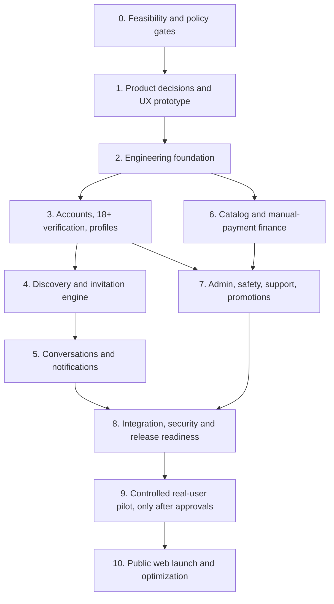

# XORA — Development Phases, Milestones & Launch Plan

**File:** `PHASES.md`  
**Version:** 1.0  
**Prepared:** 22 November 2026  
**Status:** Proposed execution plan, not a commitment or an active project schedule  
**Companion specifications:** `PRD.md` v1.2, `ARCHITECTURE.md` v1.0, `DATABASE_SCHEMA.md` v1.0, `API_SPECIFICATION.md` v1.0, `TECH_STACK.md` v1.0  
**Product:** XORA responsive **web app**. One account for Date / Casual / Both, free registration, renewable Connect passes, optional profile promotions and manual Mobile Money review.

> **Phase 1 design handoff update (22 November 2026):** `XORA_PHASE1/` now contains a responsive interactive prototype, UI design system, all-screen inventory, member/admin UX journeys, manual-payment blueprint, copy/state library, mockup boards and acceptance evidence. Static logic checks passed. **Formal Phase 1 gate is still pending** founder sign-off, observed real-device usability/accessibility testing and prerequisite Phase 0 legal/merchant decisions. See `XORA_PHASE1/PHASE1_ACCEPTANCE.md`.

> **Phase 2 deep engineering design update (22 November 2026):** `XORA_PHASE2/` now contains a detailed implementation blueprint, data/API foundation contracts, threat model and privacy controls, deployment/restore runbook, 53 engineering tickets, 52 proposed acceptance tests, ADR/decision register, traceability matrix and architecture diagrams. This is **DESIGN ONLY**: no XORA server, production database, payment workflow or deployed staging instance is implemented or validated by this document package. Formal Phase 2 exit remains pending built code, actual test evidence and sign-off. See `XORA_PHASE2/README.md`.

> **Launch boundary:** XORA in these documents is a legally permitted adult dating/casual-connection service only. It does **not** arrange paid sexual services or escort bookings. Manual verification of payments does not waive mobile-money provider rules or legal requirements. Until legal, receiving-account, hosting and data-protection approvals are complete, work may proceed only with **synthetic data, fake payments and a non-public demonstration**.

---

## 1. Purpose: how to use this plan

This is a **delivery roadmap** that converts the PRD's journeys, the architecture's modules, the database design and the API contract into a build order. Every phase contains: objective; what to deliver; priority workflows; explicit success/exit criteria; dependencies; staff responsibilities; and risks or things that must not be done yet.

This is not a funding estimate and does not claim that development, hosting or verification are free. A founder and engineering lead should turn each phase into tickets with an owner, test evidence, dependencies and budget; no phase is “done” just because the user interface looks finished.

### Key rules carried through every phase

1. One responsive **web app**, not separate native Android/iOS apps.
2. One XORA member identity with Date, Casual, Both intentions.
3. Free joining and ordinary member visibility, subject to approved adulthood/profile status.
4. First **accepted** eligible outgoing invitation is free **once per account**; rejection/expiry does not consume it.
5. Incoming invitations and replies to existing conversations are free, including after a paid pass expires.
6. Connect Week **UGX 10,000 / 7 days**; Connect Month **UGX 25,000 / 30 days**; Connect Quarter **UGX 60,000 / 90 days**.
7. Optional VIP Week **UGX 20,000 / 7 days**; Spotlight Month **UGX 50,000 / 30 days**; VIP Month **UGX 80,000 / 30 days**.
8. Manual Mobile Money transfer, order reference, member submission, independent settled-funds verification, admin approval, then single entitlement grant. **No gateway, wallet or auto-renewal.**
9. Safe identity handling, staff MFA, access controls, audit trail, complaints and refunds are essential product scope—not later add-ons.
10. Verified eligibility and consent always override payment or promotion.

---

## 2. The roadmap in one view

### Where this fits the existing ARCHITECTURE.md

| Architecture delivery stage | Detailed stages here |
|---|---|
| Architecture Phase 0: approvals | Phase 0 |
| Architecture Phase 1: prototype + skeleton | Phases 1–2 |
| Architecture Phase 2: member MVP | Phases 3–5 |
| Architecture Phase 3: commerce + admin MVP | Phases 6–7 |
| Architecture Phase 4: controlled pilot | Phases 8–9 |
| Architecture Phase 5: expansion | Phase 10 and future backlog |

**Planning note:** Phases are **dependency gates, not rigid calendar promises**. Engineering can design components and write synthetic tests in parallel, but a real paid pilot cannot skip legal/provider approval, finance reconciliation tests or adult-safety controls.

---

## 3. Roles and accountability

| Role | Accountable for | Minimum review points |
|---|---|---|
| Founder / product owner | Brand, final business rules, budgets, sign-off, review hours, promotions and refunds | Each phase gate, especially prices and public launch |
| Product/UX designer | Member and admin flows, mobile design, accessibility, copy, usability tests | Phase 1, 3–7, 8 |
| Full-stack engineering lead | Code structure, API/DB integrity, security, deploys, evidence of tests | Phases 2–10 |
| QA / test owner | Acceptance scenarios, regression, manual device testing, defect evidence | Every implementation phase; major gate Phase 8 |
| Finance operations owner | Authorized recipient, manual account reconciliation, refunds, exception queues | Phases 0, 6–10 |
| Safety / verification lead | Adult assurance, profile review, reports, appeals, evidence retention | Phases 0, 3, 7–10 |
| Privacy/legal adviser | Lawful scope, notices, data processing, retention, receiving-account and host restrictions | Phase 0 and before pilot/public launch |
| Support operator | Member help, payment corrections, privacy request intake | Phases 7–10 |

A small team can combine people in different roles, but **must preserve separate application permissions** and log privileged actions. Where one person is both owner and finance reviewer, document compensating checks and use two-person approval for payee changes/refunds when practical.

### Working cadence

- Plan short work cycles (e.g., weekly review or a two-week sprint if the team prefers).
- Every work item needs: linked PRD requirement, UI/API/data impact, accepted definition, owner, test and release risk.
- Demonstrate a working increment in staging, not screenshots alone.
- Keep a list of risks, open product decisions and departures from the approved PRD.
- Never declare a payment or consent feature finished without its negative-path and concurrency tests.

---

## 4. Phase 0 — Validate legality, operations, name and vendors

**Goal:** Decide whether XORA's actual proposed business can legally and commercially operate and safely handle real personal and financial records. This phase can include research and synthetic prototypes but **not** a live marketplace or actual payment acceptance.

### Product / legal / vendor tasks

- [ ] Obtain Uganda-qualified legal review of the actual Date/Casual business, advertising, content policy and any prohibited sex-work facilitation; remove unsupported functionality.
- [ ] Confirm what constitutes adequate adulthood verification and necessary moderation/reporting procedures.
- [ ] Clarify personal data-processing obligations, PDPO registration, consent, transparency, cross-border transfers and retention obligations.
- [ ] Check XORA brand, URSB/trademark conflicts and domain availability before investing in brand or DNS.
- [ ] Obtain acceptable-use approval for hosting, storage, authentication and email vendors for the **actual** content/service.
- [ ] Obtain consent/authorization for receiving business payments through the proposed MTN/Airtel payment account. Do not assume a personal account is a compliant merchant account.
- [ ] Define the official recipient name/number/code management process and how an admin independently checks settled incoming funds.
- [ ] Approve actual support/finance review hours, complaints process, refunds and overpayment/wrong-recipient handling.
- [ ] Confirm staffing capacity for payment reconciliation, verification and safety reports.
- [ ] Confirm proposed product prices and what “VIP” actually does; do not promise matches or sexual services.

### Deliverables

1. Signed/off-recorded **business scope and compliance decision** (go / revise / stop).
2. Written vendor/merchant feasibility register with owner and evidence links.
3. Approved product-catalog sheet and manual-payment receiving-account policy.
4. Preliminary privacy notice, community standards, age-assurance method, refund policy and data-retention schedule (reviewed by counsel).
5. Launch budget categories and staffing plan.

### Exit criteria

**GO:** The intended product/receiving account/providers are approved, policies and operational owners exist, and the founder authorizes implementation.  
**CONDITIONAL:** If anything remains unresolved, engineers may build only synthetic-data demo features and staging tests, with production payment/real-user onboarding disabled.  
**STOP:** If the actual activities or receiving-payment methods are not permitted, revise or abandon those activities; do not disguise the service to bypass rules.

---

## 5. Phase 1 — Finalize product UX and complete the design system

**Goal:** Turn the PRD into approved, testable mobile web journeys before engineering builds them.

### Design deliverables

- [ ] Page inventory and route map for public, member and admin areas; match `ARCHITECTURE.md` §7.
- [ ] Information architecture: home, eligibility, signup, Date/Casual/Both setup, profiles, discovery, invitations, messages, membership, payment history, help and account settings.
- [ ] Admin route map: dashboard, member queue, finance queue, settlements, refunds, VIP campaigns, reports, tickets, staff/configuration.
- [ ] Brand/UI tokens: colors, typography, spacing, controls, focus and error states, photo crops, responsive breakpoints, dark/light behavior if offered.
- [ ] End-to-end mobile wireframes for first visit → signup → verified adult account → first accepted introduction → chat → Connect Pass.
- [ ] Separate manual checkout wireframes for (a) choose plan, (b) show trusted payee/reference, (c) submit details/evidence, (d) pending, (e) correction, (f) approved, (g) renewal, (h) refund.
- [ ] Admin finance review screens displaying order, evidence, independent official settlement match, duplicate flags, reason notes and final activation.
- [ ] Safety/verification wireframes including rejections, appeals, pause/delete and serious-report flows.
- [ ] All empty, loading, offline, partial, failed and permission-denied states.
- [ ] Usability walk-through on low-cost mobile screen sizes and narrow bandwidth; fix confusing pricing or trust language.

### Product decisions to close

- Invitation expiration window; daily rate/spam limits; discovery ranking fairness; what counts as a verified badge; supported genders/preferences; photo limits; profile visibility policy.
- Handling renewals across different tiers and purchased VIP slot overlap.
- Clear terms for unpaid reply rights, promotions and benefit expiry, in plain language.
- Policies for undiscoverable/suspended users who submitted payments.

### Exit criteria

- Founder signs off responsive prototype and every paid/right-sensitive copy state.
- Each core PRD journey has a wireframe and a testable acceptance statement.
- Accessibility design review has no obvious blockers; no public personal-data directory is designed.
- Engineering identifies data/API/UI dependencies and unresolved questions.

---

## 6. Phase 2 — Engineering foundation and safe deployment pipeline

**Goal:** Deliver a secure, deployable skeleton before loading personal-data and payment features into it.

### Build deliverables

- [ ] One Git repository using a TypeScript + Next.js modular structure from `TECH_STACK.md`.
- [ ] Approved, pinned dependency/compatibility matrix: Node LTS, Next.js patch release, Drizzle, PostgreSQL, auth library, tests.
- [ ] Design tokens, accessible layout shell, reusable form and status components.
- [ ] Three isolated environments (local, staging, production placeholder), with secrets and environment validation.
- [ ] Managed PostgreSQL development/staging connection, reviewed migration process, synthetic seed catalog and automated backup/restore rehearsal.
- [ ] Authentication proof-of-concept: session, email verification and protected `/api/v1` route.
- [ ] Server-side permission guard and typed validation/errors; idempotency-key handling pattern.
- [ ] Private file upload proof-of-concept (no public receipt or ID URLs).
- [ ] Background worker or scheduled runner, outbox event and generic test email.
- [ ] CI: lint, typecheck, unit tests, DB integration tests, build and smoke tests.
- [ ] Redacted logging, uptime alerts and safe error responses.

### Test cases

- A logged-out user cannot access a member endpoint; a member cannot access staff routes.
- Staging never contacts real payees/real members from synthetic orders.
- Secret values are not exposed in frontend bundles or logs.
- Two requests using the same idempotency key cannot duplicate a protected test mutation.
- A backup restores into a clean test database and passes a smoke query.

### Exit criteria

- Staging web app deploys reproducibly from Git, with a working API, migration/test run and private storage.
- The security/auth/infrastructure lead reviews access and deployment configuration.
- The owner has access to an operations summary without privileged secrets.

---

## 7. Phase 3 — Registration, adult eligibility, profiles and account privacy

**Goal:** Eligible adults can safely create and manage a genuine member profile. No matching, payments or member contact should be enabled until identity/eligibility controls operate.

### Member stories

1. Visitor reads policies and understands who XORA is for.
2. Visitor registers with an email and password, verifies email, accepts essential terms and selects any separate optional communications consent.
3. Member enters only necessary onboarding details; Date/Casual/Both choice affects discovery but is not publicly broadcast without warning.
4. Member saves a draft, uploads permitted photo(s), selects approximate location, preferences and visibility settings.
5. Age/identity eligibility checks and profile review are separate; unapproved content is not discoverable.
6. Member receives a clear approval, correction request, rejection/appeal option or wait status.
7. Member edits, pauses, changes intention, secures or requests deletion/export of account within policy.

### Build deliverables

- [ ] Registration, login, verified email, recovery and session/device management.
- [ ] Resumable profile wizard with optional data minimization.
- [ ] Server-side eligibility and 18+ review workflow; no auto-publication before required checks.
- [ ] Approved photo transformation and private pending-photo review.
- [ ] Profile lifecycle states (draft, review, approved, active, paused, restricted, rejected).
- [ ] Privacy controls and request ticket initiation.
- [ ] Restricted reviewer queue and evidence-access audit logs.
- [ ] Member settings, pause, export/deletion request and standard support link.

### Database / API scope

Accounts, sessions, consents, preferences, profiles, photos/media, age/identity review outcomes, audit events, privacy requests; corresponding `/auth`, `/me`, `/profiles`, media and initial `/admin/reviews` endpoints in `API_SPECIFICATION.md`.

### Exit tests

- Unverified or underage/uncertain account cannot become discoverable or initiate invitations.
- A member cannot read another member's private email, DOB, verification files or receipt information.
- Paused/banned profiles disappear promptly from results.
- Reviewer sees only minimum evidence necessary; evidence access is audited.
- Wrong photo type or oversized upload rejected without exposing files.
- The entire mobile onboarding path works under simulated slow network and retry.

---

## 8. Phase 4 — Date/Casual discovery, eligibility filtering and introductions

**Goal:** Members discover mutually eligible profiles and make a first free outgoing introduction safely. This is the heart of the dating product.

### Discovery build

- [ ] Search and filter by Date/Casual/Both, appropriate preferences and approximate area.
- [ ] Two-way compatibility checks before ranking; enforce visibility and verified eligibility every time.
- [ ] Profile cards and detailed profiles with approved photos, accurate verification/activity labels and reporting access.
- [ ] Save/unsave or Like if the PRD includes it; do not confuse a Like with an invitation or chat entitlement.
- [ ] Useful no-results state, blocklists, existing match exclusion and pagination.

### Invitation logic

- [ ] Outgoing request eligibility checked on the server, not merely hidden UI buttons.
- [ ] Exactly one **active pending** free introduction allowed as defined in the schema; first accepted outgoing request consumes free benefit once.
- [ ] Rejection, withdrawal and expiry release a pending free slot without consuming benefit.
- [ ] If first accepted outgoing connection already used, sending a new outgoing invitation requires an **active Connect Pass**.
- [ ] Incoming requests can be accepted/declined and replied to without purchasing.
- [ ] Block and safety restriction override every invitation action.
- [ ] Store historical invitation states and sender/recipient event audit details without unnecessary sensitive data.

### Critical tests

- Two simultaneous acceptances cannot consume two free introductions or open duplicate conversations.
- Member cannot invite hidden, ineligible or incompatible profiles via a direct API call.
- A blocked/restricted member cannot bypass a sanction using a paid pass or a copied URL.
- Paid-pass expiry never invalidates a previously legitimate pending invitation.
- VIP placement, when later enabled, never inserts an ineligible profile.

### Exit criteria

- Staging demo with two synthetic adult profiles completes a legitimate accepted free introduction and rejects a second outgoing introduction absent Connect entitlement.
- All invitations operate correctly under retries/concurrent requests.

---

## 9. Phase 5 — Messages, notification preferences and connection management

**Goal:** Accepted members can safely communicate with one another without exposing private contact details by default.

### Build deliverables

- [ ] Conversation created only from accepted invitation.
- [ ] Participant-only message list, send, pagination, unread counts and server timestamps.
- [ ] Bounded/adaptive polling (WebSockets not necessary at MVP).
- [ ] Error/retry states with message idempotency; protect against accidental duplicate sends.
- [ ] Ignore/mute, unmatch, block and report actions; enforce on subsequent reads/writes.
- [ ] Sanitized text, size limits, basic spam/harassment detection and moderation reporting hooks.
- [ ] Generic transactional notification templates and optional-notification controls.
- [ ] Public-facing safety advice about off-platform contact, scams and consent.

### Exit tests

- Neither an unrelated member nor a support staffer can read a chat without an authorized case basis.
- User cannot message a match after being blocked/unmatched when policy forbids it.
- Active and expired Connect Pass holders can reply to **existing** conversations.
- Email subjects and notification previews do not disclose Date/Casual mode or conversation content.
- Duplicated message requests do not create duplicate messages.

---

## 10. Phase 6 — Renewable passes, manual payments, reconciliation and finance

**Goal:** Members buy allowed timed features using an approved external Mobile Money recipient; finance reviews real incoming funds and the app grants rights exactly once.

**This phase may be built with fabricated transactions at any time after Phase 2, but must remain in synthetic/test mode until Phase 0 approvals are complete.**

### 6A. Product catalog and entitlement engine

- [ ] Seed versioned SKU catalog with Connect Week/Month/Quarter and VIP/Spotlight products exactly as in PRD v1.2.
- [ ] Order records freeze the selected price, term, recipient identifier and policy version; price not client-editable.
- [ ] Entitlement checks use UTC start/end instants; render exact EAT dates.
- [ ] Active pass authorizes additional outgoing invitations; no pass required for incoming/replies.
- [ ] Early same-tier renewal starts after existing expiry; a changed-tier decision requires agreed fair rules.
- [ ] Expired pass never blocks existing conversation; canceled/suspended rights handled by separate policy.

### 6B. Member payment journey

- [ ] Membership page displays Free/Connect/Promotion separately and clearly labels optional renewal.
- [ ] Create unique order/reference and display authorized recipient, provider, amount, name and payment safety instructions.
- [ ] Member externally transfers using their own provider; enters transaction reference, payer/approximate time and optional private screenshot.
- [ ] Member sees pending, needs-more-information, under-review, approved, held, refund/rejected states with clear support actions.
- [ ] Payment retry is idempotent; member never needs to pay again just because a page failed.
- [ ] Receipt page shows approved date range and status, not sensitive full bank statement details.

### 6C. Finance and settlement workflow

- [ ] Finance staff reviews **official external receiving-account history** independently of user screenshots.
- [ ] Record a trusted settled transaction and allocate it to an order only once.
- [ ] Confirm matched amount/recipient/provider/reference and eligibility. Hold if mismatched.
- [ ] Approval occurs as one transaction: allocate verified settlement → mark order approved → create exactly one entitlement/campaign → audit reviewer → enqueue generic notification.
- [ ] Investigate duplicates, underpayments, overpayments, wrong payee, payment delays, reversals, refunds and recipient-account changes.
- [ ] Admin can trace transfer to order to paid rights and refund, with audit and daily reconciliation.
- [ ] Changing official receiving details requires strong permissions, audit, member notice and ideally second-person approval.

### Critical tests

- Fake proof with no settled funds cannot be approved.
- Duplicate settled transaction ID cannot be allocated to two orders.
- Concurrent admin approval clicks produce **one** grant, one audit decision and no double extension.
- Received transfer of the wrong amount is held, not silently accepted.
- A pass purchased while account is ineligible is not activated until policy requirements are met or a documented refund/resolution occurs.
- Scheduler delay does not extend expired entitlements or shorten correctly queued renewals.
- Order can safely remain pending during finance staff absence; app shows true status.
- Refund is auditable and cannot be created by changing display status only.

### Exit criteria

- End-to-end synthetic order → proof claim → independent fabricated bank/provider settlement → finance approval → active timed benefit → expiry/renewal passes tests.
- Finance operator completes a supervised exception-handling walkthrough.
- Legal/merchant approvals and tested control procedures are signed off before any real-money transition.

---

## 11. Phase 7 — Promotions, full admin workspace, safety and member support

**Goal:** Finish the operational tools necessary to run XORA safely as a business rather than relying on engineers or manual database edits.

### 7A. Premium visibility

- [ ] VIP Week, Spotlight Month and VIP Month have visibly distinct, truthful benefits and exact dates.
- [ ] Only approved eligible members can appear in promoted placement slots.
- [ ] All paid placement clearly labeled; rotation and caps do not drown out ordinary users.
- [ ] Promotion starts upon actual payment approval (or queues under a disclosed schedule); expiry automatic by timestamp.
- [ ] Campaign owner sees simple privacy-respecting impressions/engagement data, not other users' private behavior.

### 7B. Operations dashboard

- [ ] Overview: urgent review counts, safety alerts, payment aging, queue status, recurring errors.
- [ ] Member/profile and 18+ review queue; correction, rejection and appeal handling.
- [ ] Finance queue, settlement workbench, payment exceptions, daily reconciliation report and refunds.
- [ ] Product catalog maintenance and promotion management.
- [ ] Reports, blocks, sanctions, appeals and evidence-access records.
- [ ] Support tickets, privacy/deletion/export requests and standardized messages.
- [ ] Staff invitations, permission scopes, mandatory MFA, audit log and offboarding.
- [ ] Receiving-account/configuration changes with strict authorization.
- [ ] Safely editable FAQs, support hours, generic notification templates and site status.

### 7C. Safety and abuse operations

- [ ] Report/block reachable from profile, chat and support entry points.
- [ ] Separate queues and priority rules for suspected minors, coercion, impersonation, abuse and payment fraud.
- [ ] Restrict unsafe profiles even if VIP or Connect period is active; resolve commercial impact fairly under policy.
- [ ] Document case evidence access, appeals, proportional sanctions and privacy holds.
- [ ] Run staff tabletop exercises for an underage report, stolen identity, leaked receipt and payment-recipient compromise.

### Exit tests

- Staff users cannot access controls outside their defined role even by calling API directly.
- A safety restriction overrides VIP placement and invitations.
- Finance can verify settlement but cannot bypass identity restrictions.
- Support can explain status without accessing raw IDs or business-account statements unnecessarily.
- Every high-risk admin action records actor, timestamp, reason and previous/new status.
- Paid VIP placement never violates two-way discovery/consent filtering.

---

## 12. Phase 8 — Integration, security, accessibility and launch rehearsal

**Goal:** Prove the *whole system* works, including failures, before it is entrusted with real identities and transfers.

### Complete end-to-end journeys

- [ ] New member: public site → register → email verify → 18+ assurance → profile approval → Date/Casual choice → discover → first accepted outgoing invitation → conversation.
- [ ] Returning free member: receives invitation, accepts and replies with no charge.
- [ ] Paid member: attempts second outgoing invitation → Connect paywall → order → manual transfer claim → finance verification → pass activation → new invitation.
- [ ] Early renewal: old paid time preserved; second period starts when expected.
- [ ] VIP: promotion paid/verified/approved → labeled eligible placement → automatic end; sanctions override placement.
- [ ] Admin: independent settlement, mismatch, duplicate, refund, reversal and recipient change process.
- [ ] Member safety: report, block, appeal, pause, privacy request and deletion review.

### Non-functional testing

- [ ] OWASP-informed security review: broken object-level authorization, CSRF, authentication abuse, upload attack, session theft, rate limiting, finance race conditions.
- [ ] Privacy review: no search indexing of private profiles, receipts or chats; data minimization and approved vendor transfers.
- [ ] Accessibility: WCAG 2.2 AA-oriented checks and manual keyboard/screen-reader paths.
- [ ] Performance on slow 3G/4G emulation, small mobile screens and reduced data conditions.
- [ ] Restore encrypted database backup to a fresh environment; test member/finance data integrity.
- [ ] Fault drills: email down, worker down, provider statement delayed, DB unavailable, mistaken approval, stale admin page, staff role revoked.
- [ ] Full automated regression in CI plus manual real-device smoke tests.
- [ ] Security patch and dependency review, secrets rotation test, operational alert routing.

### Required release documents

1. Final coverage sheet matching PRD journeys to implementation and tests.
2. Signed privacy/security/age-assurance review and applicable approvals.
3. Production runbook: deploy, rollback, backup restore, jobs, notifications, finance queue, incident handling.
4. Support and staff training materials, escalation contact list and published review hours.
5. Release checklist, known issues with severity and explicit founder go/no-go sign-off.

### Hard blockers

**No release** with: underage exposure, unauthorized private-data access, missing staff MFA, fake-receipt auto-approval, duplicate entitlement grants, failure to enforce free-invite limit, untested backups, unresolved critical security defects, disallowed provider use, or absent legally required approvals.

---

## 13. Phase 9 — Limited controlled pilot (only after approvals)

**Goal:** Observe real authorized adult users on an intentionally small scale, verify safety workload and measure willingness to pay and renewal behavior. A public launch follows only if evidence supports it.

### Pilot boundaries

- Focus on a small geographic area (e.g., Kampala) and invite a controlled group of verified adults. Do **not** fabricate member profiles or engagement.
- Published staffed finance review hours and a real support/contact path.
- Limit promotional slots and order volumes to reviewer capacity.
- Never relax safety verification to increase signups.
- Keep active alerting for financial mismatches, report severity, staff queue backlog and data incidents.
- Review product copy when users misunderstand the free invitation, expiry or payment approval time.

### Pilot success scorecard (founder to approve thresholds)

| Area | Measure | Interpretation / action |
|---|---|---|
| Supply quality | Approved profiles active in the pilot area | Too few active profiles means discovery disappointment |
| Onboarding | Visitor→verified→approved completion | Identify confusing or unnecessary steps without weakening assurance |
| Discovery | Eligible results, profile views, invitations sent | Shows whether matching preferences are workable |
| Connection quality | Invitation acceptance and reply rates | Valuable connections matter more than traffic |
| Free-to-paid | Eligible members purchasing a Connect pass | Tests hypothesis of post-free-invitation demand |
| Renewals | Share of expired-pass users renewing | Tests renewable model; never assume retention |
| VIP value | Promotion uptake and permitted engagement uplift | Avoid selling a package without measurable value |
| Payments | Pending age, verified-match rate, discrepancies, refunds | Shows whether manual review is commercially manageable |
| Safety | Reports per active members and resolution age | Ensure operations scale with demand |
| Reliability | Critical errors, failed jobs, outage time, load speed | Finds engineering risks before growth |
| Privacy | Rights requests and evidence retention exceptions | Check compliance and trust |

**Thresholds are to be agreed after estimating realistic traffic and staffing; the PRD does not provide proven baselines.** Do not manufacture success targets and call them market data.

### Pilot exit decision

- **Go:** Compliance, safety, finance correctness, usability and operating capacity meet signed criteria.
- **Iterate:** Users do not pay/renew or queues age too long; improve product/process, repeat pilot.
- **Pause:** Serious user harm, illegal use, provider objection, private-data exposure, widespread fabricated receipts or financial mismatch.

---

## 14. Phase 10 — Public web launch and post-launch optimization

**Goal:** Grow XORA only as fast as its verification, safety, payment reconciliation and infrastructure can support.

### Release day checklist

- [ ] Official domain and brand cleared, DNS/HTTPS correct, public pricing/policies reviewed.
- [ ] Legal, privacy and provider approvals on file for actual operation.
- [ ] Production database and private storage separate from staging; tested restore.
- [ ] All staff MFA and least privilege; recovery and offboarding instructions.
- [ ] Payment recipient fully verified, details displayed securely, finance queue staffed.
- [ ] Registration, connection, membership/expiry, VIP and moderation smoke tests passing.
- [ ] No real-user personal data in logs, screenshots, test accounts or public caches.
- [ ] Monitoring, abuse reports, support, urgent incident response and site status active.
- [ ] Founder approves release, promotion copy and operational commitments.

### First operational priorities after launch

- Daily: reconcile incoming money and unmatched transfers; review urgent safety reports, aging pending applications and failed jobs.
- Weekly: examine approved-member supply, legitimate connections, conversion, renewals, refunds, spam patterns and reliability.
- Monthly: financial reconciliation, access reviews, evidence-retention purge, backup restore spot-check, security patch review, provider/infrastructure spend and product backlog.
- Quarterly or per policy: privacy/legal review, staff access recertification, incident rehearsal and vendor review.

### Expansion rules

Do not build native apps, video calls, AI matching, user wallets, geolocation tracking, elaborate recommendation systems or integrated payment gateways just because they appear impressive. Introduce new technology only when the pilot evidence and legal/vendor permissions justify it. Changes to pricing, paid rights or free invitations require an updated PRD, architecture, database contract, API tests and member notice where relevant.

---

## 15. MVP scope versus later backlog

| Feature | MVP required? | Why |
|---|---|---|
| Public brand/prices/policies/help pages | **Yes** | Trust and compliance |
| Verified login, age assurance, basic profile | **Yes** | Adult-only and authentic participation |
| Date/Casual/Both discovery and privacy filters | **Yes** | Core XORA differentiator |
| First accepted outgoing free invitation | **Yes** | Core commercial rule |
| Incoming invitation and established chat free | **Yes** | Fair member experience |
| Text chat and block/report | **Yes** | Value and safety |
| Manual orders, evidence, finance approval | **Yes if monetizing** | No gateway MVP, no unverifiable receipts |
| Renewable Connect Week/Month/Quarter | **Yes if monetizing** | Revenue logic |
| VIP/Spotlight with labels/fair rotation | **Yes if selling promotions** | No misleading paid placement |
| Staff MFA, case queues, role permissions, audit | **Yes** | Secure operations |
| Refund/exception workflow, backups, privacy handling | **Yes** | Operational and legal safety |
| Push notifications / installable PWA extras | Later | Web push optional; permission/privacy constraints |
| Video/voice calls | Later / likely not initial | Higher moderation and infrastructure costs |
| Complex AI recommendations | Later | First prove basic eligible matching |
| Dedicated search engine | Later | Optimize Postgres first |
| WebSocket/chat service | Later | Polling enough for initial controlled pilot |
| Native Android/iOS | Not in current project | User requested web app only |
| Automated financial integration | Later **only if approved** | Provider permission and fraud controls required |
| Escort booking, paid sexual-service catalog | **Excluded** | Outside approved product boundary |

---

## 16. Dependency map and parallel work

| Workstream | Depends on | May run in parallel with |
|---|---|---|
| Brand/legal/merchant feasibility | Founder and qualified review | Synthetic UX prototypes, risk register |
| Design system and user journeys | PRD product decisions | Vendor research, architecture proof-of-concept |
| Auth and basic infrastructure | Technology choice and repository | Component design and synthetic testing |
| Adult assurance/profile review | Auth + privacy policy decisions | Catalog prototype with fake transactions |
| Discovery/intro engine | Approved profiles and schema | Finance module development using fake orders |
| Chat | Accepted invitation contract | VIP sponsored placement work |
| Payment finance module | Catalog, DB locks, roles and merchant/process approval | Member discovery, messaging work in staging |
| Full admin/safety | Auth, profiles, finance data schemas | Frontend design refinements |
| Security/QA integration | Feature-complete staging | Staff policy/runbook preparation |
| Real-user pilot | All P0 compliance/safety/finance/recovery gates | No unresolved compliance dependencies |
| Public launch | Successful controlled pilot + founder approval | Subsequent optimizations only after launch readiness |

**Critical path:** compliant operating model → approved identity and secure system foundation → eligibility/profile → invitations/messaging → manual payment/finance correctness + admin moderation → integration and recovery testing → controlled pilot → launch. Some streams can parallelize, but none can be skipped.

---

## 17. Delivery tickets: definition of ready and definition of done

### Definition of ready

A story is ready when it names: member/staff role; action and intention; relevant policy/entitlement; PRD chapter; API endpoint; database owner; permission rule; empty/negative state; test examples; and known vendor/compliance dependency.

### Definition of done

A story is done only if:

- [ ] Correct mobile and desktop UI exists, including loading/error/empty states.
- [ ] Server-side authorization and validation are implemented.
- [ ] Database transaction/constraints protect relevant state changes.
- [ ] API response matches `API_SPECIFICATION.md`, or documented change is agreed.
- [ ] Automated unit/integration/contract/E2E tests cover normal and abuse cases.
- [ ] Accessibility and privacy concerns are reviewed; no sensitive log leaks.
- [ ] Staff/user-facing wording is accurate, especially money and availability statuses.
- [ ] Audit and supportability are in place for privileged or financial actions.
- [ ] Feature demonstrably works in staging on mobile with fabricated data.
- [ ] Changelog, operations/runbook and documentation updated as applicable.

---

## 18. P0 acceptance test register (must not be deferred)

| ID | Scenario | Expected result |
|---|---|---|
| T01 | Visitor browses public pages | No private member profile or payment evidence visible/indexed |
| T02 | Underage/unverified tries publishing | Blocked pending adequate approval |
| T03 | Approved member changes Date↔Casual | One account; appropriate matching/privacy rules updated |
| T04 | Blocked user searches or deep-links profile | Target omitted/denied |
| T05 | First free outgoing invite rejected | Free acceptance benefit remains unused |
| T06 | First free outgoing invite accepted | Free acceptance consumed exactly once; single chat created |
| T07 | Two concurrent first-free acceptances | At most one accepted free benefit |
| T08 | Member after free use invites without Connect Pass | Server returns pass-required; no invitation sent |
| T09 | Free member receives invitation | Can accept and reply without payment |
| T10 | Paid pass expires | New outgoing gated, existing chat continues |
| T11 | Early renewal approved | All remaining old days preserved; next period queued |
| T12 | Member submits fake screenshot | No entitlement without independently verified funds |
| T13 | One transfer claimed for two orders | Only one allocation; second flagged |
| T14 | Two staff click approve simultaneously | Single order status/grant with audit trail |
| T15 | Partial/overpaid transfer | Held and documented resolution/refund; no silent change |
| T16 | Wrong recipient paid | XORA does not mark as received; provide provider help guidance |
| T17 | Payment admin tries profile approval | Denied unless separately authorized |
| T18 | Support user opens raw ID evidence | Denied and logged |
| T19 | Paid VIP profile becomes suspended | Removed from discovery/promoted slots immediately |
| T20 | Account requests pause/deletion | Discovery blocked; lawful rights workflow recorded |
| T21 | Server job delayed at expiry | Request-time entitlement check still denies expired rights |
| T22 | Staff changes official payee | Strong role check, audit, dual review where established; old orders preserved |
| T23 | Database backup restored | Records, entitlements and settlement uniqueness intact |
| T24 | Low-bandwidth checkout request repeats | One order/submission, honest pending UI |
| T25 | Member tries reading someone else's payment order | Denied without sensitive data disclosure |
| T26 | Live data accidentally sent to analytics | Test prevents/flags privacy leak; do not release |
| T27 | Privileged staff account missing MFA | Staff operations denied |
| T28 | Existing conversation receives block | Future messages not permitted; case policy applied |
| T29 | Member refund after approval | Reconciled finance event and fair entitlement decision |
| T30 | Promotion ranking | Only eligible mutually compatible profiles; clearly labeled sponsored |

Expand this register into feature-level automated tests before Phase 8. Other acceptance tests already exist in `ARCHITECTURE.md` and `API_SPECIFICATION.md`.

---

## 19. Risks, early warnings and mitigation

| Risk | Early warning | Response |
|---|---|---|
| Business/payment provider prohibits service | Refusal or unclear acceptable-use response | Stop real-money launch; redesign lawful model; no circumvention |
| Lack of genuine members | Many empty results, poor reply rate | Focus geography, verify real activity; do not invent profiles |
| Payment screenshot fraud | Mismatch between claims and official statement | Independent finance check, unique allocations, slow down reviews safely |
| Manual reviews create long delays | Aging queue and support complaints | Publish real staffed hours, add reviewer capacity, improve submission clarity |
| Underage/impersonation risk | Suspicious profiles, severe reports | Strong eligibility checks, evidence review and urgent escalation |
| Data leak or staff misuse | Unusual access/exports | Least privilege, audited evidence access, incident response and training |
| Admin concentration of power | Unreviewed payee change/refund | Split roles, MFA, dual control and regular audit |
| Price resistance / weak retention | Low Connect conversion or renewal | Test pricing and value, revise PRD transparently |
| Poor mobile performance | Abandonment, slow media delivery | Image optimization, smaller bundles, network testing |
| Provider outage | Delayed DB/email/receipts | Honest status page, no optimistic approvals, recovery playbook |
| Team scope creep | Features added before P0 tests | Strict MVP backlog and founder sign-off |
| Legal/privacy changes | New rule or regulator contact | Reassess compliance, stop affected activity until cleared |

---

## 20. Project controls and reporting

### Founder dashboard for project delivery

At each review, report: phase and gate status; accepted/rejected deliverables; open high-severity bugs; unanswered legal/provider decisions; budget spent vs approved budget; security/privacy unresolved items; changes to PRD/price; and next phase dependencies. Avoid presenting a percent-complete number without validated acceptance criteria.

### Work item numbering convention

- `XORA-P0-###` feasibility and vendor approval
- `XORA-UX-###` design and content
- `XORA-CORE-###` identity/profiles/eligibility
- `XORA-DISC-###` discovery and invitations
- `XORA-CHAT-###` messaging
- `XORA-PAY-###` orders, settlement, membership, refund
- `XORA-ADMIN-###` staff permissions, moderation, support
- `XORA-SEC-###` security/privacy/incident controls
- `XORA-QA-###` tests, pilot, launch

Use one issue tracker; every ticket links the PRD/architecture section and its acceptance test.

### Change control

For any substantial new feature, record: reason, user value, harm/privacy risks, required legal/merchant check, effect on products/prices, API/data migrations, staffing workload and whether it delays P0 launch scope. Changes to the one-free-accepted-invitation rule or manual payment verification require specific founder and finance approval.

---

## 21. Resource and timing planning assumptions

Do not treat a precise launch date or price as guaranteed without vendor approvals and a real development team. Phase durations vary with developer experience, quality of existing UI assets, adult-verification method, availability of review staff and payment-provider acceptance.

Suggested way to estimate **after Phase 1**:

1. Break each phase into testable tickets, assigning low/medium/high complexity with confidence.
2. Identify parallel and sequential tasks in the dependency map.
3. Add explicit time and budget for review, accessibility, security tests, failed uploads, fraud cases and recovery drills.
4. Keep contingency for legal/provider and verification decisions that can block the entire project.
5. Publish an internal milestone forecast only after the team has delivered one completed vertical slice (registration and a protected DB/API operation).

**Pilot staffing minimum:** someone accountable for 18+ verification and serious reports; a trained finance reviewer with official account access; member support coverage; engineering incident response; and privacy/legal escalation. These may be part-time roles depending on volume, but cannot be purely imaginary names on a dashboard.

**Budget priorities, in order:** legality and approved receiving path; member safety/age assurance; secure hosting and recoverable data; core matching; transaction integrity; staff operations; marketing and optional enhancements. A low-budget build should reduce extra features, **not** remove independent payment verification or basic user safety.

---

## 22. Cross-document traceability

| Main requirement | PRD | Architecture | Database | API | This phase plan |
|---|---|---|---|---|---|
| One app, Date/Casual/Both | §§1–6 | §§1,7,10 | Account/profile/preferences tables | Profiles/discovery | 1, 3, 4 |
| Registration and adult eligibility | §§10–12 | §§9,16,18 | Accounts/verification | §§3–4 | 0, 3, 7 |
| One first accepted outgoing free | §14 | §11 | Invitation/free-right constraints | §5 | 4, 8 |
| Incoming and existing chats free | §§14–15 | §§11–12 | Conversation records | §5 | 4, 5, 8 |
| Connect 7/30/90 | §§7,14 | §12 | Product/entitlement records | §6 | 6, 8 |
| VIP/Spotlight | §§7,16 | §14 | Campaign/slots | §6/11 | 6–7 |
| Manual payment / independent reconciliation | §17 | §13 | Orders/transfers/allocations | §§7,9 | 0, 6, 8 |
| Reports, privacy, staff permissions | §§18–20 | §§15–18 | Cases/audit/privacy | §§8,10 | 3, 7–9 |
| Recovery, load, security and release | §§23–35 | §§18–25 | Migration/tests | §§12,16–17 | 2, 8–10 |

If documents disagree, **do not silently choose a rule**: raise a design decision, update PRD first for changed business intent, and then update architecture/schema/API/stack/phase plans and tests together.

---

## 23. What to build first — first sprint-shaped backlog

These are early implementation tasks, not a claim that compliance is complete:

1. Create XORA repo with documented `README`, folder boundaries and lint/typecheck/test/build scripts.
2. Establish safe development/staging and synthetic datasets, with no real recipient or identifiable profile data.
3. Implement public landing and safe policy placeholders clearly marked as drafts.
4. Set up PostgreSQL, Drizzle migration and restore proof.
5. Set up auth library, verification email sandbox, secure sessions and a server-authorized `/me` endpoint.
6. Build UI component kit: buttons, fields, status banners, form wizard, profile card, approval modal, mobile navigation.
7. Draft and test the first small vertical slice: register dummy adult → verified test email → save profile draft → staff reviewer sees pending state → approve synthetic member.
8. Prepare tests for one-time free invitations and the settlement uniqueness rule **before** writing production payment UI.
9. Convert `DATABASE_SCHEMA.md` examples into real migration files and `API_SPECIFICATION.md` into OpenAPI 3.1 as part of the engineering backlog; neither is already executable software.
10. Review the Phase 0 decision register at each sprint until all live-operation blockers close.

---

## 24. Final launch-gate summary

XORA should not accept genuine public accounts or real money merely because the home page and admin panel look good. Its release requires **five passes**:

**Business pass:** lawful scope; provider/merchant and hosting terms; XORA brand review.  
**Member safety pass:** age assurance, profile review, block/report, privacy rights and evidence controls.  
**Financial correctness pass:** external transfer independently verified, unique allocation, once-only approval, legitimate refunds and transparent renewals.  
**Engineering pass:** protected APIs, tested concurrency, secure media, restoration, alerts, accessible mobile UX.  
**Operational pass:** accountable staff, staffed review hours, customer support, escalation and an approved pilot result.

**Ship the smallest XORA web app that passes all five. Then improve it with real evidence, not guesses.**

---

**End of PHASES.md v1.0.**

---

## Phase 2 live Neon milestone — 22 November 2026

New isolated Neon project `xora-platform` (`sweet-meadow-04731447`) created, with PostgreSQL 18 and `xora` database, `main` and `staging` branches. The 14-table Phase 2 database foundation, two migrations, restricted NOLOGIN runtime role, and three private storage buckets per branch have been applied and verified. Staging-only synthetic checks passed; main has zero accounts. See `XORA_PHASE2_IMPLEMENTATION/` for migration SQL, live verification evidence and operational instructions.

**Phase 2 remains IN PROGRESS.** The web repository, actual authentication and staff MFA, API service, deployment pipeline, signed-file access, worker execution, backup restore rehearsal, and full 52-test acceptance plan have not been implemented or passed. No real users or payments should be handled.

---

## Implementation update — 22 November 2026

Phase 2 foundation source code has been started in `XORA_APP/`, with 46 locally passing policy/logic tests, 28 TypeScript/TSX files passing syntax/transpile checks, and live Neon staging tests for permissions and duplicate job delivery. This is **partial Phase 2 implementation**, not full sign-off. `XORA_APP_CODE_STATUS.md` records completed work and remaining gates. Build/deployment, installed auth migrations, actual sign-in, media service, staff MFA and recovery testing are not yet complete. Existing non-XORA projects were not modified.

---

## Live Phase 2 engineering status — 22 November 2026

The Phase 2 XORA-only **Neon foundation and protected Vercel full-source staging build are live**. On Neon staging the schema now has 20 tables and 7 migrations (including Better Auth schema alignment); the main branch remains on 14 tables / 2 migrations with no members. The live Vercel Next.js 16.4.6 build and TypeScript checks passed. **73 automated policy tests** pass locally. Private storage buckets and a constrained staging login exist. A main-branch snapshot restore into a separate test branch passed.

**Phase 2 remains incomplete:** Better Auth identity/session/2FA integration, email sending, file scanning E2E, worker scheduling, monitored restricted CI, comprehensive automated acceptance/security tests, and formal founder/legal/merchant sign-offs are not finished. Account signup, paid plans, matching, and live transactions remain OFF. See `XORA_APP_CODE_STATUS.md` and `XORA_PHASE2_IMPLEMENTATION/PHASE2_LIVE_STAGING_AND_AUTH.md`. Implementation progress is not an approval to start Phase 3 or public launch.

## 22 November 2026 — Additional Phase 2 authentication/security implementation

The XORA staging branch now contains **22 tables / 10 migrations**. New migrations 0008–0010 implement staff MFA evidence and revoke web-app ability to mark files confirmed before inspection. The application source has 102 passing Node tests and 42 TS/TSX syntax and security-boundary checks, plus server-side TOTP step-up, encrypted MFA secrets, email-sending safeguards, and purpose/owner-controlled short-lived private-file URLs. The XORA main branch and other projects are unchanged. `XORA_PHASE2_IMPLEMENTATION/PHASE2_AUTH_SECURITY_UPDATE.md` records all live evidence.

**Still open:** dependency-installed full compile/build for the new source, real verified email provider, Better Auth live sessions, real staff MFA E2E, scanner, worker release, CI, and release approvals. The protected Vercel deployment remains the **previous** source version; these new changes were not deployed. Public signup and payments stay disabled. Phase 2 has **not** received formal exit sign-off.
