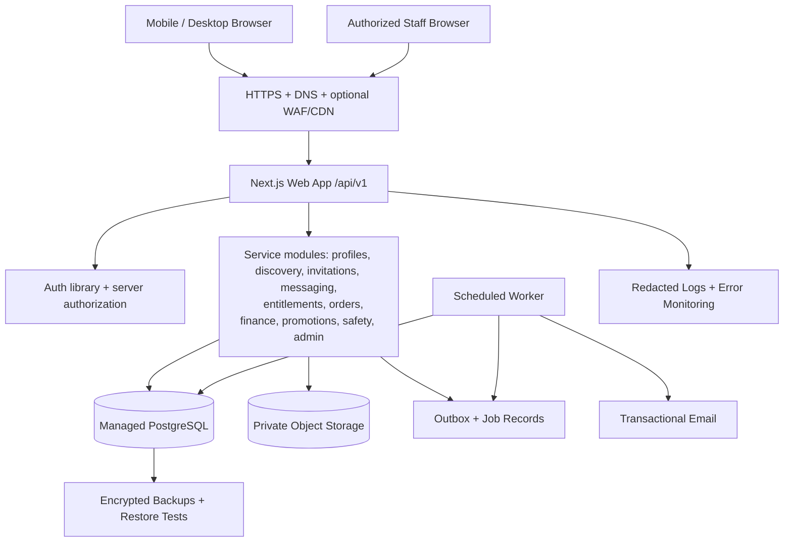
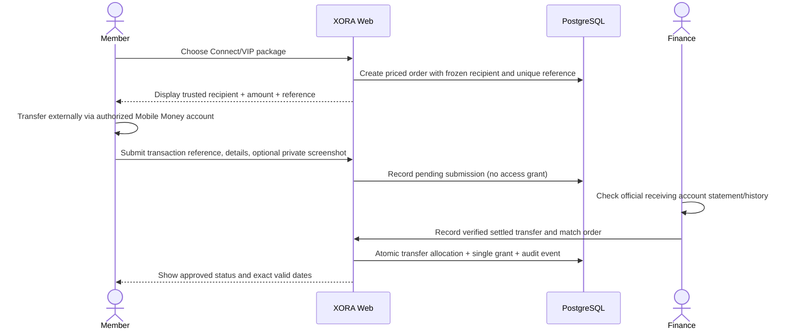

# XORA — Technology Stack & Engineering Decisions

**File:** `TECH_STACK.md`  
**Version:** 1.0  
**Prepared:** 22 November 2026  
**Status:** Recommended technical choices for review; not yet implemented  
**Source of truth:** `PRD.md` v1.2, `ARCHITECTURE.md` v1.0, `DATABASE_SCHEMA.md` v1.0, `API_SPECIFICATION.md` v1.0  
**Product:** XORA, one responsive **web application** for eligible adults choosing Date, Casual, or Both. Uganda-first; English-first; prices in UGX; member-visible time in Africa/Kampala (EAT).

> **Boundary:** XORA is specified as a consensual adult dating and casual-connections web app, **not** an escort booking marketplace, intermediary for paid sexual services, or payment processor. The manual-payment design does not exempt it from Ugandan laws or Mobile Money/hosting/email providers' rules. No real payment collection, sensitive data collection, or open launch before the Phase 0 approvals described in `PHASES.md`.

---

## 1. Executive technology decision

**Build one Next.js + TypeScript web app, with server-side modules, PostgreSQL as the single transactional source of truth, private file storage, and a small background worker/scheduled-job mechanism.** Use separate member and staff authorization within one identity and administration system. Make the first release mobile-browser first; no native app and no dedicated microservices.

The defining engineering challenge is **correct, auditable state**, not fancy infrastructure: accepting a free invitation exactly once, showing only eligible/mutually compatible adult profiles, keeping incoming messaging free, proving actual incoming money before activation, avoiding duplicate entitlement grants, fairly extending renewals, and protecting sensitive profiles/receipts/ID evidence.

### Recommended stack at a glance

| Area | MVP recommendation | Decision / why |
|---|---|---|
| Web experience | **Next.js (App Router) + React + TypeScript** | One codebase for public pages, member screens, admin screens and API; matches existing architecture |
| Server execution | **Node.js Active LTS** supported by the selected Next.js release | Operationally familiar; run sensitive DB transactions server-side; do not rely on a browser or edge-only runtime for finance |
| Styling | **Tailwind CSS** + small in-house design token system | Consistent mobile-first components without buying a UI kit |
| Accessible primitives | **Radix UI**-style primitives or equivalent, after dependency review | Dialogs, menus, form controls and keyboard interaction without building accessibility from scratch |
| Forms and validation | **React Hook Form + Zod** or equivalent; Zod/server schemas authoritative | Clear errors on slow mobile connections; shared contracts without trusting client validation |
| API | **Next.js Route Handlers**, `/api/v1`, REST-style JSON | Implements existing `API_SPECIFICATION.md`; protected route handlers are not automatically safe |
| Business logic | **Modular service layer / domain modules** | Member, matching, invitations, finance, promotion, safety and support isolated behind interfaces |
| Authentication | **Better Auth** (recommended candidate) + email/password verification, secure cookie sessions | Avoid paid SMS dependence at MVP; staff MFA mandatory; benchmark/review integration before pinning |
| Authorization | **Server-side RBAC/permission checks** backed by DB | Separation of staff finance, moderation, support and owner powers |
| Data store | **Managed PostgreSQL (supported stable major release)** | Transactions, constraints, partial unique indexes and auditable money records |
| Database toolkit | **Drizzle ORM + Drizzle Kit migrations + reviewed raw SQL when needed** | Typed data access and migrations while preserving explicit SQL and transaction discipline |
| File storage | **Private S3-compatible object storage** | Separate controlled storage for profile media, identity evidence and payment proof |
| File transformations | **Server-authorized image processing** | Resize, strip metadata, block unsafe content, create derivatives after review |
| Chat | **PostgreSQL-backed messages + bounded short polling** initially | Simpler than operating WebSocket infrastructure for a controlled pilot |
| Email | **Approved transactional email sender**, generic subject lines | Verification, recovery, receipt status, security notices, support |
| Background work | **Transactional outbox + PostgreSQL-backed job table + scheduled runner** | Durable notifications, expiries, retention and reminders; no Redis required at first |
| Testing | **Vitest, React Testing Library, Playwright** | Business rules, UI accessibility and real user journeys |
| Observability | **Redacted structured logs, uptime checks, error monitoring** | Identify failures without logging messages, sex/intent preferences, receipt images or ID documents |
| CI/CD | **GitHub repository + automated checks + protected deployments** | Reliable reviews and migration releases |
| Hosting | **Managed Node-capable web hosting, managed PostgreSQL and private storage**, all approved for the actual lawful activity | Keep operations simple; choose vendor after acceptable-use/security/data review |
| CDN and DNS | **TLS, managed DNS and optional CDN/WAF** | Fast secure delivery; private member data must never be publicly cached |

**Version policy:** Choose the latest **patched, supported** release in a tested compatibility matrix at project kickoff; pin dependencies and record exact versions in `package.json` / lockfile. As of 22 November 2026, Node.js **26.x is Active LTS**, and PostgreSQL **18 is supported**; PostgreSQL 19 was just released, so prefer a mature managed version the chosen provider supports rather than upgrading on launch day. Next.js 16 is on a maintained line, but install the latest security-patched supported version. Reverify release status when coding starts. See [References](#23-official-technical-references-and-verification-notes).

---

## 2. Relationship to the four existing XORA specifications

This file **selects technologies**; it does not redefine the product.

| Existing document | This document must preserve |
|---|---|
| `PRD.md` v1.2 | Free signup; Date/Casual/Both; one accepted first outgoing invitation free; renewable Connect Week/Month/Quarter; optional VIP/Spotlight; manual receipts; privacy and admin journeys |
| `ARCHITECTURE.md` v1.0 | Modular monolith; PostgreSQL; one web app and staff dashboard; server-enforced entitlements; outbox/jobs; P0 safety controls |
| `DATABASE_SCHEMA.md` v1.0 | Table ownership, constraints, payment settlements, approval uniqueness, member privacy, migrations and concurrency rules |
| `API_SPECIFICATION.md` v1.0 | `/api/v1` contracts, idempotency, UTC timestamps, integer UGX amounts, 403 membership gate, admin authorization and API tests |

**Commercial catalog, version 1.2 proposal (not validated market prices):**

| Product | Price | Duration | Scope |
|---|---:|---:|---|
| Free XORA | UGX 0 | Ongoing | Browse as eligible member, one accepted outgoing introduction, receive and answer requests, existing chat |
| Connect Week | UGX 10,000 | 7 days | More permitted outgoing introductions |
| Connect Month | UGX 25,000 | 30 days | Same rights for 30 days |
| Connect Quarter | UGX 60,000 | 90 days | Same rights for 90 days |
| VIP Week | UGX 20,000 | 7 days | Labeled, eligible visibility rotation |
| Spotlight Month | UGX 50,000 | 30 days | Labeled featured placement |
| VIP Month | UGX 80,000 | 30 days | Enhanced labeled eligible placement and permitted analytics |

No lifetime subscription, internal wallet, automatic renewal, payment gateway, meeting deposits, service-price fields or payment to another member.

---

## 3. Why these technologies instead of common alternatives

### One Next.js application vs separate React + Express/NestJS projects

**Choose:** Next.js application with route handlers and a separate **domain/service layer**. A small team can share TypeScript validation and data types, build public SEO-friendly marketing pages while protecting member routes, and host one initial application. Do **not** put finance logic directly into UI components or a sprawling set of page actions.

**Alternative:** React SPA + independent NestJS backend makes sense if multiple independent clients, specialist backend teams, or intensive real-time processing emerge. It adds project, hosting, authentication and cross-origin complexity now. A migration later is possible because `/api/v1` and domain boundaries remain explicit.

### PostgreSQL vs Firebase/document-first storage

Choose PostgreSQL because member entitlements, order-to-settlement matching, refund records, uniqueness and transactions demand relational guarantees. Firebase-style storage is not impossible, but would require more effort to prove these core invariants and match `DATABASE_SCHEMA.md`.

### Drizzle vs Prisma vs raw SQL

**Choose Drizzle** for typed queries, clear schema code and migrations. **Use explicit SQL/transactions** for finance locks, partial unique indexes, exclusion constraints and sensitive authorization where generic ORM abstractions hide important behavior. Prisma is a reasonable substitute if a team already excels at it, but **do not run two ORMs**. Raw SQL everywhere is valid technically but increases repetitive mapping/maintenance for a small team.

### Better Auth vs custom password system

Choose a maintained authentication library and use its supported adapters for PostgreSQL. Prefer Better Auth as the initial candidate because it supports email/password, email verification and sessions. Verify the chosen version, security updates, staff-MFA solution and integration tests before lock-in. **Never write a home-grown password hashing, reset token or session engine.** Store authentication data under the auth library's schema and map it to XORA's account IDs without conflicting table ownership.

### Short polling vs WebSockets vs external real-time platform

Start with paginated message fetches and adaptive polling while a conversation is open; pause or slow polling when the tab is hidden, back off after errors, and use transactional delivery/retry semantics. For a small pilot this avoids persistent socket infrastructure. Add SSE, a managed real-time provider, or WebSockets only when measured latency/concurrency justifies them and provider use is approved. Never let client-side delivery indicators substitute for persisted messages.

### PostgreSQL jobs vs Redis/BullMQ

Start with a durable `jobs` table and `outbox_events` in PostgreSQL plus a supervised worker or scheduled runner. Add Redis/BullMQ only if queue volume or throughput becomes a measurable problem. Schedulers must never silently mark payments approved.

### No third-party advertising or invasive tracking SDKs

Dating intention, identity, photos, message metadata and location are sensitive. Avoid retargeting pixels, broad third-party analytics and session recordings. If analytics are added, use minimal aggregated events without sensitive profile data and verify consent/legal requirements.

---

## 4. The recommended deployment model



**Deployment rule:** Keep privileged transactions in a reliable Node runtime that supports PostgreSQL transactions and the necessary execution duration. If a serverless deployment imposes short execution limits or awkward background scheduling, use an approved small persistent Node instance/worker for those modules. Do not use browser-local state as the source of truth for permissions, memberships, settlement or messages.

### Environments

1. **Development:** synthetic adults, false orders and fabricated Mobile Money references; no personal production data.
2. **Staging:** independent database/storage/auth secrets/email sandbox; test full admin and paid-state flow without moving real money.
3. **Production:** separate secrets, domain, storage, backups, limited staff access and real account records only after compliance gates.

### Hosting selection scorecard (must be completed; no vendor assumed approved)

| Test | What to verify |
|---|---|
| Terms / allowed use | Actual lawful dating/casual web-app activity permitted in writing or clearly under terms; no misclassification |
| Uganda privacy/data | Hosting location, cross-border transfer basis, processing agreements and deletion support reviewed |
| Security | Encryption, secure secrets, private buckets, access/audit logging, reasonable incident support |
| DB capability | Real Postgres transactions, PITR or verified backups, migration operations, pooling and monitoring |
| Runtime | Supported Next.js/Node, persistent worker/scheduler plan, file upload path and timeouts |
| Recovery | Export/migrate data, restore-tested backup, provider outage procedure |
| Costs | Document actual recurring price, overages, outbound traffic, storage and email before purchase |

**Do not promise free hosting.** Free tiers may pause/sleep, offer no backup, forbid the use case, or be too limited for identity/payment data. Pay for minimum safe operations rather than unnecessary upgrades.

---

## 5. Code organization and ownership

Recommended repository (one repo, no microservices):

```text
xora/
  app/
    (marketing)/                 # public safe pages: landing, FAQ, policies
    (auth)/                      # register, login, recovery
    (member)/                    # discover, profile, matches, messages, membership
    (staff)/admin/               # finance, approvals, moderation, reports
    api/v1/                      # contracts in API_SPECIFICATION.md
  components/
    ui/                          # accessible controls
    member/                      # profile cards, chat, subscription states
    admin/                       # queues, review details, receipts, audit tables
  domain/
    accounts/
    profiles/
    eligibility/
    discovery/
    invitations/
    messaging/
    catalog/
    entitlements/
    payments/
    promotions/
    moderation/
    support/
    privacy/
  lib/
    auth/ db/ storage/ email/ audit/ config/ security/ validation/
  workers/                        # outbox, email, expiry, retention, reminders
  db/
    schema/                       # schema definitions
    migrations/                   # reviewed migration scripts
    seeds/                        # synthetic/approved catalog
  tests/
    unit/ integration/ contract/ e2e/ security/
  docs/                           # PRD/architecture/schema/API/stack/phases
  public/                         # only non-sensitive assets and branding
```

Rules:
- Route handlers validate, authenticate, authorize, call domain services, and return minimal DTOs. They do not directly update unrelated tables.
- Domain modules own business decisions. Finance cannot silently alter profile verification; promotions cannot override blocking.
- Database operations are transactionally grouped for orders, approvals, free-invite acceptance, renewals and refunds.
- UI and API share canonical field conventions, error codes and consent semantics from `API_SPECIFICATION.md`.
- `public/` must never hold profile photos, evidence, receipts, ID scans, exports or actual payment statements.
- Prefer integration tests against a real disposable PostgreSQL database over mocks for the most critical invariants.

---

## 6. Frontend product and visual system

### Primary experience

- **Mobile-first responsive layout:** optimized for common lower-cost Android devices and constrained data plans; functional in modern desktop browsers.
- **One account; switchable intentions:** Date, Casual or Both only changes matching and discovery, never creates a second profile/payment identity.
- **Navigation:** Discover, Invitations/Connections, Messages, Membership, Profile. On mobile, use a five-item bottom navigation; on desktop, use a clear side or top navigation.
- **Public pages:** brand home, how XORA works, prices, safety, help, terms, privacy and eligibility policy. Keep actual member content behind authorized access and **noindex** sensitive routes.
- **Admin:** separate strong-auth workspace visually differentiated from member UI; queue-first layout, warnings on irreversible actions.
- **Aesthetic:** midnight charcoal/plum, muted gold accents, warm ivory surfaces, modern typography, restrained imagery, accessible focus states and status colors. No explicit sexual imagery needed.

### Accessible interaction standards

Use semantic elements, keyboard access, legible typography, error summaries, screen-reader labels and high contrast. Target **WCAG 2.2 AA** where applicable; confirm through automated audits plus manual keyboard and screen-reader testing. Avoid flashy animations, autoplay media and misleading countdowns.

### Performance and network resilience

- Serve optimized thumbnails and responsive source sizes; lazy-load below-the-fold media.
- Cache **public marketing assets**, not authenticated profiles, chats, receipts or admin pages in a shared CDN.
- Reduce JavaScript on discovery; paginate results; do not load all photos at once.
- Save onboarding drafts server-side; support safe retry of payments/invitations with idempotency keys.
- Use honest placeholders and reconnect states; never show a payment as approved while pending.
- Meet measured targets from `ARCHITECTURE.md` and choose budget thresholds after pilot tests rather than inventing a guaranteed page speed.

---

## 7. Identity, eligibility, role-based access and sessions

### Account lifecycle

- Registration uses email + password + email verification; progressive profile collection as per PRD §10.
- A date-of-birth entry and affirmation alone are **not sufficient proof of adulthood**; required age assurance must be established with legal/privacy review. Until eligibility is approved, profiles are not discoverable and cannot initiate private contacts.
- Store verification outcome and an audit reference separately from identity evidence. Restrict raw evidence and delete when its justified retention period ends.
- Member password reset and email change are rate-limited and verified.
- Staff accounts are invite-only, use MFA and short-lived privileged sessions; no staff access through an ordinary member session.

### Required roles

| Role | Minimum scope |
|---|---|
| Visitor | Public pages only |
| Member | Own profile, approved discovery, own invitations/messages/orders, reports, privacy requests |
| Verification reviewer | Restricted eligibility review, not finance settlement |
| Moderator / safety | Reports, restrictions, appeals, only necessary evidence |
| Finance reviewer | Approved receiving-ledger records, own queue and reconciliation; never user PIN/OTP |
| Support agent | Ticket handling and limited account status; no unrestricted ID/payment proof or chat browsing |
| Owner / system administrator | Configuration and controlled privileged action, with logging and dual control on high-risk edits |

**Every protected route** rechecks both authentication **and** authorization at the server, including resource ownership, account standing, 18+ eligibility, blocks/mutual intent, active paid rights where applicable, and staff permissions.

**Sessions:** Use secure `HttpOnly` cookies, `Secure` in production, appropriate `SameSite`/CSRF defenses, session rotation/revocation and server-enforced logout/restrictions. Avoid storing long-lived bearer tokens in browser local storage. Do not pass sensitive account data into logs or notification text.

---

## 8. Database and migration toolchain

- Start with a supported managed **PostgreSQL** version; PostgreSQL 18 is a stable choice if offered by approved hosting, while 19's November 2026 release warrants provider/plugin maturity review.
- Use **Drizzle Kit** migration files with human review, checked into version control; never rely on ad-hoc production schema pushes.
- Follow `DATABASE_SCHEMA.md` for records, keys, constraints, optimistic versions, ledger allocation and schema owners.
- For exceptional invariants, maintain SQL migrations with explicit unique indexes, transactional row locking, foreign keys, checks and appropriate isolation.
- Apply migration to staging first; record backward-compatibility/rollback approach. Take a backup before risky operations; **test restore**.
- Store prices as integer UGX, not floating point. Use UTC timestamps and display EAT with correct formatting.
- Do not store dates using only calendar-day labels for 7/30/90-day subscriptions; expiry is an exact instant.

### Most important atomic operations

1. **Free invitation:** create one pending free request when eligible; on recipient acceptance, lock state and atomically consume one lifetime free benefit. A declined, withdrawn or expired request does not consume the benefit.
2. **Membership gate:** before any further outgoing request, server checks eligibility, allowance and active Connect right. Receiving/replying never requires an active pass.
3. **Manual payment:** incoming transfer is an **independent trusted staff-confirmed ledger record**, never a browser claim. One settled transfer allocated once to one order; one order grants an entitlement once.
4. **Renewal:** same-plan renewal approved early creates a queued period starting immediately after the old paid end, preserving purchased days.
5. **Safety:** ban/block/underage review immediately restricts discovery and chat operations even where time remains on a paid plan.
6. **Refund:** reversible financial workflow with evidence, reconciliation and a separate entitlement correction—not deleting audit history.

See `DATABASE_SCHEMA.md` §§5–8 and `API_SPECIFICATION.md` §§5,7,9 for exact tables, API behavior and idempotency.

---

## 9. Manual Mobile Money payment system — implementation boundary

**No gateway, no stored-value wallet, no direct bank/phone scraping, no automatic approval.** A member transfers using approved MTN/Airtel business instructions **outside** XORA. XORA stores the **order** and **evidence of a claim** until finance independently verifies funds in the official receiving account.



### Implementation decisions

- Payment-instruction record includes business recipient name/identifier, method, validity window, read-only server price and order reference. Changes require owner-controlled approval and a verifiable record.
- Member submits provider transaction ID, payer contact and approximate time. Screenshot is **optional** if payment can be independently matched. Never request PIN, OTP, balance screenshot, SIM access or password.
- Restricted uploads require MIME/type checks, strict size limits, signature verification, malware scanning where available, and metadata scrubbing. Only approved finance users may view them via short-lived authorized access.
- A finance approval button stays disabled until trusted incoming-funds confirmation exists. The single database transaction allocates transfer, marks order approved, writes entitlements, logs actor/reason and schedules member notification.
- Duplicate clicks must replay the same result. Two finance staff cannot approve one transfer for two orders.
- Handle wrong payer/recipient, partial/overpayment, duplication, delayed posting, paid while ineligible, refunds and reversals through explicit case states and support actions.
- Never expose complete mobile-money statements or proof images in analytics, logs or support roles by default.
- The legal/payment-provider approval gate is **independent** of whether transactions are manually reviewed.

---

## 10. Matching, invitations and conversation access

### Discovery

First filter by verified adulthood, account approval, mutual intention and personal preferences, approximate location preferences, blocks, existing restrictions and visibility settings. Only then apply ranking. An active VIP promotion may influence placement **within that eligible result set** and must carry a sponsorship label. Do not reveal home addresses or precise real-time GPS locations.

### Invitations and chat

- Likes are free and are not equivalent to opening a conversation.
- An eligible member can send one pending free outgoing invitation; it consumes the **one free accepted outgoing** allowance only when accepted, atomically.
- If the free invitation is rejected/withdrawn/expires, the allowance remains available, subject to spam/rate limits.
- Once the accepted free allowance is used, a valid Connect Pass is needed for additional **outgoing** requests.
- Incoming invites and existing conversations remain free after expiry, unless safety or consent restrictions require closure.
- Chat creation occurs only on accepted invitations; all read/write routes enforce participant and block status.
- Avoid auto-reading member chats for analytics; tightly restrict moderation access to lawful, necessary cases with audit.

### Chat delivery choice

MVP uses paginated messages and bounded polling while the chat is open (e.g., an initial tuning value around 10–15 seconds, adjusted after measurements). Prefer client-acknowledged send IDs and server-generated sequence/order. Later consider SSE or sockets when needed. No online-status promise beyond actual observed activity.

---

## 11. Private media and data handling

Use storage tiers with distinct access policies:

| Storage area | Content | Policy |
|---|---|---|
| Member gallery | Approved profile photos, processed thumbnails | Only available in authorized discoverable-member contexts; never indexed public directory |
| Pending gallery | Unreviewed uploads | Private to member and moderation reviewers until approved |
| Identity evidence | Restricted adult-verification documents/artefacts where justified | Separate bucket/prefix, tight reviewer role, no public URLs, encrypted and short retention |
| Payment proof | Optional receipts/screenshots | Separate private bucket, finance-only access, prompt retention review |
| Case evidence | Report attachments, moderation artefacts | Role-scoped access, audit and documented retention holds |
| Public assets | Logos, fonts you have rights to use, marketing illustrations | Public and CDN-cacheable, no sensitive member content |

The upload API must authorize a short-lived single-purpose upload and verify the resulting object server-side before attaching it to an entity. Prefer dedicated private buckets for highest-risk data. Never store government IDs or receipts in a public Next.js `public/` folder or a globally readable CDN.

Document who can export data, who can delete it, what must be retained for legal obligations, and how access is logged.

---

## 12. Notifications and scheduled jobs

**Transactional email:** account verification/reset, profile-review outcome, invitation notice (discreet), payment submission/decision, pass renewal reminders, important security and support notices. Member preference controls govern optional notices. Avoid exposing “Casual,” sexual intent, payment amount or partner identifiers in subject lines and lock-screen previews.

**Background tasks:** deliver outbox messages; expire orders/invitations and subscriptions; activate queued renewals; expire promotion slots; send consented reminders; purge expired temporary evidence; produce daily finance reconciliation alerts; trigger backup/health checks where supported.

Each job is idempotent, has retry/backoff and dead-letter/failed status visible to operations. If scheduler is down, entitlement validity is still checked against DB timestamps **on each protected action**, so expired access cannot persist just because a job did not run.

---

## 13. Security and privacy baseline

Use **OWASP ASVS 5.0** as a verification checklist and the OWASP Next.js security guidance for route handlers and the data-access layer. Important controls:

1. Email verification, effective age assurance, staff MFA and account recovery verification.
2. Server authorization at every protected endpoint; object/resource-level ownership checks.
3. CSRF protection and strict same-origin rules for cookie-authenticated mutations; HTTPS and security headers including CSP where practical.
4. Input validation, bounded lengths, parameterized queries, limited file sizes/types, malicious upload checks and image reprocessing.
5. Rate limits on signup, auth, invitations, messages, reports, uploads, receipts and admin login; anti-automation/abuse investigations.
6. A single finance allocation path with unique constraints, idempotency, row locks and audit logs.
7. Encryption in transit and at rest; least-privileged credentials; secrets in managed configuration, not source control.
8. Public routes never reveal member identities, exact locations, private contacts or unapproved photos.
9. No sensitive contents in crash logs/analytics; redact token, identity evidence, receipt, messages and support attachments.
10. Backup restoration tests, access review, patch cadence, incident and breach response, staff offboarding and deletion workflows.
11. Lawful processing grounds, appropriate notices and PDPO registration/requirements reviewed before collecting real Ugandan users' sensitive information; consult qualified local counsel.
12. All high-risk actions (ban, evidence access, finance approval, refund, changing official payee, owner permissions) leave immutable/restricted audit events.

### A critical hosting constraint

Sensitive data may be subject to cross-border transfer rules and service terms. Choose hosting and subprocessors with explicit privacy arrangements; being technically easy to deploy is not enough. Record and review data-transfer/storage decisions before real verification uploads.

---

## 14. Admin workspace architecture

A staff-only UI may live under `/admin` with stronger authorization; a distinct staff hostname is optional, not a substitute for proper authorization. All operations use audited APIs.

| Workspace | Key actions | Control |
|---|---|---|
| Home | Queue sizes, review age, safety incident alerts, failed jobs | Redacted stats only |
| Member review | Approve/hold/reject profile/eligibility with reason | Reviewer permissions; raw IDs tightly restricted |
| Payment orders | View submitted order, proof, claimed reference | Finance permission; never assume transfer is real |
| Settlement/reconciliation | Verify official incoming transfer, allocate once, approve/hold/refund | Trusted settlement record + transaction + idempotency |
| Plans & promotions | Maintain versioned product catalog, placement inventory, campaign dates | Founder/authorized manager; audit configuration |
| Safety & appeals | Review reports, restrict, unmatch, appeal, retain case evidence as needed | Moderation permissions + evidence scope |
| Support | Tickets, correction requests, member responses | Limited member view; cannot override finance/verification |
| Privacy | Requests, access, retention, controlled exports/deletion | Need-to-know; legal hold tracking |
| Staff & config | Roles, receiving-account changes, review hours, templates | MFA, dual approval for sensitive changes |
| Monitoring | Health, outbox failures, backup alerts, unusual payment duplicate rates | Operations roles; no raw private payloads |

Design administrator pages for safe **human-in-the-loop** verification: evidence + independent confirmation + reason + explicit action, with review history. If founder is the only staff member initially, keep role boundaries in code and audit every privileged action; add second-person review for high-risk changes as soon as feasible.

---

## 15. Testing and release controls

| Test layer | Tooling | Must validate |
|---|---|---|
| Unit | Vitest | Entitlement date math, statuses, permission matrices, expiry, price snapshots |
| Component | React Testing Library | Registration and checkout form errors, accessible states, admin warning dialogs |
| Integration | Vitest + disposable PostgreSQL | Concurrent free invite accept, transfer uniqueness, duplicate approval, early renewals, refunds, account holds |
| API contract | OpenAPI-generated/schema checks + HTTP tests | API shape and error codes match `API_SPECIFICATION.md` |
| End-to-end | Playwright | Register → verify → onboard → match → free chat → pay manually → finance approves → use pass → expire → renew |
| Accessibility | Automated audits + manual review | Keyboard, labels, contrast, focus order, form status announcements |
| Security | OWASP-informed checklists + targeted tests | IDOR/BOLA, CSRF, rate limits, evidence access, privilege escalation, upload abuse |
| Operations | Restore & failure drill | DB restore, failed job retries, email outage, expired order, revoked staff, receiving account unavailable |

**CI sequence:** format/lint → typecheck → unit → integration tests → production build → E2E smoke → artifact/deploy approval. Run migrations as a deliberate release step, not uncontrolled on every server startup. Staging approval and smoke checks before production.

**Release block conditions:** eligibility bypass, cross-user private-data exposure, duplicate free credit/finance grant, unreconciled payment approval, unauthorized admin access, lack of backup restore, provider/legal refusal, or unresolved critical security defects.

---

## 16. Operating costs and cost-control policy

Do not lock fictitious supplier prices into the architecture. Maintain a monthly vendor quote sheet in UGX including conversion/fees and usage assumptions.

**Likely necessary recurring cost categories:** domain/DNS; managed Node runtime; managed PostgreSQL with backup; private object storage and egress; transactional email; uptime/error monitoring; age/identity verification labor or approved service; mobile-money receiving account charges; staff/safety support; security reviews.

**Spend later, if justified:** Redis, full-text/search service, WebSocket fleet, AI matching, video chat, native apps, paid SMS OTP, multiregion, broad marketing analytics, complicated container orchestration.

Set launch-stage alerts for database/storage growth, file bandwidth, email volume, invitation abuse, worker failures and outstanding finance queues. Never cut backup, identity verification, encryption or independent fund checks to meet a low budget.

### Capacity triggers for optional upgrades

| Upgrade | Trigger based on evidence |
|---|---|
| Dedicated search | Explain/query performance shows Postgres search cannot meet agreed user experience |
| Realtime chat | Measured conversation latency/volume justifies persistent connectivity |
| Redis queue | DB jobs show sustained backlog or missed notification/expiry SLAs |
| Separate API service | Server/runtime growth requires independent scaling or a separate mobile client |
| Payment provider API | Provider approves actual business, manual queue is inefficient, fraud controls remain in place |
| Extra moderation tooling | Actual report volumes and response times create a documented safety gap |

---

## 17. Engineering conventions, versioning and maintenance

- Use strict TypeScript and one code formatting/lint policy.
- Maintain `package-lock.json` (or the single chosen package manager's lockfile); use one package manager across CI/local.
- Dependabot/renovation automation for security updates, reviewed and tested before merging.
- Use environment-variable validation at app startup; production secrets never enter tests or version control.
- Keep an Architecture Decision Record (ADR) for major changes and mark superseded decisions.
- Use UTC in database/API, EAT for user display; store language/locale explicitly where needed.
- Use internal immutable IDs, public user-safe references and explicit product/version snapshots.
- Maintain a living permissions matrix, retention schedule and incident procedure.
- Use privacy-respecting synthetic seed data—no scraped dating photos or real screenshots.

---

## 18. Decisions that remain open before implementation

| Decision | Recommended default | Owner / required input |
|---|---|---|
| XORA name/domain | Brand only after URSB/trademark/domain clearance | Founder/legal |
| Lawful business/merchant activity | Adult dating and casual connections only; no paid-sex facilitation | Legal/merchant providers |
| Hosting vendors | Evaluate 2–3 approved providers against written scorecard | Engineering/privacy |
| Node/Postgres/Next versions | Pin currently patched supported compatible versions at kickoff | Engineering |
| Authentication implementation | Better Auth candidate; staff MFA and verified-email test | Engineering/security |
| 18+ assurance provider/process | Adequate adulthood proof, minimal collection, legal review | Legal/safety/privacy |
| Retention & deletion | Written schedule by data type, legal hold exceptions | Legal/privacy |
| Outgoing invitation anti-spam | Testable daily limits and abuse moderation; no arbitrary unlimited spam | Product/safety |
| Renewal tier changes | Define fair date/credit choices and UI before build | Product/finance |
| Refund and overpayment policy | Clear consent and reconciled finance entries | Legal/finance |
| Official payment recipient | Provider-approved business account, ownership and change policy | Finance/legal |
| Staff operating hours | Real staffed manual-review hours, no instant promises | Operations |
| Chat delivery | Bounded polling MVP; reassess after pilot | Engineering/product |
| Media review approach | Human-review flow with approved tooling/retention | Safety |

**Any decision altering current PRD prices, consent, free-invite semantics, payment mechanics, or role boundaries must trigger a PRD + API + database + test traceability review.**

---

## 19. Handoff to PHASES.md

`PHASES.md` defines the build order. The stack decision should be considered ready only when:

- [ ] Legal/merchant/provider feasibility is cleared, or work is limited strictly to synthetic demo mode.
- [ ] Hosting terms and privacy/data-location decision are documented.
- [ ] A tested Next.js + Node + Postgres + Drizzle + auth compatibility matrix is pinned.
- [ ] Core module folder ownership and `/api/v1` conventions are agreed.
- [ ] All money/permission/verification invariants have named test cases.
- [ ] Staging, production, backup, staff MFA and incident-response ownership are assigned.

---

## 20. Summary for the founder

**Make XORA a fast, secure website.** Visitors can read public information, adults register and prove eligibility, choose Date/Casual/Both, browse matching profiles, receive and respond to invitations for free, and purchase **renewable** access or optional labeled promotions. An independent finance reviewer confirms actual Mobile Money receipts before any paid right begins. The owner manages everything from a protected dashboard. Start with one maintainable codebase and reliable data; scale only after users and operations prove the need.

---

## 21. Implementation-level notes for engineers

### Dependency compatibility proof-of-concept

Before writing feature modules, build a proof-of-concept in staging demonstrating: (a) Next.js authenticated route, (b) verified email and secure session, (c) Postgres + Drizzle migration and rollback/restore, (d) server-only permission check, (e) private receipt upload/read via short-lived authorization, (f) database transaction preventing two approvals, and (g) a scheduled worker sending a generic email from outbox. If one of these cannot be reliably supported by hosting, change the hosting choice before feature work.

### Database responsibility and transactional outbox

When a finance approval or accepted invitation changes state, write the corresponding notification event to the **same transaction** as the business data. The background worker can then retry delivery without replaying the original finance approval. This separates user-facing email delivery failure from the correctness of purchased rights.

### Media CDN caveat

The media host must not expose private signed URLs in public logs, search engines, caching proxies or third-party page analytics. A gallery thumbnail visible to authorized matched users may have a different access model from identity or payment evidence. The latter must never use long-lived public CDN URLs.

### Outages

During a provider outage or DB maintenance, the site may show a read-only status banner; it must not create optimistic approvals or claim receipts have been received. When service resumes, queued operations should be idempotently replayed and discrepancies investigated.

---

## 22. Security and deployment acceptance checklist

- [ ] Versioned migrations reproducibly create schema from empty DB.
- [ ] Every protected API has authorization tests.
- [ ] Member cannot open another member's order, private ID or chat.
- [ ] Free introduction not consumed on rejected/expired invite; exactly once on acceptance.
- [ ] Two concurrent invitation acceptances cannot give two free accepted outgoing introductions.
- [ ] One settled transfer cannot activate two orders; two reviewer clicks cannot double-grant.
- [ ] Pass starts only on approval; early same-tier renewal preserves all purchased days.
- [ ] Existing chats survive pass expiry; restricted accounts cannot bypass safety rules.
- [ ] Staff MFA and distinct finance/moderation powers are working.
- [ ] Privacy evidence has access, redaction, purge and legal-hold controls.
- [ ] Encrypted backup is restorable; deployment rollback plan tested.
- [ ] Slow-network and small-screen registration/payment journeys are tested.
- [ ] External provider and legal approval for actual business use are documented.

---

## 23. Official technical references and verification notes

Checked against public source material on **22 November 2026**. These are technical references, not vendor permission to operate:

1. Next.js official documentation — <https://nextjs.org/docs> and Route Handlers — <https://nextjs.org/docs/app/getting-started/route-handlers>
2. Next.js authentication and security guidance — <https://nextjs.org/docs/app/guides/authentication> and <https://nextjs.org/docs/app/guides/data-security>
3. Next.js support policy — <https://nextjs.org/support-policy>
4. Node.js release policy — <https://github.com/nodejs/Release> (26.x Active LTS in November 2026)
5. PostgreSQL supported versions — <https://www.postgresql.org/support/versioning/> (18 supported; 19 released November 2026)
6. Drizzle PostgreSQL and migrations — <https://orm.drizzle.team/docs/get-started/postgresql-new> and <https://orm.drizzle.team/docs/migrations>
7. Better Auth email/password and verification — <https://www.better-auth.com/docs/authentication/email-password>
8. Playwright & Next.js testing — <https://nextjs.org/docs/app/guides/testing/playwright>
9. W3C accessibility guidelines — <https://www.w3.org/TR/WCAG22/>
10. OWASP ASVS 5.0 — <https://asvs.owasp.org/> and OWASP Next.js cheat sheet — <https://cheatsheetseries.owasp.org/cheatsheets/Nextjs_Security_Cheat_Sheet.html>
11. Uganda PDPO — <https://pdpo.go.ug/> and Uganda government registration information — <https://doingbusiness.finance.go.ug/licensing/pdpo-data-protection-registration>

**End of TECH_STACK.md v1.0.**
