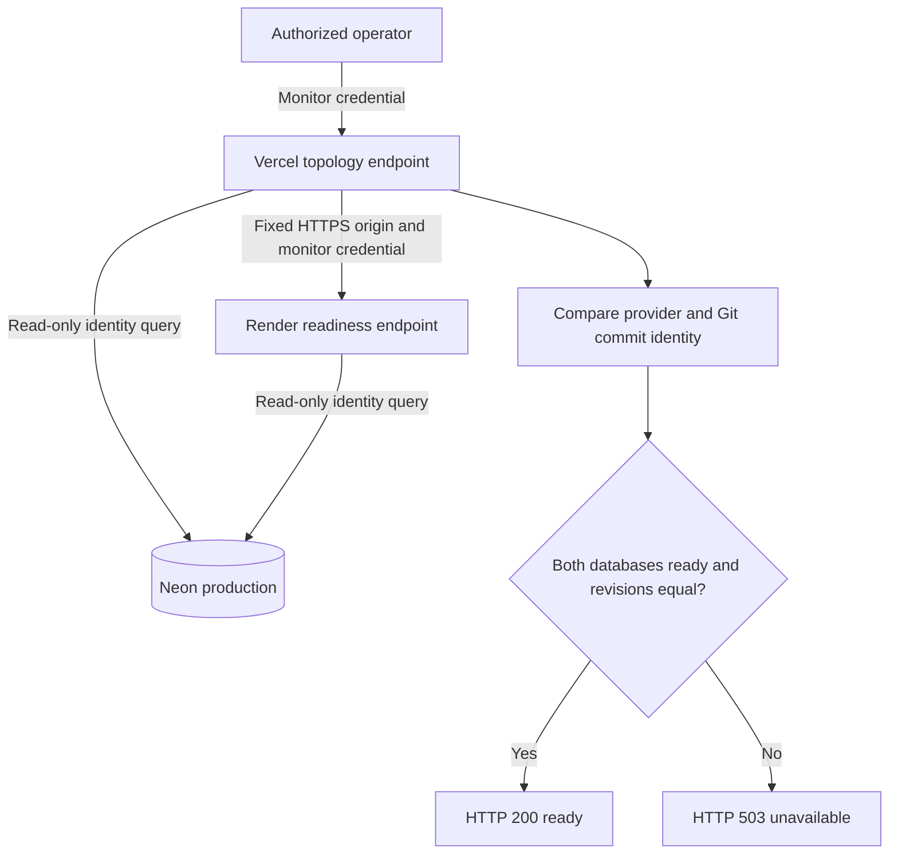

# Production topology and release verification

## Baseline and intent

The existing XORA GitHub `main` was last verified at `b3dd5cbfe76375abd490246a2b21812682f852e5`. Render and Vercel had deployed that commit. Both returned liveness HTTP 200. The Neon runtime role was separately verified. These facts describe the prior release, not this new source package.

This delivery adds an authenticated, read-only Vercel-to-Render operational connection. It does not move business APIs or create another environment. Both deployments still run the same Next.js application. Registration, uploads, payments and public launch controls remain unchanged.

## Request flow

## Endpoint contract

`GET /api/health/live` stays public at the application layer and does not query Neon. Render's automatic health-check path should be set to this route; use an authorized Vercel request if deployment protection is active.

`GET /api/health/ready` requires `X-Xora-Monitor-Token`. An absent or invalid token returns 404. A successful authenticated response contains `status`, `provider` and `revision` (full Git SHA or null). It verifies database name and runtime role using the existing guarded pool. No database connection strings or internal errors are returned.

`GET /api/health/topology` is available only on Vercel with the same authentication. It checks the local DB and Render readiness in parallel. It returns only categorical statuses: `status`, `local`, `render`, `revision`. HTTP 200 requires both databases to respond and both providers to report the same valid Git SHA. Unknown SHA, mismatch, timeout, malformed response or upstream 404/503 fails closed. It is not a public endpoint, does not write data, and never accepts an arbitrary destination.

## Configuration

- Preserve the current XORA-only production database environment values on both services. No Neon migration is required.
- Vercel `XORA_RENDER_API_URL` must be `https://xora-production.onrender.com` (optional trailing slash). The peer URL is fixed in code, not derived from requests.
- Both providers already have an internal monitor credential configured or require one in their secret store. Verify privately. If their values differ, configure `XORA_RENDER_MONITOR_TOKEN` on Vercel with Render's existing monitor credential. If equal, leave that optional variable absent. Never place credentials in GitHub source or logs. Do not replace unrelated secrets.
- Vercel must expose its system variables (`VERCEL`, `VERCEL_ENV`, `VERCEL_GIT_COMMIT_SHA`). Render must expose `RENDER` and `RENDER_GIT_COMMIT`. Missing identities deliberately fail the topology check. The provider and revision values are supplied by platform configuration; the endpoint does not cryptographically attest the source tree.
- Keep Vercel deployment protection and existing access gates enabled. Use the existing approved bypass mechanism for operator checks.

## Release procedure

1. Import the new repository ZIP using the existing successful extractor. Keep the workflow unchanged unless a new defect is identified. Verify both CI jobs and confirm no processed ZIP remains in GitHub `main`.
2. Confirm both providers deploy the resulting source commit. Do not promote an older or unrelated commit.
3. From an authorized environment, export `XORA_INTERNAL_MONITOR_TOKEN`, optionally `XORA_RENDER_MONITOR_TOKEN` and `XORA_VERCEL_BYPASS`; run `npm run verify:production`. Do not pass secrets on command lines or include them in terminal screenshots.
4. The script checks both liveness routes, both authenticated readiness routes, provider revision equality, and the direct topology route. Any missing credential or failed check exits nonzero. Render free-tier wake-up can delay liveness; retry after startup if needed. The topology route has a shorter bounded deadline and intentionally fails during a cold start.
5. Inspect runtime logs and deployment commit records if any check fails. A failed topology check does not authorize disabling protection or changing database credentials to an owner account.

## Diagnosis matrix

| Observation | Interpretation | Action |
|---|---|---|
| Liveness 200, readiness 404 | No valid monitor credential | Check secret configuration, never expose the endpoint |
| Readiness 503 | DB guard, credentials, network or SQL identity failed | Inspect provider-side configuration and sanitized logs |
| Topology 503, revision different | Providers deployed different commits | Compare GitHub main and provider deployment records |
| Topology 503, revision unknown | System metadata unavailable | Verify system environment injection |
| Topology 503, Render unavailable | Cold start, invalid peer token, incorrect configuration or upstream failure | Warm Render and test readiness directly |
| Topology 404 | Wrong host or monitor authorization | Use the protected Vercel route |

## Scope limitations

The topology route is an operational health probe, not a business API proxy or traffic failover mechanism. No public features are enabled. Production readiness must be verified on the deployed release with provider secrets; local unit tests use synthetic fixtures. The existing package has no committed dependency lockfile. A fresh dependency-aware build requires access to the npm registry and remains a remote CI release gate.
