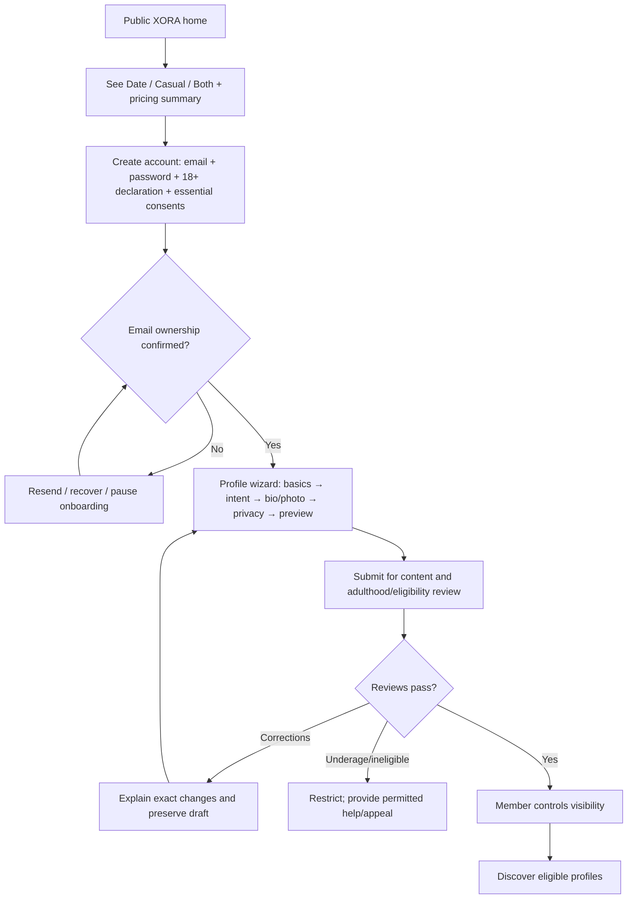
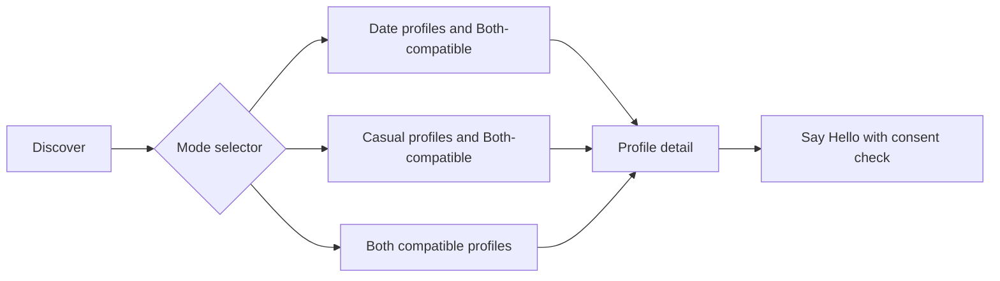
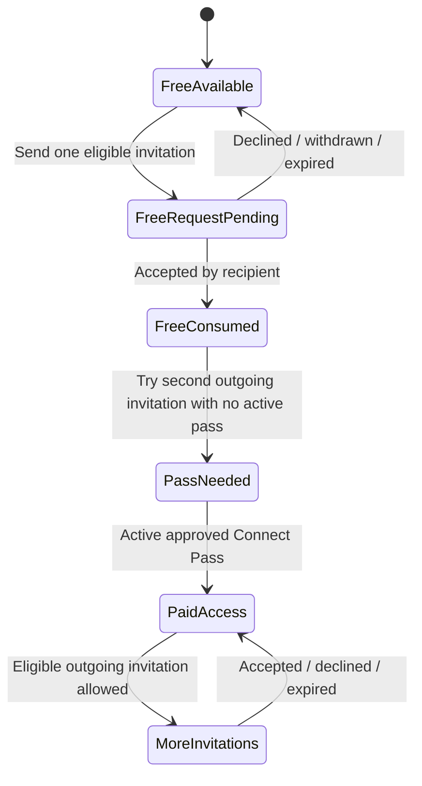
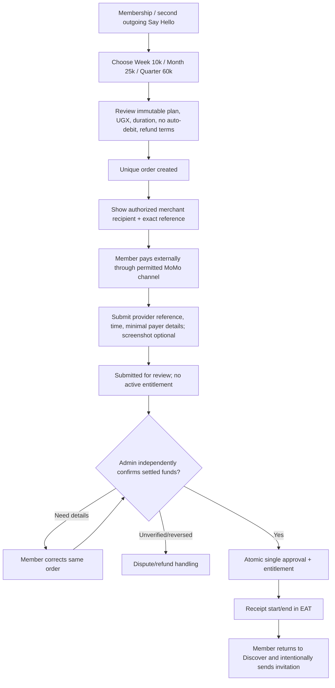
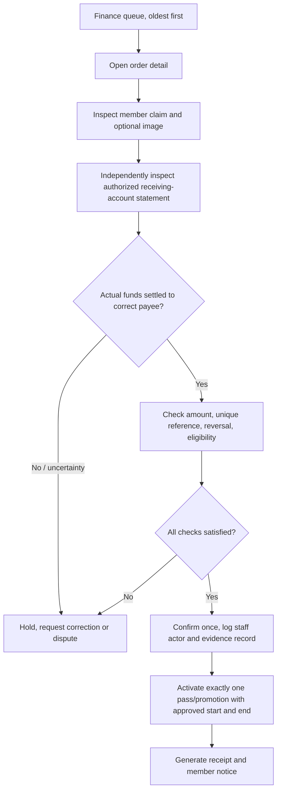
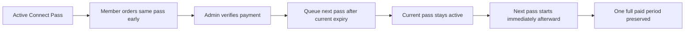
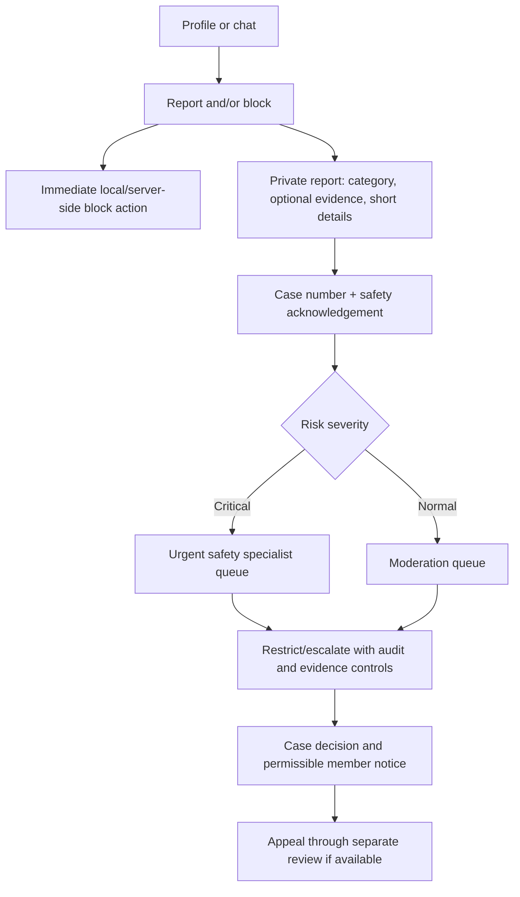
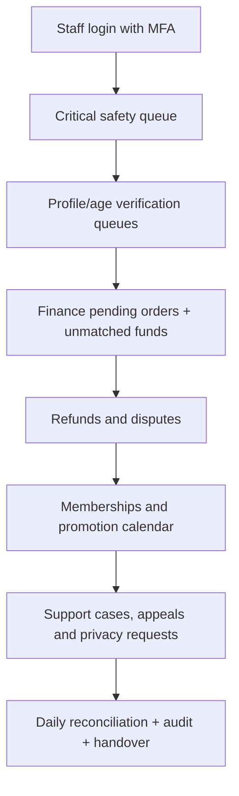

# XORA — End-to-End UX Journeys & Acceptance Scripts

**Scope:** Phase 1 design, mobile-first web; mock demonstration uses fictional people and simulated payment records.  
**Linked sources:** `PRD.md` §§9–22; `PHASES.md` §5; `SCREEN_INVENTORY.md`.

## Experience principles

1. Users **understand before they commit**: privacy, consent, free outgoing allowance, plan duration, manual review.
2. Membership never purchases a person's response or consent.
3. People may receive and accept invitations and maintain already-accepted chats **without a Connect Pass**.
4. Date, Casual, Both are intentions/preferences inside one account, not separate profiles.
5. A paid feature never overrides safety, verification, block, recipient preferences or staff decision restrictions.
6. Payment receipt submission and independently verified settled funds are **different states**.
7. Every failed/empty/restricted state offers the next permissible step.

## Journey 1 — First visit → verified eligible profile → discovery

**Field contract:** email and password required at account creation; optional marketing unchecked; later collect public display name, private DOB or lawful age-evidence alternative, broad region, intention, minimum compatibility preferences, biography, approved photo and privacy controls. Exact location, payment PIN/OTP, income and sexual history must not be demanded.

**Acceptance:** user can state what is publicly visible vs private and navigate to status/recovery. The Phase 1 demo simulates account creation; real email and age checks are not present.

## Journey 2 — Date / Casual / Both switching

**Acceptance:** current mode is visible, filters never expose exact location, and selecting another mode never charges or resets membership/free allowance. Preference controls should be private unless member consents to display them.

## Journey 3 — Outgoing invitation with one free accepted introduction

**Rules:** Only **one active free outgoing invitation at a time**; proposed expiry 7 days, subject to founder approval. A declined/withdrawn/expired free request does not consume allowance. Sending a paid invitation never means acceptance. Block/privacy/fair-use checks always apply.

**Demo steps:** Explore member preview → Profile → Say Hello → Invitations → **Simulate acceptance** → Messages → Discover another profile → Say Hello → Membership.

## Journey 4 — Incoming invitation and continuing chat

1. Eligible adult sees incoming request without phone number/precise location.
2. They may **Accept**, **Decline**, **Report** or **Block**.
3. Accept opens a mutual conversation; recipient's one-free-outgoing credit does not change.
4. The conversation remains available after any Connect Pass ends unless safety restrictions, block or account closure require otherwise.
5. Report/Block remains immediately accessible within chat; member can end the connection.

**Acceptance:** member can explain that incoming and replies are free. No false claim that a person is waiting or interested.

## Journey 5 — Connect Pass manual purchase

**Acceptance:** before transferring funds, buyer can find the exact recipient name, amount and order; after submission, buyer can see a pending state and know not to repay; after approval they can see exact dates. The Phase 1 prototype provides *no real recipient*, funds or verification.

## Journey 6 — Finance reviewer confirms or requests correction

**Critical edge case:** two reviewers must not grant access twice; real backend must use transactions, uniqueness and idempotency. Demo checklist is illustrative only, not connected to a MoMo settlement feed.

## Journey 7 — Correcting wrong payment details

1. Member's existing order is in **Needs details**.
2. They see exact information missing (e.g., reference or approximate time) without exposing internal fraud rules.
3. They edit the **same order**, not buy another plan by mistake.
4. Staff re-examines independent settlement; new evidence is logged without deleting prior record.
5. If received amount differs, finance follows an approved partial/overpayment/refund policy. Never invent credit in a wallet.
6. If a recipient was wrong, the platform does not claim receipt of money it never received.

**Acceptance:** the member is never automatically told to pay twice; the correction CTA is visible next to status and contact options.

## Journey 8 — Early renewal and expiry

**Acceptance:** exact EAT timestamps shown for active and queued passes. On expiry, only **new outgoing introductions** lose paid entitlement; incoming invites and accepted chats remain free. Tier switches require a plainly disclosed rule before purchase.

## Journey 9 — Optional VIP or Spotlight

1. Eligible member chooses promoted profile placement separately from Connect Pass access.
2. Profile must be content-approved, adulthood-approved and discoverable.
3. Review exactly which placement is purchased; label it **Sponsored**/**Promoted**.
4. Place manual order; finance independently verifies funds and approves it.
5. Promotion activates/queues using declared dates, rotates fairly, and stops if profile becomes paused or restricted.
6. Show basic *true* performance reporting only if actually measured. Never guarantee a match or a response.

## Journey 10 — Safety report, block and appeal

**Acceptance:** report flow does not require paid membership, exposes no case data to the reported member, and does not hide critical work behind finance tasks.

## Journey 11 — Member pause and privacy request

1. Member opens My Profile → Privacy.
2. **Pause** immediately removes discoverability, while account and existing conversations behave according to published rules.
3. Optional activity label defaults to off.
4. Data export/deletion is a recorded, verified request; do not imply immediate deletion of records subject to lawful retention.
5. Staff privacy specialist assesses each category and provides an outcome or reasoned exception.

## Journey 12 — Daily admin operating cycle

**Acceptance:** paid orders do not trump safety; unverified receipts never count as revenue; exception items have assigned owners; production permissions prevent unrelated private data access.

## Journey acceptance matrix

| ID | Observable user outcome | Prototype coverage | Production dependency |
|---|---|---|---|
| R1–R5 | Sign up, onboarding draft, review state, correction language | Signup + 5-step wizard + pending review | Real auth, mail, private media and eligibility checks |
| D1–D4 | Change Date/Casual/Both and broad location | Discover + profile | Accurate matching/permissions/filter data |
| C1 | Free accepted outgoing introduction consumed once | Invite + simulated acceptance | Atomic free-credit write, anti-abuse, expiry job |
| C2–C4 | Paid outgoing entitlement after verification | Membership + checkout + admin | Real bank/MoMo reconciliation and billing transaction |
| M1–M3 | Private accepted chat + end/report | Messages demo | Authentication, encrypted transport, moderation access |
| P1–P2 | Optional visibility, exact dates | Promotions and member receipt | Placement calendar, audited pause/eligibility |
| PAY0–PAY4 | Safe manual order and member correction | Checkout + status + finance queue | Authorized recipient, evidence, receipts and refund execution |
| S1–S3 | Report, block, safety queue, appeals | Help demo and admin safety stub | Case management, serious-risk policy, trust staff |
| ADM1–ADM14 | Staff queues, approvals, audit and exceptions | Main finance/profile/safety demos + detailed wireframe contracts | Named staff roles/MFA, ledger and operational tools |
| A1–A8 | Privacy, plans, pause, export/deletion | Settings, membership, help demo | Backend rights handling and secure deletion workflow |

## Scripts for founder and moderated testing

### Member test script (approx. 25 minutes, proposed)

Start with no explanation. Ask the participant to: (1) tell whether XORA is free to join, (2) create a pretend account, (3) set a Date intention and broad area, (4) send a free invitation and find when it is consumed, (5) explain the price and expiry of Connect Month, (6) explain pending vs approved, and (7) find block/report and pause controls.

Record whether they complete each task without help; note mistaken beliefs such as “uploading a screenshot activates access,” “accepting costs money,” “VIP means verified” or “all profiles are publicly visible.” Any of these misunderstandings are design failures to repair before sign-off.

### Staff test script (approx. 20 minutes, proposed)

Open a fictitious submitted order. Ask: (1) show where the independent settled-funds check comes from, (2) identify why screenshot-only approval is unacceptable, (3) request correction without telling the member to pay twice, (4) confirm an independently verified order exactly once, (5) explain renewal queueing, and (6) locate the critical safety queue and a staff audit event.

### Evidence status

**Journey scripts are defined and implemented as an interactive simulation, but no external research participant has been tested and no founder acceptance has been recorded.** Capture signed design review, usability outcomes and legal/provider scope decisions before closing Phase 1 as an approved gate.
