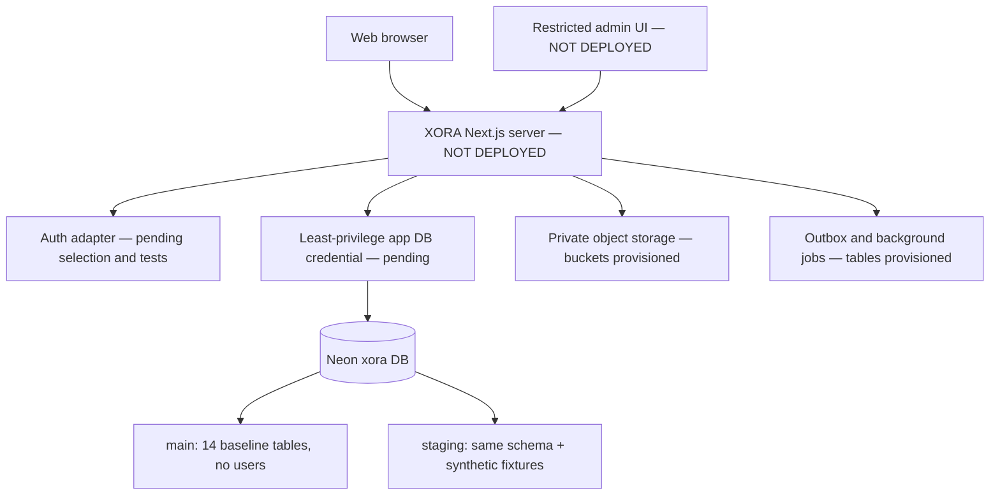

# XORA — Neon Project Implementation & Operating Design

## 1. Overview

XORA uses one **brand-new** managed Neon project. The database is not shared with any other business application or Neon project. It supports a small modular-monolith web app as specified in the PRD and Phase 2 Engineering Blueprint.

**Project:** `xora-platform` (`sweet-meadow-04731447`)
**Console:** https://console.neon.tech/app/projects/sweet-meadow-04731447
**Region:** AWS Frankfurt `aws-eu-central-1`
**Postgres:** version 18
**Primary database:** `xora`
**Main:** `br-young-hill-bgijo9jk`
**Staging:** `br-proud-base-bgx1lcns`

### Architecture

No login secret is embedded in the project bundle. The `xora_runtime` role has `NOLOGIN`; the actual login role and application secret must be created only when managed deployment is available.

## 2. Database tables

| Area | Tables | Implemented database guarantees |
|---|---|---|
| Schema management | `app_schema_migrations` | Version uniqueness |
| Identity mapping | `accounts` | UUID PK, one auth-user mapping, status check |
| Staff | `staff_memberships`, `roles`, `permissions`, `role_permissions`, `staff_role_grants` | FK boundaries, role lookup, only one live grant of a role per staff membership |
| Audit | `audit_events` | Request/action history structure, no runtime delete privileges |
| Request idempotency | `idempotency_records` | Unique actor/operation/key, SHA256-format hashes, expiry check |
| File metadata | `file_objects`, `file_access_events` | Account ownership reference, unique opaque key, purpose and state checks |
| Durable event delivery | `outbox_events`, `background_jobs`, `job_attempts` | Unique dedupe keys, one job per event, valid job states and attempt cap |

**Explicitly not added:** Auth adapter's password/session/MFA tables, eligibility evidence and actual profile tables, matching, chat, subscriptions, payments, manual approval orders and refunds. They belong to later approved migrations, not Phase 2 base infrastructure. Future migration reviews must prevent conflicting canonical account IDs.

## 3. Neon storage

Each branch has the following three empty, **private** buckets:

| Bucket | Intended later content | Policy |
|---|---|---|
| `xora-profile-media` | User-approved profile media, metadata-controlled | Private; server checks owner and eligibility |
| `xora-eligibility-evidence` | Restricted adult-eligibility support material | Private; case-scoped moderator access only |
| `xora-payment-proofs` | Receipts and supporting evidence once lawful payments are enabled | Private; finance case-scoped access only |

There are no files uploaded, no signing tokens, and no live storage URLs in user-facing pages. Before using these buckets implement content/size checks, short-lived signed access, EXIF stripping and expiry/deletion schedules, and confirm Neon provider terms/security controls.

## 4. Environment isolation

- `main` is reserved for controlled future use. It is **not live** and currently has zero real users and no payment data.
- `staging` is the disposable integration-testing area. Two synthetic accounts with `.invalid` addresses exist there. Never add real IDs or private user data to it.
- A future CI pipeline must use distinct branch-specific credentials and storage access. Never point local/staging development to `main`.
- Database/project owner credentials should only be used for controlled migrations. Do not ship them in runtime environment variables.

## 5. Runtime least privilege

Implemented NOLOGIN database role `xora_runtime`:

- Can read role/permission definitions and existing staff memberships/grants.
- Can select/insert/update ordinary app-managed account, idempotency, file-metadata, outbox and job rows.
- Can select/insert audit events and file access events, but **not edit/delete** them.
- Cannot write roles, role-permission maps or staff grants.
- Has no table-delete rights or schema `CREATE` rights.
- Cannot log in independently.

This improves defense in depth but **is not a substitute for server-side authorization or row-level ownership checks**. Later add a dedicated runtime login with inheritance/membership restricted to this role, configure TLS, rotate credentials and validate `has_table_privilege`, before testing the actual application.

## 6. Migration procedure

The baseline was successfully applied on XORA `main` using one atomic transaction. A `staging` branch was cloned from the newly migrated `main`. A second, restrictive runtime-role migration was independently committed on `staging` and `main` after testing. These actions **only targeted** project ID `sweet-meadow-04731447`.

For any future migration: author a new sequential file, apply to a disposable XORA branch, verify, request code review, then apply to the approved target branch with a migration runner under dedicated migration credentials. Do not rerun `0001` or `0002` against an existing branch. Store the git commit and deployment record beside migration IDs.

## 7. Required remaining engineering

1. Create XORA GitHub repository and TypeScript/Next.js app and keep server modules independent from UI.
2. Pin compatible Next.js, Drizzle and Better Auth versions and inspect generated authentication migrations.
3. Provision backend secret storage and dedicated runtime/migration database login roles, with rotation.
4. Integrate secure email verification, sessions, recovery, staff MFA and session revocation.
5. Build `/api/health/live`, `/api/health/ready`, `/api/v1/me` and protected staff API proof endpoints.
6. Implement resource authorization and staging-only synthetic idempotency and private-file flows.
7. Implement durable job worker/outbox lease and retry logic, discreet email sandbox and structured redacted logs.
8. Deploy access-controlled staging with HTTPS, CI/CD, monitoring, migration review and rollback process.
9. Run all Phase 2 automated and manual tests, including cross-user denial, staff MFA, worker crash and verified backup restoration.
10. Review business activity, hosting and storage-provider terms and privacy obligations before handling sensitive adult or payment data.

**Current conclusion:** The Neon database and empty private storage infrastructure are actually provisioned. The web server, authentication flow and operational security checks are not. Phase 2 overall is in progress.
