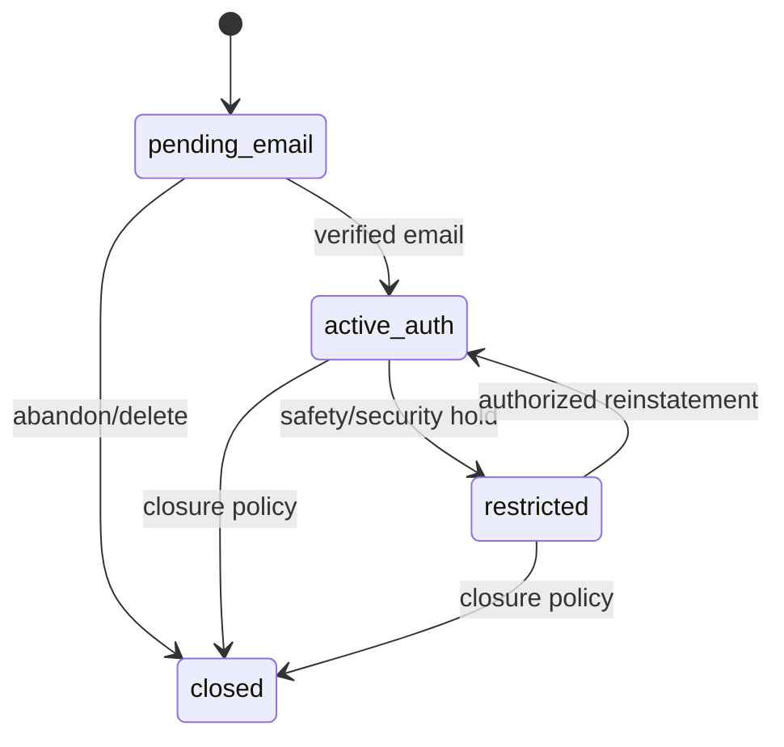
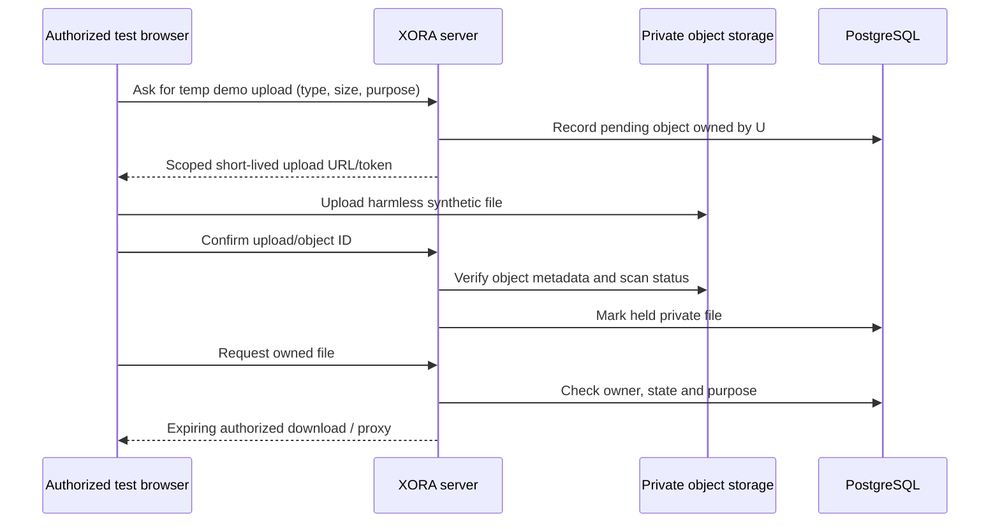

# XORA — Phase 2 Database, API, Auth and Storage Contract

**Purpose:** Implementation-level *design contracts* for the Phase 2 skeleton. These do not replace `DATABASE_SCHEMA.md` or `API_SPECIFICATION.md`, nor do they claim that a working API or database migration already exists.

## 1. Canonical design choices

| Subject | Contract | Reason |
|---|---|---|
| Runtime | One Next.js Node backend plus scheduled Node worker, same repository | Small-team operations and shared service layer |
| Persistence | Managed PostgreSQL and Drizzle-reviewed migrations | Data integrity and controlled schema changes |
| Auth | Better Auth *candidate*, exact version/adapter chosen in a documented spike | Avoid homegrown credential/session implementation |
| Application identity | XORA UUID referenced from a single canonical auth user mapping | Avoid inconsistent user IDs |
| Staff | Separate permission grants and MFA state; no UI-driven role switching | Security and audit |
| Resource authorization | Policy check after resolving target from DB | Object-level access, not simply route-level |
| API | `/api/v1` route convention, consistent problem JSON | Reuse future API specification |
| Transactions | DB unique/locks with request-scoped idempotency | Future one-free-intro and manual finance correctness |
| Media | Private buckets with server-issued scoped capabilities | No public ID/receipt/profile files |
| Jobs | Transactional outbox, idempotent scheduled consumer | Reliable generic notifications without external queue |
| Disabled features | Date/Casual live discovery, real payments, adult evidence, messages | Phase 2 is foundation, not an open marketplace |

## 2. Canonical IDs and timestamps

- App `account_id`: immutable UUID internal; do not use an email address as primary key.
- Auth adapter's user ID: owned by selected library. Record its type and uniqueness before creating app foreign keys.
- `staff_membership_id`: UUID and grants linked to `account_id` or auth user as approved.
- `request_id`: opaque trace value generated when absent; never an authentication credential.
- `resource_id` for files/outbox/audit: opaque UUID; not a guessable sequential ID.
- Timestamps: UTC in storage and JSON; front-end may format EAT (Africa/Kampala) for display.
- Integer UGX for **later** payment domain; not needed for Phase 2 synthetic orders.

## 3. Proposed initial tables and constraints

This is a design overview. Exact DDL/Drizzle schema must respect the chosen auth adapter and `DATABASE_SCHEMA.md`.

| Table | Required fields | Critical constraint |
|---|---|---|
| `accounts` | `id`, `auth_user_id`, `status`, `created_at`, `updated_at`, `version` | Unique auth-user mapping; DB-owned status |
| `staff_memberships` | `id`, `account_id`, `status`, `provisioned_by`, `created_at`, `revoked_at` | No self-provisioning via public endpoints |
| `roles` | `code`, `description`, `enabled` | Stable approved codes only |
| `permissions` | `code`, `description` | Versioned allowlist |
| `role_permissions` | `role_code`, `permission_code` | Unique pair |
| `staff_role_grants` | `staff_membership_id`, `role_code`, `granted_by`, `granted_at`, `revoked_at` | Grants only from privileged audited service |
| `audit_events` | `id`, `actor_id`, `action`, `resource_type`, `resource_id`, `outcome`, `request_id`, `created_at` | Append-only service logic; restricted select |
| `idempotency_records` | `id`, `actor_scope`, `operation`, `key_hash`, `payload_hash`, `status`, `result_ref`, `expires_at` | Unique `(actor_scope,operation,key_hash)` |
| `file_objects` | `id`, `owner_id`, `purpose`, `object_key`, `state`, `content_type`, `size_bytes`, `created_at`, `expires_at` | Unique key, private purpose-bound access |
| `file_access_events` | `id`, `file_id`, `actor_id`, `purpose`, `outcome`, `created_at` | Access history for sensitive future media |
| `outbox_events` | `id`, `type`, `dedupe_key`, `payload_version`, `payload_ref`, `state`, `created_at` | Unique dedupe key where required |
| `background_jobs` | `id`, `event_id`, `state`, `scheduled_at`, `lease_until`, `attempts`, `max_attempts` | Indexed due jobs; concurrent claims safe |
| `job_attempts` | `id`, `job_id`, `started_at`, `finished_at`, `outcome`, `error_class` | No sensitive payload in error logs |

**Auth library schema:** inspect its actual generated migrations with the pinned release, including credential accounts, sessions, verification tokens, MFA/TOTP/recovery state. Do not manually duplicate these tables from a guess. Product eligibility review records are a Phase 3 addition.

### Data invariants

1. An account has at most one canonical auth-user mapping.
2. A revoked staff membership has no effective staff permissions, regardless of cached UI state.
3. An idempotency record cannot be reused by the same actor+operation+key for a different payload hash.
4. A private file has exactly one owner/purpose and opaque storage key; changing owner requires a privileged audited operation.
5. A committed business event and its outbox notification are created in the same DB transaction.
6. At-least-once worker dispatch must not produce an irreversible duplicate business action.
7. Migrations run under different credentials than normal runtime.

## 4. Lifecycle: authentication versus eligibility



An authenticated `active_auth` **is not** an adult-eligible or profile-approved person. `adult_approved` and `profile_approved` remain separate decisions/records added in Phase 3. In Phase 2, member discovery and invitations are disabled even for verified-email users.

### Example safe `/api/v1/me` response

```json
{
  "data": {
    "account_id": "00000000-0000-4000-8000-000000000001",
    "account_status": "active",
    "email_verified": true,
    "eligibility_status": "not_available_in_phase_2",
    "profile_status": "not_available_in_phase_2"
  },
  "meta": { "request_id": "req_demo_001" }
}
```

This is demonstrative JSON, not a fixed schema assertion. Do not expose credential hashes, raw token, date of birth, IP/location history, staff role information or payment details in the response.

## 5. Endpoint POC table

| Route | Validation | Session / permission | Example response/error |
|---|---|---|---|
| `GET /api/health/live` | None | Health-system use | `200 {status:"ok"}` (no internal details) |
| `GET /api/health/ready` | None | Internal-only | `200/503`, sanitized dependency status |
| `GET /api/v1/me` | Cookie session | Verified user, not suspended | `200`; else `401/403` |
| `GET /api/v1/admin/health` | Safe optional filters | Staff MFA + dashboard permission | `200`; else `401/403` |
| `GET /api/v1/admin/audit` | Cursor, max limit | Staff MFA + audit permission | `200` redacted list or `403` |
| `POST /api/v1/_test/idempotency` | `Idempotency-Key`; bounded input | Staging-only auth + request scope | `200/201`, replay, `409` changed payload |
| `POST /api/v1/_test/files/issue-upload` | Purpose, size, type, checksum hint | Staging-only verified session | Temporary signed upload or `403/413/422` |
| `GET /api/v1/_test/files/{id}/download` | File UUID | Owner or specially scoped test staff | Short-lived read or `404` |
| `POST /api/v1/_test/events` | Allowlisted type + dedupe | Staging-only auth | `202`, outbox event ref |

`/api/v1/_test/*` must **not** be available in a live production build. Future auth handlers may be library-owned routes and must still receive custom XORA account/eligibility checks at the service boundary. Cookie-authenticated POST requests need CSRF/origin verification.

## 6. API response/problem conventions

Success response contains `data` and `meta.request_id`; list responses include an opaque cursor. HTTP statuses follow the existing API spec: `401` no session, `403` denied, `404` concealed inaccessible resource, `409` conflicting same key/stale state, `413` oversized upload, `422` invalid fields, `429` rate-limited and `503` unavailable. Errors are stable machine-readable XORA codes plus safe human wording; never echo private DB values.

### Example version conflict

```json
{
  "type": "https://docs.xora.example/problems/state-conflict",
  "title": "This action could not be completed",
  "status": 409,
  "code": "STATE_CONFLICT",
  "request_id": "req_demo_002"
}
```

## 7. Idempotency transaction design

```mermaid
sequenceDiagram
 participant B as Browser
 participant API as Authorized API
 participant PG as PostgreSQL
 B->>API: POST with key K, payload P
 API->>PG: BEGIN; reserve (actor,operation,K) + hash(P)
 alt new unique key
   API->>PG: perform one synthetic state change + record result
   API->>PG: COMMIT
   API-->>B: 201 result + request_id
 else same key and same payload
   API->>PG: load original committed result
   API-->>B: 200/201 replay (no new state change)
 else same key and changed payload
   API-->>B: 409 KEY_REUSED
 end
```

**Crash semantics:** if commit fails no state change should remain; if response fails after commit a retry must replay committed result. Include concurrent load test against genuine PostgreSQL. Store a normalized payload hash and only safe result metadata, never the full sensitive request. The design must later support additional finance keys with appropriate retention beyond the generic test TTL.

## 8. Storage request contract



Files remain private after upload, regardless of whether the browser guessed a storage URL. Direct bucket listing and public ACLs are disabled. If the chosen object store cannot meet these requirements, select another vendor. The Phase 2 test uses only generated files, not evidence photos.

## 9. Outbox and scheduled worker contract

- Allowed initial event types: `test.generic_notification`, `test.audit_smoke`; no member or payment contents.
- Event is inserted with application state in one transaction.
- Worker claims eligible job with lease, records attempt and sends to sandbox email sender.
- Success sets done; recoverable failure schedules retry with exponential backoff and jitter; retry exhaustion moves to failed/dead-letter state and alerts operator.
- Another worker must not claim same live lease. When lease expires after crash, safe reprocessing is allowed; downstream email may duplicate, hence stable dedupe headers/reference where available.
- Job payload versions are explicit and validated; unknown versions cause safe failed-state alert rather than unpredictable execution.

## 10. Migration and environment contracts

- Auth adapter schema is generated only from the selected pinned release and inspected.
- All migrations apply deterministically from blank DB to current, and from prior test fixture schema.
- Keep migration history; never alter an already applied file to disguise drift.
- Use an application DB role for runtime and a more privileged migration role for controlled release jobs.
- Staging seeds create fake users and separately MFA-protected staff roles; production never receives test staff credentials or fake financial approvals.
- Tests destroy only disposable databases and must refuse to run against a production-like URL by design.

## 11. Future seams demonstrated, not activated

`accounts`, `eligibility`, `profiles`, `discovery`, `invitations`, `messages`, `orders`, `settlements`, `entitlements`, `promotions`, `moderation` will each later use the same request ID, auth guard, audit, idempotency, DB transaction and job/outbox contracts. Proving these building blocks now reduces risk of fake payment approval, duplicate entitlement grants and invitation-credit race bugs later. **Phase 2 does not implement actual payment approval or matching.**

## 12. Sign-off and evidence required

- Checked auth library table ownership and compatible database adapter.
- Migration replay and unique-constraint tests.
- A guest/member/staff authorization matrix with response evidence.
- Staging-only test endpoints inaccessible in production placeholder.
- Same-key and concurrent idempotency tests against real disposable PostgreSQL.
- Private file cross-account/expired-link denials.
- Worker crash/retry/dedupe test and email sandbox delivery.
- Safe exception/PII logging review and backup restore test.
