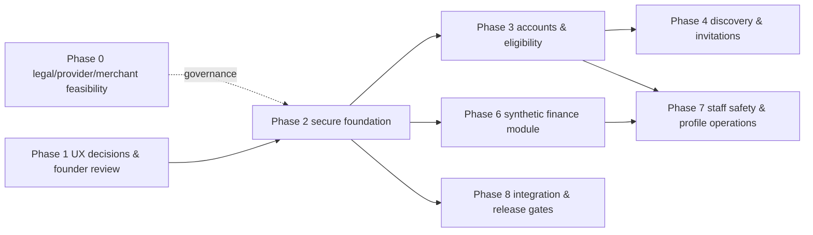
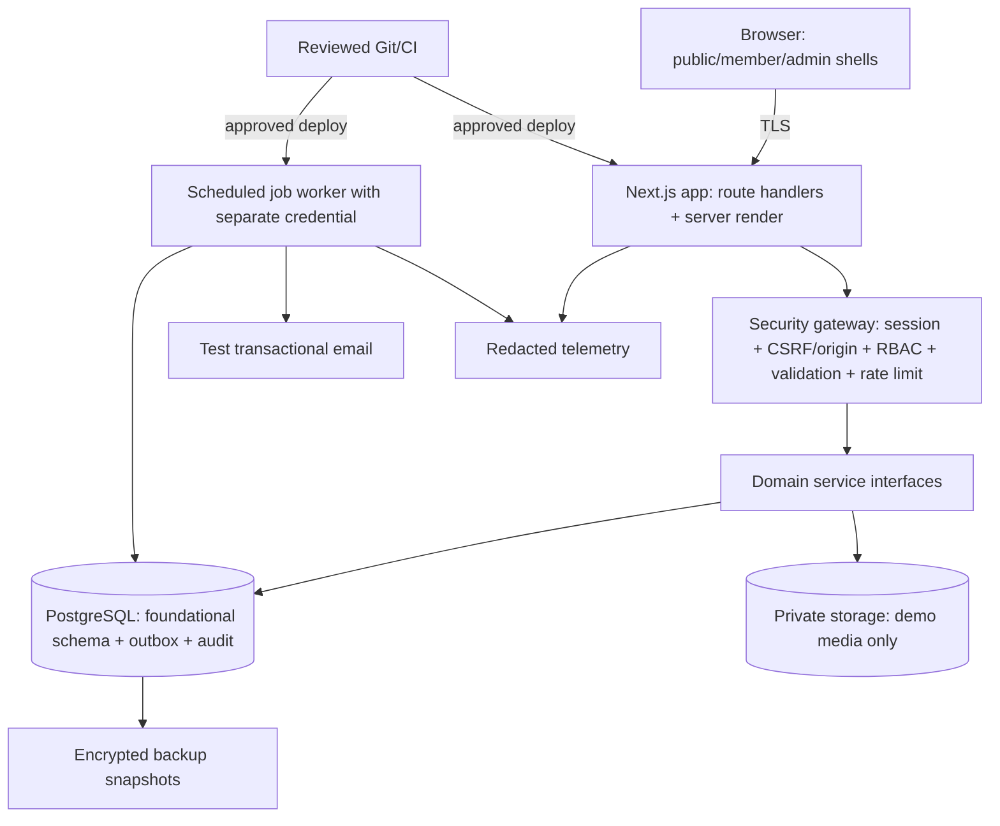

# XORA — Phase 2 Engineering Foundation: Detailed Blueprint

**Document:** `XORA_PHASE2/PHASE2_ENGINEERING_BLUEPRINT.md`  
**Version:** 1.0 | **Date:** 22 November 2026 | **Status:** Engineering design proposed; no live software or deployment implied  
**Authoritative inputs:** `PRD.md` v1.2, `ARCHITECTURE.md` v1.0, `DATABASE_SCHEMA.md` v1.0, `API_SPECIFICATION.md` v1.0, `TECH_STACK.md` v1.0, `PHASES.md` §6, and the Phase 1 handoff.  
**Primary outcome:** A reproducibly deployable **secure XORA skeleton**, with genuine server-side controls but only **synthetic/demo data** pending Phase 0 clearance.

> **Boundary:** XORA is an adults-only, non-compensated dating/casual-connection web app, not an escort booking platform. Manual MTN/Airtel payment *processing* is designed for Phase 6, not enabled in Phase 2. No real receiving number, real transfer, real member identification, real dating photos, real evidence or live invitations are to be accepted during this stage. Provider, legal and privacy approval must precede any real operation.

## 1. Executive decision: what Phase 2 actually is

Phase 1 supplied a fictional-data interactive UX prototype and design documents. Phase 2 is the **first codebase with deployable server-side infrastructure**. Its purpose is not to build every screen or to process subscriptions; it is to prove that XORA can safely host the later functionality without repeatedly redesigning identity, data, access control or releases. At the end of Phase 2, an engineer should be able to deploy a safe *staging* instance from a reviewed Git change, open public and protected placeholder pages, sign in through a proof-of-concept identity flow, test staff denial/allowance, write and migrate synthetic PostgreSQL records, access a private test file only when authorized, deliver an outbox test notification and restore a backup into a disposable database. No member marketplace should be live.

**Principles:** secure-by-default; privacy-by-design; development on affordable managed infrastructure; database as the source of truth; explicit staff authorization; predictable restore and rollback; owner-readable operations; testable acceptance evidence.

### In scope

1. A single repository and version-pinned Next.js/React/TypeScript modular monolith.
2. Responsive public/member/admin layout shells using approved Phase 1 tokens and accessible controls.
3. Backend request conventions for `/api/v1`, schema validation, structured errors, request IDs and rate limits.
4. Authentication proof-of-concept: registration restricted to dummy staging users; email verification; secure cookie session; logout/session revocation; role-scoped staff sign-in and MFA proof.
5. PostgreSQL and reviewed migrations for foundational identity, staff/security, audit, idempotency, outbox/jobs and storage metadata. Product tables may be empty placeholders where they support future foreign keys.
6. Reusable authorization layer, server-only service boundaries, module interfaces and an initial role-permission matrix.
7. Private object-storage upload/download test including short-lived authorization and no public receipt/identity URL.
8. Outbox/worker test with generic email, retries, lease expiry, failure queue and safe logs.
9. Local/staging/production-placeholder environment separation; CI security and quality gates; protected deploys; backup/restore evidence; observability and alerting.
10. Written runbooks, threat model, traceability, foundation test report and explicit sign-off.

### Explicitly out of scope

Public real-user signup; actual 18+ verification/evidence capture; published member profiles; real dating discovery/matching/introductions/chat; live plans or paid promotion; real Mobile Money collection or financial settlement; production email to real customers; activation from receipt submission; public launch; native mobile apps; ML matching; external chat/video services. Later phases own these features. Prototype shortcuts **must never be copied as production authorization**, including the Phase 1 demo's switchable admin role.

## 2. Dependency and approval gates



**Gate decision:** If Phase 0 legal/payment/vendor clearance or formal Phase 1 founder approval remains unresolved, engineering may use developer-local and **access-controlled staging only**, with fake users/transfers/media and no public join/checkout. The founder must not interpret a working staging URL as legal or commercial approval.

### Phase 2 acceptance, exactly matching `PHASES.md` §6

| ID | Required deliverable | Evidence produced | Fails if |
|---|---|---|---|
| P2-G01 | Repository and selected compatible stack | Commit, lockfile, dependency record, CI | Install/build cannot reproduce |
| P2-G02 | Accessible app shell and design tokens | Screen demos at common widths, keyboard test | Staff/public routes leak or layout fails |
| P2-G03 | Separate environments and secrets | Environment register, staging deploy details, secret scan | Staging uses production secret or recipient |
| P2-G04 | Database and migrations | Reviewed SQL, migration replay, synthetic seeds | Drift or destructive migration unexplained |
| P2-G05 | Session/verified-email auth + protected API | HTTP tests, cookie settings, MFA demo | Anonymous or member reaches staff API |
| P2-G06 | Permission guards, validation, idempotency | Authz matrix and competing-request tests | Same key executes write twice |
| P2-G07 | Private storage test | Access-denial and signed access tests | Public or unauthorized file retrieval |
| P2-G08 | Background outbox + email | Retry/lease/dedupe tests; test inbox | Job silently lost or sends sensitive content |
| P2-G09 | CI/build/smoke and deployment | Pipeline output, deploy/rollback rehearsal | Unreviewed change deploys to protected env |
| P2-G10 | Observability, backups, restore | Redacted sample traces, restore checksum | Restore untested or private data in logs |

## 3. Architecture and runtime boundaries

XORA's Phase 2 architecture is **one deployable Next.js web service with domain modules**, one PostgreSQL database, **separate private storage areas**, and a scheduled/worker runtime using the same codebase but an independent job process. The worker is a process role, **not** a new microservice. Email is dispatched asynchronously via approved test/sandbox mode. CDN serves static branded resources only; no private profile/evidence/case files are cached publicly. Staging uses a distinct database, storage namespace, auth secret and email sender configuration.



### Trusted / untrusted boundaries

| Boundary | Untrusted input | Guardrail | Privileged side |
|---|---|---|---|
| Browser → API | Form fields, cookies, URL params, idempotency keys | Validate + authenticate + authorize + ownership check + rate limit | Domain service |
| Browser → object storage | Filename, MIME, file bytes, request intention | Server-issued short-lived upload token scoped to a single temp object; scan and review before serving | Private media namespace |
| Staff browser → API | Role claims, target IDs, action reason | Server-fetched grants, MFA and step-up for sensitive actions, audit | Staff service |
| API → database | Request transactions | Database permissions + atomic SQL + constraints | PostgreSQL |
| Scheduler → data/email | Untrusted queued metadata | Job type allowlist, payload schema, dedupe, retry ceiling | Outbox consumer |
| CI → staging/production | Build artifact, migrations, env vars | Protected credentials, artifact provenance, manual gates | Deploy environment |
| Hosting vendor → private records | Infrastructure access | Vendor review, encryption, region/transfer review, DPA where needed | Data controller |

## 4. Proposed repository and code ownership

```text
xora/
  app/
    (public)/                  landing, legal/help placeholders
    (auth)/                    login/verify/reset proof-of-concept
    (member)/                  protected responsive shell
    admin/                     staff-only shell; no public demo role-switcher
    api/v1/                    application-owned REST handlers
    api/auth/[...all]/         auth-library route adapter (verified against pinned release)
  components/
    ui/                        accessible buttons, dialogs, inputs, alerts
    layout/                    headers, mobile nav, admin sidebar
    feedback/                  loading, errors, offline, toasts
  modules/
    accounts/                  account app states, settings interface
    eligibility/               future 18+ review interface, disabled
    discovery/                 future match interface, disabled
    invitations/               future free-introduction service, disabled
    messages/                  future chat interface, disabled
    catalog/                   future paid products, seeded test-only
    payments/                  future manual reconciliation, disabled
    entitlements/              future pass dates, disabled
    promotions/                future featured placement, disabled
    moderation/                future case management, disabled
    support/                   future support queue, disabled
    admin/                     permission evaluation + shell
  lib/
    auth/                      auth adapter and server session helpers
    authorization/             permission matrix + object scope policy
    config/                    validated environment variables
    db/                        connection and transaction helpers
    idempotency/               reusable operation-key guard
    storage/                   private file access policy
    mail/                      templating + test sender adapter
    jobs/                      outbox producer + worker contracts
    audit/                     immutable action record helper
    observability/             sanitized logs/metrics/request IDs
    validation/                shared Zod request/response definitions
  db/
    schema/                    Drizzle definitions incl auth adapter ownership
    migrations/                committed, reviewed SQL
    seeds/                     synthetic accounts, staff, cases, price catalog
  workers/                     job processing entry point
  tests/
    unit/ integration/ contract/ e2e/ security/ restore/
    fixtures/                  synthetic data only
  docs/                        source specifications + ADRs + evidence
  scripts/                     safe local setup, migration status, smoke, restore
  public/                      non-sensitive assets only
  .github/workflows/            PR and protected deploy checks
```

**Layering rules:** Page/route may call module service; module service may call its repository, authorization library, DB transaction helper and outbox; a UI component may not import a DB client or secret; server-only packages must fail build on browser import. Auth library owns credentials/sessions; XORA app tables own dating preferences and entitlements. Cross-module writes require explicit service orchestration and a single DB transaction when invariants require it. Shared types must not expose database-private fields to browser bundles.

**Dependency rule:** `app → modules → lib/DB`, while `components` may depend on safe UI types only. No domain module imports route handlers or `app` files. Each new module receives a README with public API, owned tables, authorized role operations and tests. Do not create one catch-all `utils.ts` with unrestricted database access.

## 5. Foundation data design and migration boundary

Phase 2 should implement only the **minimum platform tables** and adapters needed to prove the architecture, while preserving names and decisions in `DATABASE_SCHEMA.md`:

| Group | Baseline records | Phase 2 purpose |
|---|---|---|
| Auth-provider-managed | users/auth accounts/sessions/verification/two-factor tables *according to selected adapter* | Login and session POC; do not guess auth schema |
| XORA identity mapping | `accounts` account state, auth user reference, created/updated timestamps | Stable domain identity and future privacy rules |
| Staff | `staff_memberships`, `roles`, `permissions`, `role_permissions` or equivalent | Server-side RBAC independent of client presentation |
| Security | `audit_events`, `idempotency_records`, `rate_limit_counters` (if persisted) | Evidence for sensitive operations and duplicate prevention |
| Jobs | `outbox_events`, `background_jobs`, `job_attempts` | Reliable email/test event and retry controls |
| Media | `file_objects`, `file_access_events` | Private test-upload metadata without public URL |
| Operational | `schema_versions` or Drizzle migration history; optional `system_health_events` | Drift visibility and recovery evidence |

**Later tables, not active now:** real `profiles`, `verification_evidence`, `invitations`, `conversations`, `payment_orders`, `settlement_records`, `membership_entitlements`, `promotion_slots`, `refunds`. Their future structures can be prepared, but any endpoint to create or use real records remains disabled in Phase 2.

### Non-negotiable database conventions

- Every domain entity has an immutable UUID primary key and time fields stored in UTC; account displays use a separate public-safe ID/reference. All user-provided input is bounded and validated.
- Money is represented **only as integer UGX**, but real money rows are not created in Phase 2.
- Schema changes are committed, peer-reviewed, and applied to dev → staging → production placeholder in that order. Never use interactive schema push on production.
- Keep at least one migration and one safe additive follow-up migration in the rehearsal so team learns forward-only changes.
- Rehearse dropping and restoring disposable staging test data. **Never** rehearse on the production database.
- Record auth-adapter table ownership and how `accounts.id` maps to auth user IDs; no duplicate session authority.
- Storage references store object keys, review status and retention metadata; no public bucket URLs inside member tables.
- Use DB transactions and unique constraints for idempotency; not merely client-side disabled buttons.
- Sensitive DB access uses app/service role only; migration role is separate and not available to the runtime.

## 6. Identity and staff access proof-of-concept

### Lifecycle

`create synthetic user → email verification token delivered to test inbox → verify → establish HttpOnly cookie session → /api/v1/me returns owned safe data → logout → old session rejected`.

The registration proof can run in a closed staging environment. **Email verification does not prove the person is an adult**. Real adulthood/ID methods and decisions belong to Phase 3 after approval. Never allow `email_verified=true` to imply `adult_verified=true`.

### Session policies

- Cookie attributes: `Secure` in HTTPS environments, `HttpOnly`, appropriate `SameSite`, limited path/domain and an intentional expiration. Use the auth library's supported session and rotation behavior, not a custom session token in localStorage.
- Session lookup and permission evaluation occur server-side at every privileged request; middleware/page guards are **UX conveniences**, not the only enforcement.
- Require confirmed email before a normal member session if supported by chosen auth flow. Detect token replay, expiry, logouts and sessions invalidated after lock/suspension.
- Staff accounts are explicitly provisioned and approved; normal signup cannot set `role=admin`, `verified=true` or `is_staff` via JSON.
- Staff must pass MFA before staff-only access. Favor phishing-resistant MFA where feasible; if unavailable, use supported authenticator TOTP and secure recovery codes as a minimum proof. Recovery cannot bypass approval or audit.
- Set maximum session age and idle timeout more strictly for staff than for members; step-up auth for privileged security/account changes.
- Display the user's own session list/revocation in a later phase; Phase 2 proves server-side forced revocation.

### Permission model

Example permissions for proof-of-concept: `member.read_self`, `staff.dashboard.read`, `staff.audit.read`, `staff.config.read`, `staff.accounts.review`, `staff.finances.review`, `staff.finances.approve`, `staff.roles.manage`. Future fine-grained entitlements are configured **deny-by-default**. Role names are not access grants unless mapped to these permissions in the database and checked server-side.

| Actor | Public page | `/api/v1/me` | `/admin` shell | `/api/v1/admin/health` | `/api/v1/admin/audit` |
|---|---:|---:|---:|---:|---:|
| Anonymous | ✓ | 401 | Sign-in redirect | 401 | 401 |
| Normal member | ✓ | Own safe profile | 403 | 403 | 403 |
| Support staff (MFA) | ✓ | Own safe profile | ✓ | ✓ if assigned | 403 by default |
| Finance reviewer (MFA) | ✓ | Own safe profile | ✓ | ✓ if assigned | Permission-gated |
| Owner (MFA) | ✓ | Own safe profile | ✓ | Permission-gated | Permission-gated |
| Restricted/suspended user | ✓ | 403 or minimal status | 403 | 403 | 403 |

The **object rule** is always separate: being support staff does not mean seeing another member's receipt or identity photo. Prove one ownership denial (`member A cannot fetch member B's demo private object`) and one privileged denial (`finance reviewer cannot change staff role`). No role switch available on the real application.

## 7. Initial API contracts and standards

Implement a small **contract proof**, not the entire `API_SPECIFICATION.md`. All routes use its request ID, problem response, status, UTC and idempotency patterns.

| Endpoint or operation | Method | Allowed | Proof condition |
|---|---|---|---|
| `/api/health/live` | GET | infrastructure check | Process alive; intentionally no secrets or member data |
| `/api/health/ready` | GET | internal/monitor only | DB and critical dependency readiness; no sensitive output |
| `/api/v1/me` | GET | verified session | Current user's safe ID, account status, no auth internals |
| `/api/v1/admin/health` | GET | authorized MFA staff | Redacted job/DB/queue summary |
| `/api/v1/admin/audit` | GET | designated audit/owner permission | Paginated redacted synthetic audit history |
| `/api/v1/_test/idempotency` | POST | staging-only test identity | Same key + payload returns stored result once; different payload => conflict |
| `/api/v1/_test/files/issue-upload` | POST | authorized staging identity | One purpose-bound temporary upload capability |
| `/api/v1/_test/files/{id}/download` | GET | authorized owner/test role | Short-lived read or proxy; other user denied |
| `/api/v1/_test/events` | POST | authorized staging test identity | Store outbox event and test email request in one transaction |

**Staging-only endpoints must be absent or hard-disabled in production bundles, not merely hidden in navigation.** Auth library route paths can be adapter-owned; use a wrapper/compatibility contract so later `API_SPECIFICATION.md` is honored. Deny all undocumented/unused admin operations.

### Standard error body

```json
{
  "type": "https://docs.xora.example/problems/forbidden",
  "title": "You do not have access to this resource",
  "status": 403,
  "code": "FORBIDDEN",
  "request_id": "req_demo_abc"
}
```

Do not leak permission names, emails, other people's IDs, or internal DB/stack traces in public errors. The request ID is safe to share with support and link to redacted logs.

## 8. Idempotency and concurrency foundation

This phase proves the mechanism later needed for free invitation acceptance and manual payment approval. A test mutation must accept `Idempotency-Key` bound to `(actor_id, operation, normalized_payload_hash)`. The server begins a DB transaction, locks or reserves that key and either returns the **same stored result**, waits safely for the first request, or rejects a different payload for the same key with `409 IDEMPOTENCY_KEY_REUSED`. Retain only the minimum safe response data and expire records according to policy. The insertion and domain write must be within the same transaction; a crash cannot preserve an applied mutation without an idempotency record or vice versa.

**Critical test:** race two simultaneous requests with identical key and payload against real PostgreSQL; assert exactly one write and a deterministic idempotent replay. Test changed payload, timeout, rollback, connection failure and user A reusing user B's key. A client-side `disabled` attribute does not satisfy this test.

## 9. Private storage proof-of-concept

Use separate **synthetic** storage namespaces/buckets for public branding, approved profile media (later), sensitive evidence (later), and demo test uploads. Identity/receipt evidence must not share a public profile bucket. Suggested future file phases: `requested → uploaded_private → scanned → review_pending → approved/rejected → expired/deleted`. Phase 2 can simulate scan/review outcome with a generated tiny test asset; do not claim an antivirus or age/identity-check integration exists.

**Upload sequence:** authenticated member asks server for one short-lived upload capability; server validates purpose, size budget and account scope, assigns opaque object key and records pending metadata; browser uploads to private bucket or via authorized server proxy; server verifies object existence/content type and reprocesses images before later serving; read requests re-check ownership and purpose, yielding an expiring signed read or streaming proxy. Avoid logging signed URLs. Reject SVG/script-bearing files for proof/ID use; enforce content sniffing and size limits. Strip EXIF and GPS before displaying any approved profile derivative.

**Required evidence:** anonymous URL 403/404; cross-user URL 403/404; signed URLs expire; read revoked after access removal; uploaded test file cannot be indexed; object never appears under `public/`; staff raw-evidence access is audited and restricted. Production evidence-storage configuration must wait for legal/privacy review.

## 10. Worker, outbox and generic notification

In one database transaction, a test action writes its state plus an `outbox_events` record. A separately run worker claims events with a lease/lock (`FOR UPDATE SKIP LOCKED` pattern or equivalent), sends a **generic** email to an approved sandbox sink, records delivery attempt/outcome, and marks done or schedules retry with backoff. Multiple worker instances cannot process one event concurrently. A crashed worker's lease expires and another retry can safely handle it; downstream delivery can still duplicate, so use a notification dedupe key where available.

**Never send:** profiles, Date/Casual preference, private conversations, IDs, receipts, raw payment records or detailed connection information in email subject/previews. The email content at Phase 2 is a nonsensitive dummy notice. Test email failure, slow sender, duplicate job claim, missing row, poison payload and successful replay. **A failed email does not undo a valid database action**; the outbox holds it for later retry.

## 11. Release design and infrastructure topology

### Environments

- **Local:** fake accounts; local disposable PostgreSQL; mocked email or inbox emulator; local S3-compatible emulator; no live secrets.
- **Staging:** private/password/identity-gated URL; separate cloud DB/storage/email sandbox; synthetic accounts; test admin with MFA; remote logs; real deployment pipeline; never real business recipient or member.
- **Production placeholder:** configuration and permission policies ready; public landing disabled/private holding page; no live signup, checkout, member photos or transfer instructions. Only promote after separate legal and release approval.

### Deployment sequence

`feature branch → tests → review → main branch → build immutable artifact → staging migration (reviewed) → deploy staging → smoke + authz + storage tests → approval record → production-placeholder deployment (if authorized) → smoke/readiness → observe`. Use expand/backfill/contract migrations, favoring backward compatibility; a database rollback is not necessarily reversible. Restore/backups are last-resort recovery, **not** the default rollback strategy.

### Security envelope

TLS, HSTS when safe, CSP with nonce/hash after testing, X-Content-Type-Options, Referrer-Policy, sensible Permissions-Policy, secure cookies, origin/CSRF protection, inbound request limits, outbound hostname allowlists where practical, no directory listing, no debug route, no publicly browsable admin pages. Sensitive responses set `Cache-Control: no-store`. Build and CDN cache rules must not publish personalized SSR content.

### Monitoring and recovery

Monitor availability/readiness, error rate, 5xx, auth failures/rate-limit spikes, DB connection budget, job lag/failures, storage upload errors, backup status and security exceptions. Alerts must reach named real operators (not an unstaffed inbox). Logs preserve request ID, status, route template, duration, internal error class and sanitized actor reference—never password, token, email verification code, profile intent, chat, receipt or identity image.

**Proposed engineering targets to approve (not promises):** internal availability checks every 5 minutes; initial staging backup recovery objective RPO ≤24h and RTO ≤8h, refined after vendor evaluation and real restore drills; staging critical authz incidents reviewed same day; production goals established separately before launch. These are planning defaults, not measured platform performance.

## 12. Day-by-day work streams, not fictional calendar promises

1. **Stream A — foundations:** repo, lint/typecheck, pinned stack, UI tokens, shell and route partitioning.
2. **Stream B — persistence:** DB instance, auth adapter, foundational tables, migrations, seeds and transaction helpers.
3. **Stream C — trust:** verified-email auth, secure cookie sessions, staff MFA, permission checks and account restrictions.
4. **Stream D — restricted assets:** file permission design and test upload/retrieve, evidence-access audit.
5. **Stream E — operations:** outbox, worker, test email, logging, alerts and health endpoints.
6. **Stream F — deployment and quality:** CI, staging isolation, migrations, backups, recovery, real integration tests, security review.

Do not sequence these into fixed dates without team staffing, vendor lead times and approved budget. The detailed tickets and dependency graph are in `PHASE2_EXECUTION_BACKLOG.md`.

## 13. Explicit handoff to later phases

Phase 2 will export stable contracts that later teams can build against: `requireSession`, `requireVerifiedEmail`, `requireStaffPermission`, `requireOwnedResource`, `transaction`, `idempotentMutation`, `auditPrivilegedAction`, `createPrivateUpload`, `getAuthorizedDownload`, `enqueueOutbox`, `sendGenericNotification`, `getValidatedConfig`, `requestId` and `problemResponse`. Those names are conceptual contracts, not claims of implemented functions.

Phase 3 replaces synthetic member records with approved adult eligibility flow and real controlled profile onboarding; Phase 4 adds discovery and invitation state machine; Phase 5 adds persisted mutual messaging; Phase 6 uses the *same idempotency, outbox, roles and transaction helpers* to implement manual transfer settlement; Phase 7 expands staff operational controls. No phase should bypass the common permission boundary.

## 14. Quality bar and final deliverable record

At completion, attach: commit SHA and lockfile; dependency compatibility table; architecture change ADRs; signed role policy; migration history and schema checksum; sanitized DB restore drill notes; mocked email delivery output; private media access-denial results; auth cookie and MFA evidence; automated pipeline logs; staging URL access policy (do not publish credentials); screen reader/responsiveness audit; deployment/rollback runbook; owner operations sheet; unresolved risks; named security and founder reviewers.

**Possible gate states:** `BLOCKED` (mandatory precondition absent), `DESIGNED` (documents only), `BUILT_NOT_VALIDATED` (code exists but tests incomplete), `PASS_WITH_RESTRICTIONS` (synthetic staging passes; no live activation), `PASS` (every Phase 2 test passes, with formal review). This design document is currently **DESIGNED**, not `PASS`.

## 15. Official references and source-of-truth caution

- Next.js authentication and route handler security: https://nextjs.org/docs/app/guides/authentication
- Better Auth email/password and verification: https://better-auth.com/docs/authentication/email-password
- Better Auth two-factor plugin: https://better-auth.com/docs/plugins/2fa
- Drizzle migration workflows: https://orm.drizzle.team/docs/migrations
- OWASP ASVS 5.0 verification: https://asvs.owasp.org/

Versioned third-party libraries evolve. Before implementation, pin patched compatible releases and test their actual adapters, session behavior and migration commands rather than assuming illustrative snippets are current executable code.
