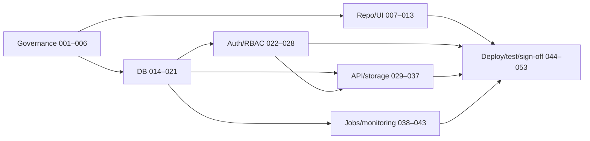

# XORA — Phase 2 Engineering Delivery Backlog

**Status:** Proposed ticket breakdown, not completed work. **53 detailed tickets** grouped into seven delivery streams. Source: `PHASES.md` §6 and `PHASE2_ENGINEERING_BLUEPRINT.md`.

## How to use this backlog

Create one tracked issue per ticket. Attach a link to the affected PRD/API/database contract, branch/PR, test run and owner. **P0** means mandatory for secure Phase 2 foundation; **P1** means required to complete full design handoff/quality but should not weaken P0 gates. Relative size **S/M/L** expresses complexity only, **not** fixed duration or price. Start with vendor/legal constraints; an unapproved live activity must remain entirely disabled.

**Definition of Ready:** scope and acceptance are understood; dependencies checked; security/data classification reviewed; owner known; synthetic fixtures available. **Definition of Done:** reviewed code, passing targeted unit/integration/security tests, staging evidence, no new secrets/PII, documentation and rollback/feature-flag impact recorded. A ticket is not complete just because a UI screen exists.

## Dependency overview

## A — Governance and prerequisites

| ID | Ticket | Owner | Priority | Size | Acceptance evidence | Dependencies |
|---|---|---|---|---|---|---|
| P2-001 | Record Phase 0 and Phase 1 gate status | Founder | P0 | S | Document signed/unsigned legal, provider, UX decisions; hard-disable real-user and real-payment paths where pending | None |
| P2-002 | Confirm team roles and review authority | Founder | P0 | S | Name engineering, security, finance/privacy and release approvers; no single role can silently self-approve | P2-001 |
| P2-003 | Write technology compatibility ADR | Engineering | P0 | M | Record Node, Next.js, TypeScript, Drizzle, DB, auth, test versions from tested compatibility spike; pin patched lockfile | P2-001 |
| P2-004 | Vendor/hosting acceptable-use scorecard | Legal/Privacy | P0 | M | Compare ≥2 candidates for actual lawful activity, data handling, email, storage and DB; retain evidence and unresolved blockers | P2-001 |
| P2-005 | Define security/privacy data classification | Security | P0 | M | Classify public, account, member-private, staff-restricted, identity/receipt evidence; no public media assumption | P2-001 |
| P2-006 | Approve role-permission matrix | Security | P0 | M | Support/finance/safety/owner distinctions signed; default denied; staff MFA requirement recorded | P2-002 |

## B — Repository and design shell

| ID | Ticket | Owner | Priority | Size | Acceptance evidence | Dependencies |
|---|---|---|---|---|---|---|
| P2-007 | Create protected Git repository | Engineering | P0 | S | Main branch protection, review rules, no public secrets, CODEOWNERS or equivalent documented | P2-002 |
| P2-008 | Scaffold Next.js modular monolith | Engineering | P0 | M | App Router, modules/, lib/, db/, workers/, tests/ align blueprint; no browser DB imports | P2-003,P2-007 |
| P2-009 | Install lint/format/typecheck tools | Engineering | P0 | S | npm lint, typecheck, format checks pass with strict TS and lockfile | P2-008 |
| P2-010 | Port Phase 1 visual tokens | Frontend | P1 | M | Colors/spacing/type, accessible primitives and coherent responsive public/member/admin shell | P2-008 |
| P2-011 | Implement safe route partitions | Frontend | P0 | M | Public, member, admin page shells; demo admin role switch removed; user cannot load private SSR data anonymously | P2-010 |
| P2-012 | Implement generic form and feedback states | Frontend | P1 | M | Accessible labels/focus, loading/error/empty/offline behavior without confidential content | P2-010 |
| P2-013 | Set client performance and cache defaults | Frontend | P1 | M | No personalized response in shared caches, no sensitive analytics, mobile performance baseline measured | P2-011 |

## C — Database and migration foundation

| ID | Ticket | Owner | Priority | Size | Acceptance evidence | Dependencies |
|---|---|---|---|---|---|---|
| P2-014 | Provision disposable local PostgreSQL | Engineering | P0 | S | One-command local setup using dummy users; tests refuse non-disposable DB | P2-008 |
| P2-015 | Provision separately secured staging database | DevOps | P0 | M | Private access and distinct credentials; explicit owner, backup settings and connection limits | P2-004 |
| P2-016 | Validate auth library and adapter schema | Engineering | P0 | M | Migrations inspected from actual pinned version; identity mapping design signed | P2-003,P2-014 |
| P2-017 | Implement foundational Drizzle tables | Backend | P0 | L | Accounts, staff grants, audit, idempotency, file metadata, outbox/jobs; constraints tested | P2-016 |
| P2-018 | Establish migration generation/review process | Backend | P0 | M | CI migration diff checked; migration role distinct; no runtime schema push | P2-017 |
| P2-019 | Create synthetic seed catalog | Backend | P0 | M | Fake member/staff identities and dummy media; no raw IDs/real MoMo refs; repeatable data | P2-017 |
| P2-020 | Test blank/prior-schema migrations | QA/Backend | P0 | M | Clean and incremental migrations pass; duplicate apply safe; drift and destructive SQL flagged | P2-018 |
| P2-021 | Build DB transaction and repository helpers | Backend | P0 | M | Typed transactions, error mapping, row lock and connection limit standards; no raw DB in UI | P2-017 |

## D — Authentication and authorization

| ID | Ticket | Owner | Priority | Size | Acceptance evidence | Dependencies |
|---|---|---|---|---|---|---|
| P2-022 | Implement verified-email login POC | Backend | P0 | L | Sandbox email verification; no session until required verification; reset tokens expire once used | P2-016,P2-021 |
| P2-023 | Secure sessions and logout/revocation | Backend | P0 | M | HttpOnly/Secure/SameSite tested; logout revokes; suspended account denied on next request | P2-022 |
| P2-024 | Provision staff out-of-band | Security/Backend | P0 | M | No self-registration as staff; grants made by audited privileged operation; fake staff for demo | P2-006,P2-023 |
| P2-025 | Implement staff MFA proof | Backend | P0 | L | Staff restricted until MFA; single-use recovery, revocation and reset behavior verified | P2-024 |
| P2-026 | Create requireSession and requirePermission | Backend | P0 | L | Route- and resource-level checks; finance cannot read evidence; member cannot open admin | P2-023,P2-025 |
| P2-027 | Implement restricted account behavior | Backend | P0 | M | Server-side deny on restricted/suspended status without erasing audit | P2-026 |
| P2-028 | Security review of cookie/CSRF/CORS | Security | P0 | M | Cross-origin state mutation rejected, redirects allowlisted and headers checked | P2-026 |

## E — API, idempotency and protected files

| ID | Ticket | Owner | Priority | Size | Acceptance evidence | Dependencies |
|---|---|---|---|---|---|---|
| P2-029 | Implement request ID/problem response middleware | Backend | P0 | M | All sample API errors carry safe code/request id; no stack traces or private data | P2-008 |
| P2-030 | Implement typed server validation | Backend | P0 | M | Zod (or equivalent) rejects unknown/overlong/invalid fields; UI validation never trusted | P2-029 |
| P2-031 | Implement /api/v1/me and admin health | Backend | P0 | M | Ownership/staff MFA and redacted response tests pass | P2-026,P2-030 |
| P2-032 | Build persistent idempotency guard | Backend | P0 | L | Same actor/operation/key + same payload applies once, changed payload conflicts, crash-safe | P2-021,P2-030 |
| P2-033 | Race-test idempotent test mutation | QA/Backend | P0 | L | Simultaneous same-key calls against PG yield one write, replay identical; cross-actor isolation | P2-032 |
| P2-034 | Configure private test storage bucket | DevOps | P0 | M | No public ACL/list; namespace separate from profile/evidence future data; least privilege | P2-004,P2-015 |
| P2-035 | Implement scoped synthetic upload capability | Backend | P0 | L | Allowed mime/size/purpose; opaque key; expiring token; uploads remain private | P2-026,P2-034 |
| P2-036 | Implement protected file retrieval and audit | Backend | P0 | M | Owner allowed, anonymous/cross-user/expired token denied; events logged without signed URL | P2-035 |
| P2-037 | Test malformed uploads and storage exhaustion | QA/Security | P0 | M | Unexpected type/oversize/script vectors fail, quota/rate guard enforces limits | P2-035 |

## F — Background jobs, mail and observability

| ID | Ticket | Owner | Priority | Size | Acceptance evidence | Dependencies |
|---|---|---|---|---|---|---|
| P2-038 | Implement transactional outbox producer | Backend | P0 | M | Event inserted with test operation in one transaction; rollback removes both | P2-021 |
| P2-039 | Implement leased worker job runner | Backend | P0 | L | Two workers claim one live job once; crashed lease retries; no lost job | P2-038 |
| P2-040 | Connect generic sandbox email sender | Backend | P0 | M | Only approved test domains; no sensitive intent/profile/receipt fields in message | P2-039 |
| P2-041 | Implement backoff and dead-letter alerts | Backend | P0 | M | Transient failure retries, poison event quarantined and visible to operator | P2-039 |
| P2-042 | Add redacted structured logging/traces | DevOps | P0 | M | Request ID, safe error class, no tokens/passwords/intent/evidence in output | P2-029 |
| P2-043 | Add live/ready endpoints and alerts | DevOps | P0 | M | Health checks, error and job-lag alert go to named test recipients | P2-015,P2-042 |

## G — Deployment, recovery and validation

| ID | Ticket | Owner | Priority | Size | Acceptance evidence | Dependencies |
|---|---|---|---|---|---|---|
| P2-044 | Provision restricted staging app+worker | DevOps | P0 | L | Git deploy uses staging-only DB/storage/email, TLS, access gate and no public registration | P2-015,P2-034,P2-039 |
| P2-045 | Create CI quality/security pipeline | DevOps | P0 | L | Locked install→lint→types→unit→PG tests→build→smoke; secrets scanning | P2-009,P2-020,P2-026 |
| P2-046 | Set production placeholder closed by default | DevOps | P0 | M | No live sign-up, payments, email broadcast, fake test routes or member data exposure | P2-044 |
| P2-047 | Rehearse staged migration deployment | DevOps/Backend | P0 | M | Reviewed migration separate from app startup; smoke succeeds; deploy record saved | P2-020,P2-044 |
| P2-048 | Implement backup and restore rehearsal | DevOps/QA | P0 | L | Fresh disposable DB restore with row counts/checksums/constraints and elapsed time evidence | P2-015,P2-020 |
| P2-049 | Test incident and session kill switch | Security/QA | P0 | M | Revoke compromised staff grant; API access disappears; operator runbook exercised | P2-025,P2-044 |
| P2-050 | Run cross-browser/accessible shell tests | Frontend/QA | P1 | M | 320–1440px, keyboard/focus, error feedback and screen reader sampling | P2-012,P2-044 |
| P2-051 | Run foundation security acceptance suite | Security/QA | P0 | L | Anon/member/staff deny, CSRF, secret/bundle, private files, idempotency and rate-limit tests | P2-033,P2-036,P2-045 |
| P2-052 | Staging smoke and operational handover | Engineering/Operations | P0 | M | Release URL access, logs, alerts, worker, DB, email and restore evidence demonstrated | P2-043,P2-047,P2-048,P2-051 |
| P2-053 | Formal Phase 2 sign-off | Founder/Security | P0 | S | All P0 evidence checked; blockers listed; Phase 3 gate approved only with scope restrictions | P2-052,P2-050 |

## Critical delivery order and parallelism

1. **Governance:** P2-001–006 before real vendor/identity configurations.
2. **Repository/DB:** P2-007–021; P2-010–013 may run alongside schema once shell structure exists.
3. **Identity:** P2-022–028. Staff MFA must exist before a usable admin view.
4. **Backend hardening:** P2-029–043. Private storage and worker may progress in parallel after base DB/auth.
5. **Deployment:** P2-044–053. Build CI early, not only on final day. Risk-focused tests block sign-off.

**Critical path:** approval gate → repo/DB/auth → staff authorization → private file/idempotency → staging/CI → backup/security → signed exit. Data/media/worker seams can be parallel only once their ownership and test fixtures are agreed.

## Evidence board template

| Ticket | PR / commit | Staging URL or run ID | Test evidence | Reviewer | Risk / notes | State |
|---|---|---|---|---|---|---|
| P2-001 | Pending | — | Phase 0/1 decision record | Founder | Legal/provider approvals unresolved | Not started |
| P2-053 | Pending | — | Phase 2 signoff packet | Founder + security | No launch implied | Not started |

## No-go rules

Even if ticket totals are high, **do not** pass Phase 2 without staff MFA and route guards, private object authorization, validated secrets/build, real PostgreSQL race tests for idempotency, controlled migrations, a passing restore exercise, staging isolation, CI and a named release owner. No real finance flows or member matching are authorized by this backlog.
