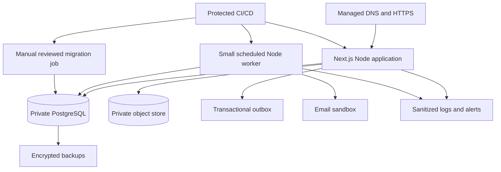

# XORA — Phase 2 Infrastructure, CI/CD and Operations Runbook

**Status:** Design and operational runbook; no infrastructure has been provisioned.  
**Goal:** A reproducible local environment and protected staging deployment, plus a non-public production placeholder, with clear ownership, secrets handling, recovery and evidence.

## 1. Infrastructure topology

Initial deployment unit is a modular application, plus a **separately invoked worker process** from the same repository. Avoid paid Redis queues, dedicated search engines, complex Kafka infrastructure, Kubernetes and native app builds. The selected provider must permit the actual lawful service; the cheapest vendor is not necessarily acceptable. Hosting/vendor procurement decisions remain **unresolved** until explicit acceptable-use/privacy review.

## 2. Environment matrix

| Property | Local | Staging | Production placeholder |
|---|---|---|---|
| Access | Developer machine | Restricted team URL; access-gated | Restricted holding page until launch approval |
| Accounts | Generated fixtures | Fake, sandbox-verified test users | No public sign-up permitted |
| Database | Disposable local PostgreSQL | Separate managed/staging PostgreSQL | Separate empty provisioned DB, if approved |
| File storage | Emulated private S3-compatible | Distinct private test bucket | Distinct private bucket, not enabled for member upload |
| Email | Sink/Mailpit-like local emulator | Test domain/inbox sandbox | Sender configured only after review, no user broadcast |
| Payments | Disabled / dummy orders only | Disabled / dummy claims only | No live receiving details or approval endpoints |
| Feature flags | Developer defaults | Strict demo-only | All member/finance flows closed |
| Secrets | Local gitignored disposable | Hosting secret store; staging-only keys | Production-only secret store, no copy from staging |
| Logging | Redacted console/dev collector | Structured redacted central logs | Redacted; restricted operations access |
| Backup | Export/restore rehearsal | Encrypted scheduled backups | Backups configured and restore-tested before opening |
| Deploy | Local commands | Protected CI automatic after review or manual promotion | Restricted/manual approval only |

### Domain and DNS rule

Use the actual XORA domain **only after trademark/domain clearance**. Staging uses a separately owned, access-gated hostname that is not indexed; `robots.txt` alone does not secure it. Never invent or place a real receiving business number in staging. URL placeholders in documentation remain `.example`.

## 3. Deployment provider selection scorecard

Evaluate candidates under documented criteria rather than presume Vercel, Render or another vendor accepts the intended activity:

| Factor | Required decision record |
|---|---|
| Acceptable use | Written confirmation for actual adult dating/casual service, no mischaracterization |
| Region/data transfer | Location, transfer mechanisms, applicable Uganda privacy review |
| Application runtime | Supported Node App Router features, durable worker/scheduler strategy |
| Database | PostgreSQL version, private network, PITR/backup, restore workflow, SSL |
| Storage | Private bucket, short-lived signed requests, server-controlled ACL and logging |
| Email | Sandbox and actual transactional use subject to approval |
| Operations | Availability of logs, metrics, alerting, key rotation and incident process |
| Cost | Predictable USD/UGX budget, outbound traffic and storage charges |
| Portability | Exportable DB, object store and source; no lock-in to proprietary auth |

**Decision rule:** Two reasonable vendors compared, founder approves price, engineer approves runtime and privacy/legal owner approves acceptable use/data handling. No vendor is selected by this blueprint.

## 4. Branches, reviews and repository protection

- `main` is protected; direct pushes disabled except emergency documented process.
- Feature branches use `P2-###-short-name`; pull requests include description, risk, testing, affected migration/API/security and screenshots only with fabricated data.
- At least one engineer reviews each merge; security/DB-impacting changes require a second qualified reviewer where team capacity allows. If solo developer, record independent external review for high-risk changes before real operation.
- CI secret scanning and dependency audit are mandatory. No production credentials are made available to code from external pull requests.
- Sign commits/artifacts where feasible; keep immutable deploy revision and dependency lockfile/hash.
- Release log records commit, migration identifiers, approval, environment, test results, outcome and rollback decision.

## 5. CI quality gates

The logical pipeline:

```mermaid
flowchart LR
 PR[Pull request] --> INSTALL[Locked dependency install]
 INSTALL --> LINT[Format and lint]
 LINT --> TYPES[Strict TypeScript]
 TYPES --> UNIT[Unit tests]
 UNIT --> INT[Disposable PostgreSQL integration]
 INT --> BUILD[Production build and secret/bundle scan]
 BUILD --> E2E[Staging-like browser/API smoke]
 E2E --> REVIEW[Code and security review]
 REVIEW --> MAIN[Protected main]
 MAIN --> STAGE[Deploy staging]
 STAGE --> MIG[Reviewed migration and smoke]
 MIG --> SIGN[Release evidence/sign-off]
```

If any stage fails, deployment stops. Timeouts, transient network problems or flaky tests are not silently ignored; fix or explicitly quarantine with owner and expiry, never waive P0 security tests. Check build artifacts for inappropriate secrets and private source maps before publishing.

### Suggested script contracts (names proposed, not currently implemented)

| Script | Required behavior |
|---|---|
| `npm run lint` | No lint/style violations |
| `npm run typecheck` | Strict TS compilation without emitting output |
| `npm run test:unit` | Fast pure tests and component checks |
| `npm run test:integration` | Start/reuse disposable PG, migrate, test RBAC/idempotency/outbox |
| `npm run test:security` | Authz denial, CSRF/origin, file access, secret scans |
| `npm run test:e2e` | Controlled full browser flows, no external live messages |
| `npm run build` | Production artifact and browser bundle audit |
| `npm run db:migrate:status` | Migrations match recorded history; no mutation |
| `npm run db:migrate` | Explicit reviewed migration job, not run on every app start |
| `npm run smoke` | Check public, session, staff deny, DB readiness, storage isolation |
| `npm run worker:once` | Run bounded queue processing for staging tests |
| `npm run backup:restore-test` | Restore into disposable DB, verify invariants and clean it up |

Scripts are **acceptance requirements**, not claims that a runnable repository exists.

## 6. Schema change and migration procedure

1. Developer proposes Drizzle schema change, generates migration and reviews SQL line-by-line.
2. Confirm ownership with auth adapter; never let a generated migration unexpectedly drop adapter-managed tables.
3. Run migration from blank database, from previous-version database, and twice to verify the history prevents duplicate apply.
4. Validate required indexes/constraints and down-time implications. Prefer additive nullable column → backfill → constraint → remove old fields after multiple deploys, rather than destructive changes.
5. Record schema hash and migration timestamp; open a backup restore point.
6. Apply to development, then staging with monitored review, then authorized production placeholder **separately**.
7. Smoke test login, RBAC, file permissions and worker after each release.

**Rollback realism:** reverting application code while an additive migration remains may be safe; reversing destructive SQL may cause data loss. Do not promise automatic DB rollback. Have a forward fix and restore plan with actual test evidence. Preserve backups according to retention policy; do not export sensitive records to developer laptops.

## 7. Feature flags and progressive exposure

| Flag | Default in staging | Default production placeholder | Rules |
|---|---:|---:|---|
| `REGISTRATION_ENABLED` | Synthetic-only behind staff/demo restriction | false | Later real launch gate |
| `ADULT_ELIGIBILITY_ENABLED` | false | false | Phase 3 after assurance approval |
| `PUBLIC_MEMBER_DISCOVERY_ENABLED` | false | false | Phase 4 only after eligibility/filter tests |
| `INVITATIONS_ENABLED` | false | false | Phase 4 |
| `MESSAGING_ENABLED` | false | false | Phase 5 |
| `MANUAL_PAYMENT_ORDERS_ENABLED` | false | false | Phase 6, only after provider authorization |
| `MANUAL_PAYMENT_APPROVAL_ENABLED` | false | false | Phase 6, reconciled funds required |
| `VIP_PROMOTIONS_ENABLED` | false | false | Phase 7 |
| `REAL_NOTIFICATION_DELIVERY_ENABLED` | false | false | Only approved operational sender |
| `DEMO_TEST_ROUTES_ENABLED` | true behind restricted staging | false, cannot be enabled by user | Build-time plus runtime restriction |

A feature flag must **not** be the sole authorization control. The code path itself still needs session, permission, eligibility and object-scope checks. Production flags are readable only to the configured server process and cannot be flipped via a public API.

## 8. Health, monitoring, redaction and alert ownership

| Signal | Example detection | Who acts | Safe instrumentation |
|---|---|---|---|
| Availability | Readiness failure / 5xx spike | Engineering on-call | Route template, status, duration, request ID |
| Authentication abuse | Elevated login resets or 429s | Security/engineering | Counts and anonymized actor hashes only |
| Admin access anomalies | Unauthorized staff endpoint attempts | Security owner | Action + actor ID + outcome, no receipt contents |
| Database saturation | Connection pool near cap, slow transactions | Engineering | Query class, latency; no SQL parameters |
| Worker failure | Queue oldest-age threshold exceeded | Operations/engineering | Event type, retries; no email/body content |
| File access issues | 403/404 spikes or unexpected public reads | Security/privacy | Object class, opaque ID, reason code |
| Backups | Missing backup or failed restore drill | Engineering/security | Backup ID and validity results |
| Finance (later) | Duplicate allocations / overdue manual reviews | Finance operator | Aggregated order counts, not transfer evidence |

Alerts need verified destinations and primary/backup responders. A log dashboard with no named reviewer is not an operational capability. Check that staging log data itself is not public.

## 9. Backup, restore and disaster recovery

**Planning targets requiring signoff:** staging backup frequency at least daily, initial staging **RPO ≤24 hours** and **RTO ≤8 hours**. For production, refine targets based on provider capabilities and product risk before launch. Do not claim these targets are met until an actual timed restore has succeeded.

**Restore rehearsal:** create known synthetic records and schema checksum in clean disposable database → back up → intentionally modify/drop test data in disposable source → restore backup to a **new** isolated DB → verify row counts, referential constraints, owner/session denial, idempotency unique constraints and worker consistency → document timing, backup age, checksum, person, cleanup. Do not restore over active production. File-store backups and their cross-reference consistency also require a later restore exercise.

### Recovery runbook for a failed release

1. Freeze new deployments; mark incident owner, affected environment and revision.
2. Stop or restrict affected feature, do not delete logs/audit events.
3. Determine whether issue is code-only, migration, DB data, storage, secret or vendor.
4. Roll application back only if compatible with current DB schema; otherwise fix forward or isolate feature.
5. If integrity compromised, restore into a new environment, check logs/checksums and re-point traffic only with authorization.
6. Rotate suspected compromised credentials; invalidate sessions if required.
7. Run smoke suite (public, session, staff denial, DB, files, worker) and record outcome.
8. Inform stakeholders transparently according to incident/legal plan; record postmortem.

## 10. Cost and ownership planning

Phase 2 expense categories: Node hosting; managed PostgreSQL; private storage/operations; outbound email sandbox; domain/DNS; logs/alerts; backups; engineering time; security review; usability/accessibility testing; legal and provider approvals. No fake zero-cost estimate: free tiers change and may disallow use cases. Keep infrastructure budget with estimated usage envelopes and stop thresholds; switch providers only through a reviewed migration plan.

### Staff responsibilities

| Work | Owner | Approver |
|---|---|---|
| Repo/CI/lockfile | Engineering lead | Security peer |
| Staging deploy | DevOps/full-stack engineer | Engineering lead |
| Database migration | DB-capable engineer | Engineering lead; risk reviewer for destructive SQL |
| Secret issuance/rotation | Security/operator | Named account owner |
| Vendor/provider acceptable use | Product/legal/privacy | Founder |
| Backup restore | Engineering/on-call | Security/operations |
| Monitoring and alerts | Engineering | Founder/operations on-call |
| Launch enabling | Product + legal + finance + trust | Explicit founder go decision; **not Phase 2** |

## 11. Operational handoff evidence checklist

- [ ] Environment inventory with actual hostnames (restricted), owner and permission model.
- [ ] Source commit/release SHA, lockfile/hash and recorded package versions.
- [ ] CI workflow run links and review approvals.
- [ ] Database migration diff, history and smoke result.
- [ ] Staging access policy and test-account revocation plan.
- [ ] Secret inventory **names only**, rotation procedure, no actual secrets in shared files.
- [ ] Private object read/write denial tests.
- [ ] Health/alert thresholds with named reviewers.
- [ ] Backup/restore evidence including elapsed time and recovered integrity.
- [ ] Incident response runbook exercised on dummy data.
- [ ] Production placeholder functionality disabled and verified.
